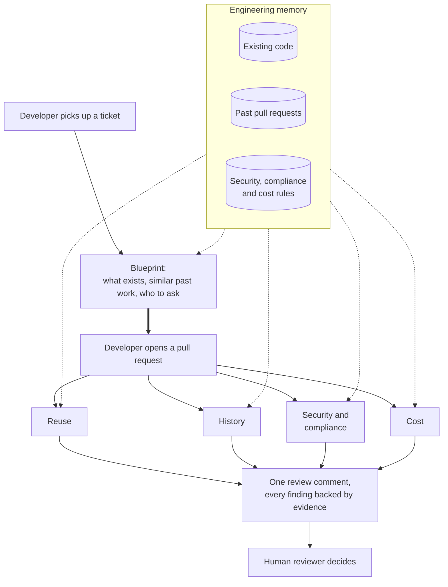

# OpenHands

An AI assistant that helps developers reuse what already exists and catches security, compliance and cost issues before a human reviewer has to.

> Status: proof of concept, built in a 3-hour hackathon slot.

## Why

- **Duplicate work.** Teams rebuild things that already exist in another repository, because nobody can know every codebase.
- **Late discovery.** Security, compliance and cost issues surface at review time or after release, when they are most expensive to fix.
- **Lost decisions.** The reasons a past approach was rejected sit in old review threads, so the same mistakes get submitted again.
- **Reviewer load.** Senior engineers spend review time on checks that could be done before the change reaches them.

## What it does

OpenHands reads our existing code and the history of past pull requests, and helps at two moments.

1. **Before work starts.** A developer gives it a ticket. It returns a blueprint: existing code to reuse, similar past pull requests, and who owns them.
2. **When a pull request is opened.** It checks the change on four tracks and posts one review comment.

| Track | Question it answers |
|---|---|
| Reuse | Did we already build this? |
| History | Was this tried or rejected before? |
| Security and compliance | Are there exposed credentials, customer data in logs, or rule violations? |
| Cost | Will this change raise cloud spend? |



## What changes for teams

| Today | With OpenHands |
|---|---|
| Developers find out at review that the feature already exists | They are told before writing any code |
| Reviewers check secrets, logging and cost by eye | Those checks arrive with the pull request |
| Past decisions are forgotten | Similar past pull requests are cited in the review |
| Feedback is scattered across comments | One comment, sorted by severity |

## Principles

- **A human always decides.** OpenHands advises. It never approves or merges.
- **Evidence or silence.** Every finding must cite a file, a past pull request or a rule ID. Findings without evidence are dropped.
- **Same knowledge at both moments.** What it recommends before coding is what it checks at review.

## How the proof of concept works

There are no custom services. Claude Code is the orchestrator and each track is a skill (a written playbook it follows).

```
context/
  repos/     cloned repositories
  prs/       past pull requests, exported as JSON
.claude/skills/
  blueprint/             ticket text in, reuse blueprint out
  pr-review/             runs the four tracks, posts one comment
  reuse-check/
  pr-history/
  security-compliance/
  cost/
rules.md     compliance and cost rules, each with an ID
```

```
claude -p "/blueprint <ticket text>"
claude -p "/pr-review <pull request URL>"
```

## Demo scenario

1. A ticket asks for a feature that an existing helper already covers. The blueprint points to that helper.
2. A pull request ignores it, and also contains a hardcoded credential, a customer identifier written to logs, and a costly infrastructure change.
3. OpenHands posts one comment that flags all four, each with its evidence.

## Limits of the proof of concept

- It is run by hand, not triggered when a pull request opens.
- It searches a few sample repositories by text search, not our full codebase.
- It reports issues but does not fix them.
- Its accuracy has not been measured on real historical pull requests.

## Future scope

| Stage | What is added |
|---|---|
| Pilot | Automatic trigger on pull requests. Silent mode on one team, comparing its findings with human reviewers. |
| Trust | Proven scanners (secrets, static analysis, dependency and infrastructure cost) run first, with the AI explaining and linking their results. Accuracy measured against a set of past pull requests. |
| Scale | A code index across all repositories, so it can trace which services a change affects. Blueprints posted on tickets and available inside the developer's editor. |
| Depth | Suggested fixes with tests, validated in an isolated sandbox. A readiness score based on blast radius, past incidents and test coverage. Findings mapped to compliance control IDs for audit. |
| Learning | Outcomes of past reviews feed back as proposed rule updates, approved by a human. |

Code is sent to an AI model for analysis, so model hosting and data handling need security and legal sign-off before any pilot on internal repositories.
