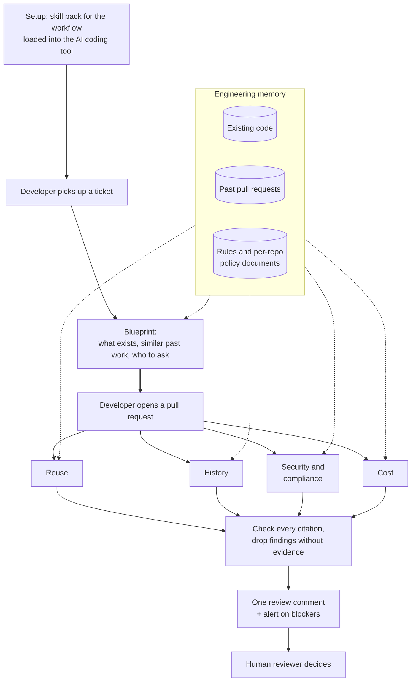

# OpenHands

An AI assistant that helps developers reuse what already exists and catches security, compliance and cost issues before a human reviewer has to.

> Status: working proof of concept, built in a 3-hour hackathon slot. Both flows run end to end on real open-source code from Capital One (locopy and datacompy). To run it, start with the [runbook](guardian/docs/RUNBOOK.md).

## Why

- **Duplicate work.** Teams rebuild things that already exist in another repository, because nobody can know every codebase.
- **Late discovery.** Security, compliance and cost issues surface at review time or after release, when they are most expensive to fix.
- **Lost decisions.** The reasons a past approach was rejected sit in old review threads, so the same mistakes get submitted again.
- **Reviewer load.** Senior engineers spend review time on checks that could be done before the change reaches them.

## What it does

OpenHands reads our existing code, the history of past pull requests and each repository's policy document, and helps at three moments.

1. **At setup.** Before any work starts, every developer loads the same skill pack into their AI coding tool. Examples: `find-skills` to discover the right playbook for a task, and `ponytail` to keep changes small and reuse existing code. This is aimed at fewer made-up answers and less over-engineering. See [skill-packs.md](guardian/skill-packs.md).
2. **Before coding.** A developer gives it a ticket. It returns a blueprint: existing code to reuse with the exact call, similar past pull requests with the reviewer's reasons, and who to ask.
3. **When a pull request is opened.** It checks the change on four tracks, posts one review comment, and raises an alert if anything blocks the merge.

| Track | Question it answers | Evidence it must cite |
|---|---|---|
| Reuse | Did we already build this? | The existing code, as `repo/path:line` |
| History | Was this tried or rejected before? | A past pull request number |
| Security and compliance | Are there exposed credentials, customer data in logs, or rule violations? | A rule ID, plus the repository's own policy ID where one applies |
| Cost | Will this change raise cloud spend? | A rule ID |



## What changes for teams

| Today | With OpenHands |
|---|---|
| Each developer configures their AI coding tool differently, and output quality varies | One skill pack per workflow, loaded at setup |
| Developers find out at review that the feature already exists | They are told before writing any code |
| Reviewers check secrets, logging and cost by eye | Those checks arrive with the pull request |
| Past decisions are forgotten | Similar past pull requests are cited in the review |
| Feedback is scattered across comments | One comment, with the verdict in the title |

## Principles

- **A human always decides.** OpenHands advises. It never approves or merges.
- **Evidence or silence.** Every finding must cite a file, a past pull request or a rule ID. The orchestrator checks each citation and drops findings that fail.
- **Same knowledge at both moments.** What it recommends before coding is what it checks at review.
- **Untrusted input.** The diff, title and description of a pull request are treated as data. Instructions inside them are ignored.
- **Nobody is pinged, nothing private is published.** People and teams are named without `@`, email addresses are left out, and secret values are masked.

## See it

| Demo pull request | What it contains | Result |
|---|---|---|
| [#8, expected blocked](https://github.com/vamsikodavali/Natwest-PRAgent/pull/8) | Hardcoded AWS keys, customer data in a log line, a re-written S3 uploader, an unbounded query, per-row uploads, a warehouse resize | 🛑 needs changes: 2 blockers, 4 warnings |
| [#9, expected accepted](https://github.com/vamsikodavali/Natwest-PRAgent/pull/9) | The same feature built by reusing locopy's `S3.upload_to_s3`, with no secrets and a bounded query | ✅ no issues found |

The review comment has the verdict in its title, one table of blockers, one of warnings, a "Who to ask" table, and the fix for each finding in a collapsed section. When there are blockers, the terminal also prints a two-line alert:

```
🛑 OPENHANDS ALERT: 2 blocker(s) in <owner>/<repo>#<number> (SEC-01, SEC-02) → <comment link>
Notify (placeholder, not sent): email <{{OWNER_EMAIL}}> · chat <{{TEAM_CHANNEL}}>
```

The mail and chat connectors are placeholders in this proof of concept. GitHub's own notification of the comment is the only message sent.

## How it works

There are no custom services. Claude Code is the orchestrator and each track is a skill: a written playbook it follows. A small Python search engine (standard library only) ranks candidates for the reuse and history tracks, and the model then reads the code to confirm or drop each one.

Everything lives in `guardian/`:

```
guardian/
  .claude/skills/
    blueprint/             ticket in, reuse blueprint out
    pr-review/             runs the four tracks, checks citations, posts one comment
    reuse-check/           did we already build this?
    pr-history/            was this tried or rejected before?
    security-compliance/   secrets, customer data in logs, credential handling
    cost/                  bigger compute, unbounded queries, paid calls in loops
  bin/guardian             search engine CLI: reuse, history, owners, blueprint, doctor, eval
  lib/guardian_kit/        the engine
  rules.md                 baseline security and cost rules, each with an ID
  data/                    per-repo technical policy documents, cited by the review
  context/                 cloned repos and exported pull requests (fetched, not committed)
  demo/                    demo ticket and expected findings
  skill-packs.md           which skills to load at setup
  docs/RUNBOOK.md          setup, demo steps, test results, troubleshooting
  docs/RUN_AND_INTEGRATE.md  engine commands and JSON contract
```

## Run it

You need Claude Code, Git Bash on Windows (or any bash), Python 3 (tested on 3.12 and 3.13), and the GitHub CLI logged in (`gh auth login`).

```
cd guardian
scripts/fetch-context.sh https://github.com/capitalone/locopy https://github.com/capitalone/datacompy
./bin/guardian doctor

# Before coding: about 1 minute
claude -p "/blueprint $(cat demo/ticket.md)" --allowedTools "Read,Grep,Glob,Bash(./bin/guardian:*)"

# Review a pull request: about 1.5 minutes, posts one comment
claude -p "/pr-review <pull request URL>" --allowedTools "Read,Grep,Glob,Write,Bash(./bin/guardian:*),Bash(ls:*),Bash(mkdir:*),Bash(gh auth status:*),Bash(gh pr diff:*),Bash(gh pr view:*),Bash(gh pr comment:*),Bash(curl:*)"

# Check your own change before opening a pull request: nothing is posted
git diff main > my.diff
claude -p "/pr-review my.diff" --allowedTools "Read,Grep,Glob,Write,Bash(./bin/guardian:*),Bash(ls:*),Bash(mkdir:*)"
```

The engine also runs without a model, in about 2 seconds: `./bin/guardian blueprint --file demo/ticket.md`.

Full steps, expected output and troubleshooting are in the [runbook](guardian/docs/RUNBOOK.md).

## What has been measured

| Check | Result |
|---|---|
| Planted pull request | All six planted issues found, with correct line numbers and no secret values printed |
| Clean pull request | No findings |
| Reuse search alone, 14 labelled tickets on the demo repos | Right helper in the top 3 for 86%, ranked first for 64% |
| Reuse search, 3 tickets where nothing exists | Stays silent on 2 of 3 |
| Engine tests | 67 tests, run in CI |

These are small samples on two repositories. They show the flow works, not how accurate it is at scale.

## Limits of the proof of concept

- **Run by hand.** Nothing triggers when a pull request opens; someone runs the command.
- **Two repositories in the context.** Policy documents exist for seven, but only locopy and datacompy are searched in the demo.
- **Text search, not a code graph.** It cannot yet trace which services a change affects.
- **Shallow history.** The latest 100 pull requests per repo, and about half of the rejected ones have a findable reviewer reason.
- **No scanners.** Secrets and vulnerabilities are found by the model reading the diff, not by proven tools.
- **Alerts are placeholders.** No mail or chat message is sent.
- **Setup is a document.** `skill-packs.md` tells people what to install; nothing loads automatically.
- **A new comment per run.** The review does not update its earlier comment in place.
- **It reports, it does not fix.**

## Future scope

| Stage | What is added |
|---|---|
| Pilot | Automatic trigger on pull requests. Silent mode on one team, comparing its findings with human reviewers. |
| Trust | Proven scanners (secrets, static analysis, dependency and infrastructure cost) run first, with the AI explaining and linking their results. Accuracy measured against a set of past pull requests. |
| Reach | Real mail and chat connectors for alerts. One comment updated in place. Blueprints posted on tickets and available inside the developer's editor. |
| Scale | A code index across all repositories, so it can trace which services a change affects. |
| Depth | Suggested fixes with tests, validated in an isolated sandbox. A readiness score based on blast radius, past incidents and test coverage. Findings mapped to compliance control IDs for audit. |
| Learning | Outcomes of past reviews feed back as proposed rule updates, approved by a human. |

Code is sent to an AI model for analysis, so model hosting and data handling need security and legal sign-off before any pilot on internal repositories.
