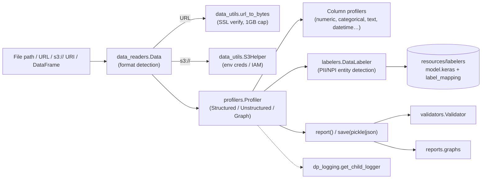

# Technical & Engineering Policy — `capitalone/DataProfiler`

## 1. Document Overview

| Item | Value |
|---|---|
| Repository | https://github.com/capitalone/DataProfiler |
| Commit analysed | `29e75e35fb65c8f2cad3ad10b912f1551746c7d9` (2026-11-17, default branch `main`) |
| Date of analysis | 2026-11-18 |
| Purpose of repo | Library for data loading, profiling, monitoring and **sensitive-data (PII/NPI) detection** using a pre-trained deep-learning labeler [Source: README.md, lines 16, 18, 36] |
| Audience | Contributors, reviewers, AI Pull Request Guardian |

**Scope.** This document holds repository-evidenced rules only. It is not Capital One corporate policy.

**Authoritative sources.**
- `.github/CONTRIBUTING.md`
- `.pre-commit-config.yaml`
- `setup.cfg` and `tox.ini`
- `.github/workflows/test-package.yml`

**Limitations.** Static analysis only. Branch protection and the inherited WhiteSource org config (`capitalone/whitesource-config`) are not visible. There is no IaC or service deployment.

---

## 2. Technology Stack

| Technology | Role | Source |
|---|---|---|
| Python ≥3.11 (CI 3.11–3.13) | Runtime | `setup.py` L53; `test-package.yml` L17 |
| setuptools + versioneer (PEP 440, git tags) | Build / versioning | `setup.py`; `setup.cfg` L1–7 |
| numpy, pandas <3, scipy, pyarrow 26.x, h5py, fastavro, python-snappy, chardet, charset-normalizer | Data reading and stats | `requirements.txt` L1–13 |
| requests ≥2.32.4, certifi, urllib3 ≥2.8.0 | URL data loading | `requirements.txt` L14–15, L22; `data_readers/data_utils.py` L884–934 |
| boto3 ≥1.37.15 | S3 data loading | `requirements.txt` L21; `data_readers/data_utils.py` L936–1055 |
| networkx | Graph profiling | `requirements.txt` L16 |
| HLL, datasketches | Approximate cardinality / sketches | `requirements.txt` L18–19 |
| TensorFlow / Keras (`requirements-ml.txt`) | PII/NPI entity labeler (`model.keras`) | `dataprofiler/resources/labelers/structured_model/model.keras`; `labelers/character_level_cnn_model.py` L498 |
| matplotlib etc. (`requirements-reports.txt`) | Graph reports | `reports/graphs.py` |
| pytest + pytest-cov (CI), unittest (Makefile/CONTRIBUTING) | Testing | `test-package.yml` L37–39; `Makefile` L17–18 |
| pre-commit: black 24.3.0, isort 5.12.0, flake8 7.3.0 + flake8-docstrings, mypy 1.11.2, check-manifest, pyupgrade, autoflake | QA | `.pre-commit-config.yaml` L1–135 |
| tox | Local matrix | `tox.ini` |
| Dependabot (GitHub Actions only) | Action updates | `.github/dependabot.yml` L1–7 |
| WhiteSource / Mend (inherits org config) | Dependency scanning | `.whitesource` L1–3 |
| Databases, messaging, containers, IaC | — | **Not present** |

---

## 3. Repository Architecture

| Package | Responsibility | Evidence |
|---|---|---|
| `dataprofiler/data_readers/` | `Data` factory auto-detects format; readers for CSV, JSON, Parquet, Avro, Text, Graph; URL and S3 loading in `data_utils.py` | `data.py`, `data_utils.py` L44–1055 |
| `dataprofiler/profilers/` | `Profiler` / `StructuredProfiler` / `UnstructuredProfiler` (`profile_builder.py`), column profilers (numeric, categorical, datetime, text, order, data-label), graph profiler, utils | `profile_builder.py`; `profiler_utils.py` L43–880 |
| `dataprofiler/labelers/` | `DataLabeler` pipelines (pre-processor → model → post-processor): CNN, regex, column-name models | `base_data_labeler.py` L519–627; `labelers/utils.py` |
| `dataprofiler/resources/labelers/` | Shipped model weights + label mappings (`SSN`, `CREDIT_CARD`, `EMAIL_ADDRESS`, `PHONE_NUMBER`, `BAN`, `PERSON`, `DRIVERS_LICENSE`, …) | `resources/labelers/*/label_mapping.json` |
| `dataprofiler/validators/` | Rule-based validation of profiled data (`is_in_range`, `is_in_list`, `Validator`) | `base_validators.py` L12–41 |
| `dataprofiler/reports/` | Graph/report generation with optional-module guards | `reports/utils.py` L11–29 |
| `dataprofiler/plugins/` | Decorator-registered plugins loaded from sub-folders | `plugins/__init__.py` L7–38; `plugins/decorators.py` L9 |
| `dataprofiler/dp_logging.py` | Library logger singleton | L1–63 |
| `dataprofiler/rng_utils.py`, `settings.py` | Seeded RNG (`DATAPROFILER_SEED`) | `rng_utils.py` L11–15 |



---

## 4. Coding Standards

| ID | Standard | Classification | Evidence |
|---|---|---|---|
| CODE-001 | All pre-commit hooks must pass. CI runs `pre-commit run --all-files`. | **Mandatory (CI)** | `test-package.yml` L33–36 |
| CODE-002 | Format with **black** (line length 88). Excludes versioneer and `_docs/`. | Mandatory (pre-commit in CI) | `.pre-commit-config.yaml` L4–10; `setup.cfg` L8–11 |
| CODE-003 | Sort imports with **isort**, black profile, line length 88 | Mandatory | `.pre-commit-config.yaml` L15–20; `setup.cfg` L13–21 |
| CODE-004 | **flake8** + flake8-docstrings (max line 88, E203 ignored). Tests and `__init__.py` excluded. | Mandatory | `.pre-commit-config.yaml` L23–29; `setup.cfg` L8–11 |
| CODE-005 | **mypy** on `dataprofiler/` (tests excluded), `warn_return_any`, `implicit_optional`, `ignore_missing_imports` | Mandatory (pre-commit in CI) | `.pre-commit-config.yaml` L42–49; `setup.cfg` L23–29 |
| CODE-006 | pyupgrade, autoflake and check-manifest hooks | Mandatory | `.pre-commit-config.yaml` L111–135 |
| CODE-007 | Follow PEP 8; docstrings in **reStructuredText** (`:param:` / `:type:` / `:return:`) for Sphinx | Mandatory (documented) | `.github/CONTRIBUTING.md` L102–105 |
| CODE-008 | Library modules obtain loggers with `dp_logging.get_child_logger(__name__)` | **Convention** (12 modules) | `dp_logging.py` L55–63; e.g. `data_readers/data_utils.py`, `profilers/profile_builder.py` |
| CODE-009 | Optional heavy dependencies (TF, plotting) are guarded with `require_module([...])` / `warn_missing_module` | Convention | `labelers/utils.py` L17–64; `reports/utils.py` L11–40 |
| CODE-010 | Randomness must go through `rng_utils.get_random_number_generator()` so `DATAPROFILER_SEED` makes tests deterministic | Convention (+ CI seeds) | `rng_utils.py` L11–15; `test-package.yml` L39 |
| CODE-011 | `print()` is used in library code (36 occurrences outside tests). No lint rule prohibits it. | Observed (not a rule) | grep of `dataprofiler/**` |

---

## 5. Reusable Components and Existing Capabilities

| Component | Category | File path | Responsibility | Usage guidance | Evidence |
|---|---|---|---|---|---|
| `DataLabeler` (structured / unstructured / regex / column-name) | **PII/NPI detection** | `dataprofiler/labelers/` + `resources/labelers/` | Detects SSN, CREDIT_CARD, EMAIL_ADDRESS, PHONE_NUMBER, BAN, PERSON, DRIVERS_LICENSE, ADDRESS, IPV4, HASH_OR_KEY, … | **Use this for any "detect sensitive data / PII" requirement.** Do not write new regex PII detectors. | README.md L36, L371; `label_mapping.json` files |
| `get_logger()`, `get_child_logger(name)`, `set_verbosity(level)` | Logger | `dataprofiler/dp_logging.py` | Thread-safe singleton "DataProfiler" logger; child loggers per module | Use instead of `logging.getLogger` / `basicConfig` | L11–63 |
| `url_to_bytes(url, options)` | HTTP client wrapper | `dataprofiler/data_readers/data_utils.py` | Streams URL content with **SSL verification on by default** and a **1 GB cap** (header + streamed) | Use for any remote download | L884–934 |
| `is_valid_url(url)` | Validator | `data_readers/data_utils.py` | Scheme + netloc check | Reuse for URL validation | L867–882 |
| `S3Helper.is_s3_uri`, `create_s3_client`, `get_s3_uri` | Storage / auth helper | `data_readers/data_utils.py` | S3 URI detection; client from explicit args, then `AWS_*` env vars, then IAM role; download to BytesIO | Use for S3 access; never inline keys | L936–1055 |
| `detect_file_encoding`, `detect_cell_type`, `get_delimiter_regex`, `reservoir`, `rsample`, `sample_parquet`, `read_csv_df`, `read_json_df`, `read_parquet_df` | File I/O / sampling | `data_readers/data_utils.py` | Encoding detection, reservoir sampling, format readers | Reuse for any file-reading feature | L281–746 |
| `Validator`, `is_in_range`, `is_in_list` | Validator | `dataprofiler/validators/base_validators.py` | Config-driven validation of profiled data | Extend instead of writing ad-hoc checks | L12–41 |
| `profiler_utils`: `recursive_dict_update`, `partition`, `chunk`, `shuffle_in_chunks`, `suggest_pool_size`, `generate_pool`, `auto_multiprocess_toggle`, `get_memory_size`, `method_timeit`, `find_diff_of_*`, `merge_profile_list` | Utilities / parallelism / diffing | `dataprofiler/profilers/profiler_utils.py` | Shared numeric, diff, multiprocessing and timing helpers | Reuse; many PRs touch these | L43–880 |
| `calculate_quantiles`, `flat_dict`, `_prepare_report` | Report builders | `dataprofiler/profilers/helpers/report_helpers.py` | Report formatting | Reuse for report output | L10–90 |
| `require_module(names)`, `warn_missing_module`, `find_resources_dir` | Optional-dependency guard | `labelers/utils.py`, `reports/utils.py` | Decorators for optional imports; resource location | Wrap optional features | `labelers/utils.py` L17–65 |
| `plugin_decorator(typ, name)`, `load_plugins()`, `get_plugins(typ)` | Extension point | `dataprofiler/plugins/` | Register and discover plugins | Use for new pluggable behaviour | `plugins/__init__.py` L7–38; `decorators.py` L9 |
| `get_random_number_generator()` | RNG | `dataprofiler/rng_utils.py` | Seeded RNG honouring `DATAPROFILER_SEED` | Never call `np.random` directly | L11–15 |

---

## 6. API and Data Contracts

- Public API: `dp.Data(...)`, `dp.Profiler(...)`, `profile.report(report_options=...)`, `profile.save()/load()` with `save_method` in `{"pickle","json"}` [Source: `profilers/profile_builder.py` L1159–1200, L1595–1624, L3055–3086].
- Label set contract: `label_mapping.json` per labeler. Changing labels changes profile output (see ARCH-001).
- CONTRIBUTING: "If you've changed APIs, update the documentation" [Source: `.github/CONTRIBUTING.md` L58].
- No HTTP API, DB schema or migrations.

---

## 7. Security Policies

| Rule ID | Rule | Severity | Enforcement | Evidence | Remediation |
|---|---|---|---|---|---|
| SEC-001 | **AWS credentials must come from arguments supplied at runtime, `AWS_ACCESS_KEY_ID` / `AWS_SECRET_ACCESS_KEY` / `AWS_SESSION_TOKEN` environment variables, or an IAM role.** Never literals. | Critical | Design (`create_s3_client` fallback chain); no secret scanner | `data_readers/data_utils.py` L984–1031 | Use env / IAM; rotate leaked keys |
| SEC-002 | **TLS verification stays on by default** for URL loads. Disabling it requires explicit `options=dict(verify_ssl=False)` and is "highly discouraged". | High | Code | `data_utils.py` L897–899, L924–930 | Don't default `verify_ssl=False` |
| SEC-003 | **Remote downloads are capped at 1 GB** (header check + streamed byte count) | Medium | Code | `data_utils.py` L905–923 | Keep cap in any new downloader |
| SEC-004 | `Profiler.load()` uses `pickle.load` by default. Only load profiles from **trusted** sources, and prefer `load_method="json"` for untrusted input. | High | **Not enforced / not documented**. Inferred from code (GAP-004). | `profile_builder.py` L1172–1199; `graph_profiler.py` L575 | Use JSON; document the risk |
| SEC-005 | Plugins are executed with `exec_module` from sub-folders of `dataprofiler/plugins/`. Do not extend this to user-writable paths. | High | Inferred | `plugins/__init__.py` L14–28 | Restrict plugin paths |
| SEC-006 | Pin GitHub Actions to commit SHAs. Dependabot updates them weekly (≤5 PRs). | Medium | Convention + Dependabot | `test-package.yml` L20–22; `.github/dependabot.yml` L3–7 | Pin SHA |
| SEC-007 | PyPI publishing uses `secrets.PYPI_USERNAME` / `secrets.PYPI_PASSWORD` GitHub secrets, **not** literals | High | CI config | `publish-package.yml` L36–37, L48–49 | Keep in secrets (consider OIDC, GAP-005) |
| SEC-008 | Release job fails if the commit is untagged or the built package fails to import | Medium | CI | `publish-package.yml` L20, L42 | — |

**May secrets, tokens or API keys be hardcoded?** **No.** AWS credentials follow an args → env → IAM chain (SEC-001), and PyPI credentials are GitHub secrets (SEC-007). There is **no secret scanning or SAST** in CI.

---

## 8. Privacy and Data Protection Policies

| Rule ID | Rule | Classification | Evidence |
|---|---|---|---|
| PRIV-001 | The library's purpose includes PII/NPI detection. Sensitive entity types it recognises include SSN, CREDIT_CARD, BAN (bank account number), EMAIL_ADDRESS, PHONE_NUMBER, PERSON, ADDRESS, DRIVERS_LICENSE, IPV4/6, HASH_OR_KEY. | Documented capability | README.md L16, L18, L36, L355–385; `resources/labelers/*/label_mapping.json` |
| PRIV-002 | Use the shipped `DataLabeler` for sensitive-data classification. Do not add parallel PII detectors. | **Inferred** (reuse) | §5 |
| PRIV-003 | Logs should emit profiling metadata (column names, stats, warnings), not raw cell values | **Inferred** (observed logging) | e.g. `data_utils.py` L964 (`is_s3_uri` debug logs the **path**) |
| PRIV-004 | The slim `DataProfiler[reports]` install **disables** sensitive-data detection. Features that rely on PII labels must not assume the ML extra is installed. | Documented | README.md L52; `labelers/utils.py` L35 (`require_module`) |
| PRIV-005 | Saved profiles (pickle/json) may contain sample values. Treat them as sensitive artefacts. | Inferred (Low) | `profile_builder.py` L1130–1138 |

Masking/redaction utilities, retention policy, access control: **Not documented.**

---

## 9. Testing and Quality Assurance

| Item | Detail | Classification | Evidence |
|---|---|---|---|
| CI gate | `DATAPROFILER_SEED=0 pytest --cov=dataprofiler --cov-fail-under=80` on Python 3.11, 3.12, 3.13 | **Mandatory (CI)**, with an 80% coverage threshold | `test-package.yml` L15–17, L37–39 |
| tox | Same 80% threshold + `pypi-description`, `manifest`, `precom` envs | Mandatory locally | `tox.ini` L2, L18–19 |
| Layout | `dataprofiler/tests/<package>/test_*.py`, data in `dataprofiler/tests/data/` | Convention | directory tree |
| Seeded tests | `DATAPROFILER_SEED=0` | Mandatory (CI) | `test-package.yml` L39; `CONTRIBUTING.md` L48 |
| Rule TEST-001 | "If you've added code that should be tested, add tests." | Mandatory (documented) | `CONTRIBUTING.md` L57 |
| Commands | `make setup`, `make format`, `make test`, `pre-commit run --all-files`, `tox` | — | `Makefile` L1–18; `CONTRIBUTING.md` L12–49 |

---

## 10. Dependency and Supply Chain Policies

| ID | Rule | Classification | Evidence |
|---|---|---|---|
| DEP-001 | Requirements are split: `requirements.txt` (core), `-ml`, `-reports`, `-dev`, `-test`, `-docs` | Convention | repo root |
| DEP-002 | **When you change any `requirements*.txt`, also update `additional_dependencies` of the mypy hook** in `.pre-commit-config.yaml` | **Mandatory (documented)** | `CONTRIBUTING.md` L107–108; `.pre-commit-config.yaml` L50–52 |
| DEP-003 | Security-relevant floors are pinned: `requests>=2.32.4`, `urllib3>=2.8.0`, `certifi>=2026.10.19` | Observed | `requirements.txt` L14–15, L22 |
| DEP-004 | Dependency scanning via WhiteSource, settings inherited from `capitalone/whitesource-config` | Org config (*unverified content*) | `.whitesource` L1–3 |
| DEP-005 | Dependabot covers **GitHub Actions only**, not pip | Config | `.github/dependabot.yml` L3 |

No lockfile, licence allow-list or vulnerability SLA documented.

---

## 11. Infrastructure and Deployment Policies

| ID | Rule | Classification | Evidence |
|---|---|---|---|
| INFRA-001 | Fork the repo and **branch from `dev`**. PRs go to `dev`. | Documented | `CONTRIBUTING.md` L56 |
| INFRA-002 | Multi-PR features live on the **author's fork** as `feature/<name>`. `staging/dev/<name>`, `staging/main/<version>` are rebase proxies with **no commits after creation**. Releases are `release/<version>`, and hotfixes may PR into the release branch. | Documented | `CONTRIBUTING.md` L63–75 |
| INFRA-003 | Docs changes go to `dev-gh-pages`, which is merged to `gh-pages` at release | Documented | `CONTRIBUTING.md` L110–113 |
| INFRA-004 | Publishing runs on GitHub `release` and requires a tagged commit | CI | `publish-package.yml` L6–7, L20 |

No containers, IaC, sizing or IAM definitions.

---

## 12. Cost and FinOps Policies

There are no formal cost rules. Observed, cost-relevant safeguards:

| ID | Observation | Classification | Evidence |
|---|---|---|---|
| COST-001 | 1 GB cap on URL downloads | Code control | `data_utils.py` L905–923 |
| COST-002 | Multiprocessing pool sizing via `suggest_pool_size` / `auto_multiprocess_toggle`. Do not hard-code pool sizes. | Convention | `profiler_utils.py` L193–296 |
| COST-003 | Sampling helpers (`reservoir`, `rsample`, `sample_parquet`) exist to avoid full reads of large files | Convention | `data_utils.py` L281–372, L480–524 |
| COST-004 | Slim install (`[reports]`) avoids the TensorFlow footprint when PII labeling isn't needed | Documented | README.md L52 |

---

## 13. Architecture Decision Records and Historical Decisions

No ADR folder. Decisions found:

| Decision | Detail | Source |
|---|---|---|
| Fork-based feature workflow | Feature branches live on forks so force-push permission isn't opened on `capitalone/dataprofiler` | `CONTRIBUTING.md` L66 |
| Staging branches as rebase proxies | No commits after creation | `CONTRIBUTING.md` L70–73 |
| ML extra optional | Slim install disables the labeler | README.md L52 |
| Pickle default for save/load | `save_method="pickle"` default; JSON supported | `profile_builder.py` L1159, L1595, L3055 |

Past discussion (from GitHub history, not the repo): PR #912 ("Remove process() from BaseDataProcessor") was replaced by #954. That is relevant if a PR touches `BaseDataProcessor`.

---

## 14. CI/CD and Release Policies

| Control | Automated | Evidence |
|---|---|---|
| pre-commit (black, isort, flake8, mypy, pyupgrade, autoflake, check-manifest) | Yes, on PRs to `main` | `test-package.yml` L6–9, L33–36 |
| Tests + 80% coverage | Yes | L37–39 |
| Code owners `@capitalone/data-profiler-admin-team` | Branch protection *unverified* | `CODEOWNERS` L1 |
| Release on tag → PyPI (twine with secrets) | Yes | `publish-package.yml` |
| Secret / SAST scan | **No** | — |
| Rollback | Not documented | — |

---

## 15. Prohibited Practices

| Rule ID | Prohibited practice | Reason | Evidence | Severity | Status |
|---|---|---|---|---|---|
| PROH-001 | Commits to a `staging/*` branch after creation | Staging is a rebase proxy | `CONTRIBUTING.md` L70 | Medium | **Documented** |
| PROH-002 | Hosting feature branches on `capitalone/dataprofiler` without maintainer exception | Avoids opening force-push | `CONTRIBUTING.md` L66, L75 | Medium | **Documented** |
| PROH-003 | Changing requirements without syncing mypy `additional_dependencies` | Type-check accuracy | `CONTRIBUTING.md` L107–108 | Low | **Documented** |
| PROH-004 | Lowering coverage below 80% | CI gate | `test-package.yml` L39 | Medium | **Enforced** |
| PROH-005 | Defaulting `verify_ssl=False` | MITM risk | `data_utils.py` L924–930 | High | Documented in error text ("highly discouraged") |
| PROH-006 | Hardcoded AWS keys | — | `data_utils.py` L984–1031 | Critical | *Proposed review recommendation* |
| PROH-007 | New PII regex/detector duplicating `DataLabeler` | Duplication | §5 | Medium | *Proposed review recommendation* |
| PROH-008 | `pickle.load` on untrusted input in new code | RCE risk | `profile_builder.py` L1196 | High | *Proposed review recommendation* |

---

## 16. Policy Registry

| ID | Category | Rule | Classification | Severity | Violation looks like | Evidence | Check | Remediation | Confidence |
|---|---|---|---|---|---|---|---|---|---|
| SEC-001 | Security | No hardcoded AWS creds | Inferred (design) | Critical | `aws_secret_access_key="..."`, `AKIA[0-9A-Z]{16}` | `data_utils.py` L984–1031 | D (Gitleaks) | Env/IAM | Medium |
| SEC-002 | Security | TLS verify default on | Mandatory (code) | High | `verify=False` / `verify_ssl` default False | `data_utils.py` L897–930 | D (Bandit B501) | Keep True | High |
| SEC-003 | Security | 1 GB download cap | Code control | Medium | New downloader without size limit | L905–923 | AI | Reuse `url_to_bytes` | High |
| SEC-004 | Security | No pickle on untrusted data | Inferred | High | New `pickle.load(` | `profile_builder.py` L1196 | D (Bandit B301) | JSON | Medium |
| SEC-005 | Security | Plugin exec path fixed | Inferred | High | `load_plugins` taking user path | `plugins/__init__.py` L14–28 | AI | Restrict | Medium |
| SEC-007 | Supply chain | PyPI creds via secrets | Mandatory (CI) | High | Literal creds in workflow | `publish-package.yml` L36–49 | D | Secrets/OIDC | High |
| PRIV-001/002 | Privacy | Use `DataLabeler` for PII | Inferred | Medium | New SSN/email/credit-card regex module | README L36 | AI | Use labeler | Medium |
| PRIV-003 | Privacy | No raw values in logs | Inferred | High | `logger.*(row)` / customer id / email in log | `data_utils.py` | AI + Semgrep | Log metadata | Low |
| CODE-001 | Quality | pre-commit passes | Mandatory | Medium | CI fail | `test-package.yml` L33–36 | D | Run hooks | High |
| CODE-005 | Quality | mypy passes | Mandatory | Medium | Type errors | `.pre-commit-config.yaml` L42–49 | D | Fix types | High |
| CODE-007 | Quality | reST docstrings | Mandatory (documented) | Low | Google/NumPy style in new code | `CONTRIBUTING.md` L103–105 | D (flake8-docstrings partial) + AI | Convert | High |
| CODE-008 | Reuse | `get_child_logger(__name__)` | Convention | Low | `logging.getLogger` in module | `dp_logging.py` L55 | D | Use helper | Medium |
| CODE-010 | Quality | Seeded RNG via `rng_utils` | Convention | Low | `np.random.` direct calls | `rng_utils.py` L11 | D | Use helper | Medium |
| TEST-001 | Testing | Add tests; ≥80% coverage | Mandatory | Medium | Coverage drop | `test-package.yml` L39 | D | Add tests | High |
| DEP-002 | Deps | Sync mypy deps | Mandatory (documented) | Low | `requirements*.txt` changed, hook unchanged | `CONTRIBUTING.md` L107–108 | D (diff check) | Update hook | High |
| INFRA-001 | Process | Branch from `dev` | Documented (conflicts with CI, GAP-001) | Low | PR from `main`-based branch | `CONTRIBUTING.md` L56 | AI | Rebase | Low |
| INFRA-002 | Process | Branch naming `feature/`, `staging/`, `release/` | Documented | Low | Other prefixes | `CONTRIBUTING.md` L67–74 | D | Rename | High |
| COST-002 | FinOps | Use pool-sizing helpers | Convention | Low | Hard-coded `Pool(64)` | `profiler_utils.py` L221–296 | D + AI | `suggest_pool_size` | Medium |
| REUSE-001 | Reuse | Don't reimplement §5 | Proposed | Medium | New URL fetcher, S3 client factory, encoding detector | §5 | AI | Call helper | Medium |

```python
# SEC-001 non-compliant
s3 = boto3.client("s3", aws_access_key_id="AKIA...", aws_secret_access_key="abc")
# compliant
s3 = S3Helper.create_s3_client()   # args -> AWS_* env vars -> IAM role
```

---

## 17. Gaps, Ambiguities and Conflicts

| ID | Issue | Files | Needs human input because |
|---|---|---|---|
| GAP-001 | CONTRIBUTING says branch from / PR to `dev`, but CI only runs on PRs to `main` | `CONTRIBUTING.md` L56 vs `test-package.yml` L6–9 | PRs to `dev` may run no CI |
| GAP-002 | CONTRIBUTING/Makefile use `unittest discover`, but CI uses `pytest --cov-fail-under=80` | `CONTRIBUTING.md` L48; `Makefile` L17–18; `test-package.yml` L39 | Which is canonical? |
| GAP-003 | CONTRIBUTING links docs version `0.11.0` | `CONTRIBUTING.md` L51 | Possibly stale |
| GAP-004 | Default `pickle` load path with no documented trust warning | `profile_builder.py` L1172–1199 | Security posture |
| GAP-005 | Publishing uses long-lived PyPI username/password secrets. The sister repos use OIDC trusted publishing. | `publish-package.yml` L36–49 | Org standard unclear |
| GAP-006 | `print()` used in library code; no lint rule against it | 36 occurrences | Is stdout output acceptable? |
| GAP-007 | No SECURITY.md, PR template, secret scanner or SAST; WhiteSource config content inherited and not visible | repo root | Org controls outside repo |
| GAP-008 | Mixed logger usage: `get_child_logger` in 12 modules; `labeler_utils.py` L315 uses `logging.getLogger("tensorflow")` deliberately | `dp_logging.py` | Confirm convention scope |

---

## 18. Source Inventory and Evidence

Files inspected (≈30): `README.md`, `CHANGELOG.md` (listed), `CODEOWNERS`, `.github/CONTRIBUTING.md`, `.github/dependabot.yml`, `.github/workflows/{test-package,publish-package,publish-docs}.yml`, `.pre-commit-config.yaml`, `.whitesource`, `setup.cfg`, `setup.py`, `tox.ini`, `Makefile`, `requirements*.txt`, `dataprofiler/{dp_logging,rng_utils,settings}.py`, `dataprofiler/data_readers/data_utils.py`, `dataprofiler/profilers/{profile_builder,profiler_utils,graph_profiler}.py`, `dataprofiler/profilers/helpers/report_helpers.py`, `dataprofiler/labelers/{utils,base_data_labeler,labeler_utils,character_level_cnn_model,char_load_tf_model}.py`, `dataprofiler/resources/labelers/*/label_mapping.json`, `dataprofiler/validators/base_validators.py`, `dataprofiler/plugins/{__init__,decorators}.py`, `dataprofiler/reports/utils.py`.

---

## Analysis Summary

| Metric | Count |
|---|---|
| Files inspected | ~30 |
| Policies in registry | 19 |
| Mandatory | 9 |
| Conventions | 4 |
| Inferred / proposed | 6 |
| Security policies | 8 |
| Privacy policies | 5 |
| Cost / infra policies | 4 COST + 4 INFRA |
| Unresolved gaps / conflicts | 8 |
