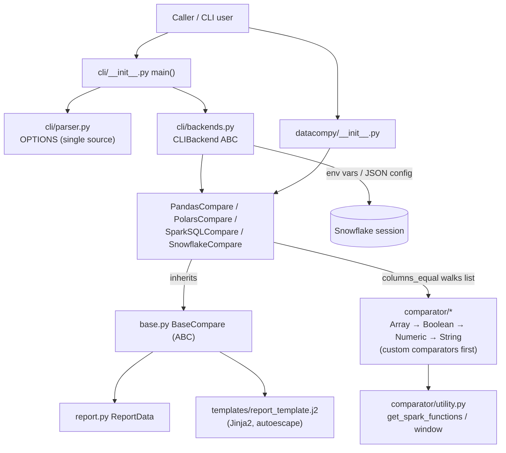

# Technical & Engineering Policy — `capitalone/datacompy`

## 1. Document Overview

| Item | Value |
|---|---|
| Repository | https://github.com/capitalone/datacompy |
| Commit analysed | `197365b643e3f253e0b0a51bb18bce9c2520cf23` (2026-11-16, branch `main`) |
| Date of analysis | 2026-11-18 |
| Purpose of repo | Compare two DataFrames/tables across Pandas, Polars, Spark (classic + Connect) and Snowflake. Originally a replacement for SAS `PROC COMPARE`. [Source: CLAUDE.md, line 7; README.md, line 18] |
| Audience | Contributors, reviewers, AI Pull Request Guardian |

**Purpose and scope.** This document consolidates repository-evidenced rules only. It does not create Capital One policy. Items without evidence are marked **Not documented**.

**Authoritative sources, in order.**
1. CI configuration (`.github/workflows/test-package.yml`).
2. `pyproject.toml`.
3. `CLAUDE.md`: a 176-line in-repo engineering guide that is the most detailed source of conventions.
4. `docs/source/developer_instructions.rst`.
5. Code patterns.

**Limitations.** Static analysis only. GitHub branch protection and required checks are not visible. There is no IaC, container or service config.

---

## 2. Technology Stack

| Technology | Role | Source |
|---|---|---|
| Python ≥3.10 (classifiers 3.10–3.15; CI 3.10–3.13) | Runtime | `pyproject.toml` L20–33; `test-package.yml` L161 |
| setuptools ≥64; version from `datacompy.__version__` | Build | `pyproject.toml` L1–3, L83 |
| jinja2 ≥3 | Report templating | `pyproject.toml` L36; `datacompy/base.py` L682–712 |
| numpy, ordered-set, pandas ≥2.2,≤3.1.1, polars[pandas] ≤2.1 | Core comparison engines | `pyproject.toml` L35–41 |
| pyspark[connect] (optional) | Spark backend | `pyproject.toml` L56–59 |
| snowflake-snowpark-python ≥1.37,<1.55 (optional) | Snowflake backend | `pyproject.toml` L55 |
| pytest, pytest-cov, pytest-benchmark, pytest-profiling, pytest-spark | Tests/benchmarks | `pyproject.toml` L60–66 |
| ruff ≥0.16, mypy (strict), pandas-stubs, pre-commit, pyproject-fmt | QA | `pyproject.toml` L54, L89–144; `.pre-commit-config.yaml` |
| tox (+ tox-conda) | Local mirror of CI matrix | `tox.ini` L1–30; CLAUDE.md L47–63 |
| edgetest | Weekly dependency upper-bound bumps | `pyproject.toml` L146–157; `.github/workflows/edgetest.yml` |
| Sphinx + furo + myst-parser | Docs | `pyproject.toml` L52 |
| GitHub Actions | CI/CD | `.github/workflows/*` |
| Java 17 (Spark tests) | Test runtime | `test-package.yml` L66–70; CLAUDE.md L41 |
| Databases/messaging/observability infra | — | **Not present** (Snowflake is a user-supplied session) |

---

## 3. Repository Architecture

The design is a **Strategy pattern at two levels** [Source: CLAUDE.md, lines 85–120].

| Module | Responsibility | Source |
|---|---|---|
| `datacompy/base.py` | `BaseCompare` ABC; report rendering (`render`, `df_to_str`, `fixed_width_table`, `save_html_report`); tolerance validation; sensitive-column masking base logic | L62–515, L517–880 |
| `datacompy/pandas.py`, `polars.py`, `spark.py`, `snowflake.py` | Backend implementations `PandasCompare`, `PolarsCompare`, `SparkSQLCompare`, `SnowflakeCompare` | CLAUDE.md L91–95 |
| `datacompy/comparator/` | Per-type column comparators (`array`, `boolean`, `numeric`, `string`) per backend; `BaseComparator` ABC | CLAUDE.md L101–112 |
| `datacompy/comparator/utility.py` | Spark Connect-safe helpers (`get_spark_functions`, `get_spark_window`, `is_spark_connect_*`), column dtype helpers | L40–200 |
| `datacompy/report.py` | Typed `ReportData` dataclasses (public API) | L53–230+; CLAUDE.md L138 |
| `datacompy/cli/` | `datacompy` console script: `parser.py` (`OPTIONS` single source of truth), `backends.py` (`CLIBackend` ABC), `compare.py`, `output.py`, `errors.py` | CLAUDE.md L144–153; `pyproject.toml` L72 |
| `datacompy/templates/report_template.j2` | Default report template | CLAUDE.md L136 |
| `skills/datacompy/` | Packaged Claude skill docs (usage, backends, v0→v1 migration) | file tree |

**Entry points.** The library classes, re-exported in `datacompy/__init__.py`. Spark and Snowflake are optional imports. There is also the console script `datacompy.cli:main` / `python -m datacompy` [Source: `pyproject.toml` L72; CLAUDE.md L97, L146].



**Comparator dispatch contract (ARCH-002).** `compare()` returns `None` to mean "not my type". Order matters. Custom comparators run before the defaults and must accept `**kwargs`. If every comparator returns `None`, the column compares as all-`False` [Source: CLAUDE.md, lines 114–120; `datacompy/pandas.py` L49, L167].

---

## 4. Coding Standards

| ID | Standard | Classification | Evidence |
|---|---|---|---|
| CODE-001 | `ruff check` must pass (B, C4, D, E, F, I, LOG, NPY, RUF, SIM, T20, TID252, UP, W; preview on) | **Mandatory (CI)** | `pyproject.toml` L93–135; `test-package.yml` L49–50 |
| CODE-002 | `ruff format --check` must pass. This also covers Python blocks inside Markdown such as CLAUDE.md. | **Mandatory (CI)** | `test-package.yml` L51–52; CLAUDE.md L74 |
| CODE-003 | Absolute imports only | **Mandatory (ruff)** | `pyproject.toml` L109, L133; CLAUDE.md L159 |
| CODE-004 | NumPy-style docstrings on public code | **Mandatory (ruff D)** | `pyproject.toml` L97, L134; CLAUDE.md L158 |
| CODE-005 | No `print` except in `datacompy/cli/output.py`, where stdout is the interface | **Mandatory (ruff T20 + per-file ignore)** | `pyproject.toml` L108, L131–132 |
| CODE-006 | "All code must be fully type-hinted and pass `mypy --strict`" | **Documented as mandatory but not enforced.** mypy is not in CI or pre-commit (GAP-001). | CLAUDE.md L157 vs L76; `pyproject.toml` L140–144 |
| CODE-007 | Module logger is `LOG = logging.getLogger(__name__)` | **Convention** (8 modules) | `datacompy/base.py` L38; `pandas.py` L46; `spark.py` L55; `snowflake.py` L73; `polars.py` L48 |
| CODE-008 | Never import `pyspark.sql.functions`, `pyspark.sql.Window` or `pyspark.sql.connect.*` at module scope. Resolve them with `get_spark_functions(df)` / `get_spark_window(df)`. | **Mandatory (documented architectural rule)** | CLAUDE.md L124–132; `datacompy/comparator/utility.py` L96, L126 |
| CODE-009 | Optional-backend imports (`pyspark`, `snowflake.snowpark`) stay inside methods in the CLI. Library modules are guarded by try/except in `__init__.py` and `check_module_available`. | **Convention** | CLAUDE.md L97, L150; `datacompy/utility.py` L21–39 |
| CODE-010 | Add a CLI option as **one new `Opt` row** in `OPTIONS`. Never hand-write it in two places. | **Mandatory (test-enforced)** | CLAUDE.md L148; `datacompy/cli/parser.py` L268; `tests/cli/test_parser.py` |
| CODE-011 | CLI expected failures raise `CLIError` subclasses. Exit codes: 0 match, 1 mismatch, 2 error, 130 interrupt. | **Mandatory (documented contract)** | CLAUDE.md L153; `datacompy/cli/errors.py` L24–42; `cli/__init__.py` L69, L84 |
| CODE-012 | Tests are plain module-level `def test_*()`. No `class Test*` unless the file already uses them. | **Convention (documented)** | CLAUDE.md L164–165 |
| CODE-013 | No em dashes and no emojis in docs, docstrings or commit messages | **Convention (documented)** | CLAUDE.md L169–170 |
| CODE-014 | `pyproject.toml` must be formatted by `pyproject-fmt` (column width 88) | **Mandatory (pre-commit, local)** | `.pre-commit-config.yaml` L19–22; `pyproject.toml` L137–138 |
| CODE-015 | Tolerances (`abs_tol`, `rel_tol`) are a float or a per-column dict, validated by `validate_tolerance_parameter()` | **Convention** | CLAUDE.md L142; `datacompy/base.py` L858 |

---

## 5. Reusable Components and Existing Capabilities

| Component | Category | File path | Responsibility | Usage guidance | Evidence |
|---|---|---|---|---|---|
| `BaseCompare.hide_sensitive_columns()` / `reveal_sensitive_columns()` / `_mask_sensitive_column_stats()` | **Privacy / masking** | `datacompy/base.py`; backend overrides in `pandas.py`, `polars.py`, `spark.py`, `snowflake.py` | Masks sensitive columns in row frames **and** derived stats (`max_diff`, `null_diff`; issue #565). Validates names, rejects duplicates, warns on unknown columns. | **Use this for any PII masking or hashing need. Do not add a parallel "hash sensitive data" feature.** | `base.py` L87–140, L469–480; `pandas.py` L200–240; `spark.py` L228; `snowflake.py` L235, L277; `polars.py` L199 |
| `check_module_available(module_available, extra_name)` | Optional-dependency guard | `datacompy/utility.py` | Decorator raising an `ImportError` that tells the user which extra to install | Wrap functions that need an optional extra | L21–39 |
| `get_spark_functions(obj)`, `get_spark_window(obj)` | Spark Connect compatibility | `datacompy/comparator/utility.py` | Resolve classic vs Connect `functions`/`Window` from the object | Mandatory in Spark paths (CODE-008) | L96–150 |
| `is_spark_connect_object()`, `is_spark_connect_dataframe()` | Type validation | `datacompy/comparator/utility.py` | Detect Connect objects without importing `pyspark.sql.connect` | Use instead of `isinstance` on Connect classes | L40–95; CLAUDE.md L132 |
| `get_spark_column_dtypes`, `get_snowflake_column_dtypes` | Schema introspection | `datacompy/comparator/utility.py` | Column dtype lookup | Reuse in comparators | L153–200 |
| `validate_tolerance_parameter`, `get_column_tolerance` | Validator | `datacompy/base.py` | Validate and resolve global/per-column tolerances | Reuse for any tolerance-like parameter | L837–880 |
| `render(template_name, **ctx)`, `_resolve_template_path` | Templating | `datacompy/base.py` | Jinja2 rendering with `select_autoescape()`, custom template resolution | Use for any new report output | L517–573, L682–720 |
| `report_to_html`, `save_html_report` | Serialization / output | `datacompy/base.py` | Convert a text report to HTML and save it | Reuse for HTML output | L747–783 |
| `df_to_str`, `fixed_width_table`, `_display_width` | Formatting | `datacompy/base.py` | Sampled DataFrame to string; aligned tables | Reuse for report tables | L574–681, L784–836 |
| `temp_column_name(*dfs)` | Utility | `datacompy/base.py` | Collision-free temporary column names | Use instead of hardcoded temp names | L722–746 |
| `build_report_data()` → `ReportData` (`RowSummary`, `ColumnSummary`, `ColumnComparison`, `MismatchStat(s)`, `UniqueRowsData`) | Serialization / public API | `datacompy/base.py`, `datacompy/report.py` | Structured report with `render()`, `to_html()`, `save()`, `to_dict()` | Prefer over parsing the string report | `base.py` L283; `report.py` L53–230; CLAUDE.md L99, L138 |
| `BaseComparator` + `Pandas/Polars/Spark/Snowflake{Array,Boolean,Numeric,String}Comparator` | Comparison strategies | `datacompy/comparator/*.py` | Type-specific equality incl. tolerances | Extend through `custom_comparators=[...]`, not by editing dispatch | CLAUDE.md L103–119 |
| `Opt`, `OPTIONS`, `build_parser`, `compare_kwargs` | CLI config | `datacompy/cli/parser.py`, `cli/backends.py` | Single declarative CLI surface | Add rows, not ad-hoc argparse | `parser.py` L56, L268, L567; `backends.py` L204 |
| `_snowflake_params(config_path)` | Configuration / credential loader | `datacompy/cli/backends.py` | Snowpark connection params from a JSON file or `SNOWFLAKE_*` env vars (incl. OAuth token) | Reuse; do not add new credential sources inline | L477–530 |
| `CLIError` hierarchy (`BadArgsError`, `LoadError`, `MissingExtraError`, `OutputError`) | Exceptions | `datacompy/cli/errors.py` | Expected-failure types mapped to exit code 2 | Raise these in CLI code | L24–42 |

---

## 6. API and Data Contracts

| ID | Contract | Classification | Evidence |
|---|---|---|---|
| API-001 | `ReportData` and its dataclasses are **public API**. Any change to their shape is **breaking**. | Mandatory (documented) | CLAUDE.md L138 |
| API-002 | Snapshot tests (`tests/test_report_snapshots.py`, `tests/snapshots/`) assert exact rendered bytes. Snapshot files are excluded from whitespace hooks. | Mandatory (tests) | CLAUDE.md L138; `.pre-commit-config.yaml` L15, L18 |
| API-003 | CLI exit codes 0/1/2/130 are the contract | Mandatory (documented) | CLAUDE.md L153 |
| API-004 | `--backend snowflake` treats `--left/--right` **always** as table references. No file-vs-table heuristic. | Architectural constraint | CLAUDE.md L152 |
| API-005 | Every `Opt.kwarg` must match the real `*Compare` constructor signature | Mandatory (test) | CLAUDE.md L148 |
| API-006 | Versioning is SemVer. v1 is current. `support/0.19.x` receives critical security fixes only. | Mandatory (documented) | `docs/source/developer_instructions.rst` L198–199; README.md L22–23; CLAUDE.md L175 |

No HTTP API, database schema or migrations exist.

---

## 7. Security Policies

| Rule ID | Rule | Severity | Enforcement | Evidence | Remediation |
|---|---|---|---|---|---|
| SEC-001 | **Snowflake credentials must come from `SNOWFLAKE_*` environment variables or a `--snowflake-config` JSON file**, never literals in code | Critical | Design (only these two sources exist); no secret scanner | `datacompy/cli/backends.py` L477–530 | Use env vars / config file; rotate any leaked secret |
| SEC-002 | OAuth: a bare `SNOWFLAKE_TOKEN` implies `authenticator=oauth`, and OAuth requires a token. Don't weaken these validations. | High | Code (raises `BadArgsError`) | `backends.py` L511–530 | Keep validation |
| SEC-003 | **Jinja2 environments must use `autoescape=select_autoescape()`** | High | Convention (single render path) | `datacompy/base.py` L707–712 | Reuse `render()` |
| SEC-004 | Pin all GitHub Actions to commit SHAs | Medium | Convention (every workflow) | `.github/workflows/*.yml` (e.g. `test-package.yml` L42–44) | Pin SHA |
| SEC-005 | CI default token is read-only (`permissions: contents: read`) | Medium | CI config | `test-package.yml` L35–36 | Keep least privilege |
| SEC-006 | Archived `support/0.19.x` gets **critical security fixes only** | Medium | Documented | README.md L22–23; CLAUDE.md L175 | Target `main` |

**May secrets, tokens or API keys be hardcoded?** **No evidence permits it.** Credentials are resolved only from the environment or a user-supplied JSON file (SEC-001). The repository has **no automated secret scanning, SAST or dependency audit** in CI (GAP-003).

Not documented: authN/authZ (N/A), SQL injection guidance for Snowflake table refs, TLS, file-upload rules.

---

## 8. Privacy and Data Protection Policies

| Rule ID | Rule | Classification | Evidence |
|---|---|---|---|
| PRIV-001 | Sensitive columns are masked with `hide_sensitive_columns(list[str])`. Masking covers the row-level frames (`df1_unq_rows`, `df2_unq_rows`, `intersect_rows`) **and** derived stats (`max_diff`, `null_diff`). | **Mandatory capability** (code + tests in all four backends) | `datacompy/base.py` L87–140; `pandas.py` L200–240; tests in `tests/test_pandas.py`, `test_polars.py`, `test_spark.py`, `test_snowflake.py` |
| PRIV-002 | Any new report statistic derived from raw values **must be cleared by `_mask_sensitive_column_stats()`** when the column is sensitive. Otherwise masked values can be reverse-engineered (issue #565). | **Mandatory (documented in code)** | `base.py` L127–140 |
| PRIV-003 | Logs carry counts, column names and match rates, **never row values** | **Inferred** (all `LOG.*` calls observed) | `pandas.py` L289–476 |
| PRIV-004 | Reports and `sample_mismatch` output **do contain row values** by design. Callers handling customer data should call `hide_sensitive_columns` before `report()`/`build_report_data()`. | Inferred guidance | `base.py` L227–234, L283; `pandas.py` L581–651 |

Retention and access restrictions are **not documented**.

---

## 9. Testing and Quality Assurance

| Item | Detail | Evidence |
|---|---|---|
| Framework | pytest, three configs: `pytest.ini` (classic Spark, ANSI off), `pytest-ansi.ini`, `pytest-connect.ini`. `-c` **replaces** config. | CLAUDE.md L31–37 |
| CI gates | lint+format; basic install on Python 3.10–3.13 (no pyspark); Spark 3.5 (py3.11, pandas 2.3.3) with and without ANSI; Spark 4 (py3.10/pandas2, py3.12/pandas3) with ANSI + Spark Connect on the baseline | `test-package.yml` L39–174 |
| Rule TEST-001 | Changes touching Spark casting or null handling must pass both `pytest` and `pytest -c pytest-ansi.ini` | `developer_instructions.rst` L43–48 |
| Rule TEST-002 | Spark Connect suites must run in **separate pytest processes** | CLAUDE.md L45; `test-package.yml` L139–152 |
| Rule TEST-003 | Coverage must target the top-level package `--cov=datacompy`, never a dotted submodule | CLAUDE.md L39 |
| Rule TEST-004 | Keep PR-review worktrees outside the repo (avoids `ImportPathMismatchError`) | CLAUDE.md L37 |
| Snowflake tests | Need a live Snowflake session. The local emulator is **not** a substitute. | CLAUDE.md L41 |
| Coverage threshold | **None defined** (reports only) | `test-package.yml` L89 |
| Commands | `pytest`, `make test`, `test-ansi`, `test-connect`, `test-connect-regression`, `test-cov`, `test-all`, `tox -e lint`, `tox -e typecheck` | CLAUDE.md L19–29, L51–56 |

---

## 10. Dependency and Supply Chain Policies

| ID | Rule | Classification | Evidence |
|---|---|---|---|
| DEP-001 | Runtime deps go in `[project].dependencies`; test/docs/QA deps go in optional-dependencies | Mandatory (documented) | `developer_instructions.rst` L151–155 |
| DEP-002 | Core deps carry upper bounds; edgetest raises them weekly via a PR | Convention (automated) | `pyproject.toml` L35–41, L146–157; `edgetest.yml` |
| DEP-003 | `ruff>=0.16` floor is required (config uses selectors newer ruff understands) | Mandatory | CLAUDE.md L74; `pyproject.toml` L54 |
| DEP-004 | Never loosen `openjdk>=17.0.8,<18` in tox Spark envs | Mandatory (documented trap) | CLAUDE.md L62 |
| DEP-005 | `pyspark` 4.0.0 is excluded on py≤3.11 (`!=4`) | Mandatory (config) | `pyproject.toml` L57 |

There is **no lockfile**, licence allow-list, vulnerability scanning or approval process documented.

---

## 11. Infrastructure and Deployment Policies

| ID | Rule | Classification | Evidence |
|---|---|---|---|
| INFRA-001 | Trunk-based: all feature branches are **squash-merged** into `main`. Releases are tags on `main` that publish to PyPI. | Mandatory (documented) | `developer_instructions.rst` L198–207 |
| INFRA-002 | PyPI publish through `pypa/gh-action-pypi-publish` with `permissions` scoped in `publish-package.yml` | CI config | `publish-package.yml` L13, L30 |
| INFRA-003 | Version bumps go through the `bump-version` workflow | Convention | `.github/workflows/bump-version.yml` |

No containers, IaC, sizing, autoscaling or IAM definitions exist.

---

## 12. Cost and FinOps Policies

| ID | Rule | Classification | Evidence |
|---|---|---|---|
| COST-001 | **Do not widen the CI Spark matrix into a cross product.** Spark jobs (~20 min each) are "the entire cost" of a run, so axes are covered independently. Read the `tox.ini` header before widening. | **Documented constraint** | `test-package.yml` L4–24; `tox.ini` L15–30; CLAUDE.md L58 |
| COST-002 | Benchmarks (`benchmarks/`) are outside `testpaths` and are not run in CI | Convention | CLAUDE.md L43 |
| COST-003 | `all_mismatch()` / `sample_mismatch()` on Spark/Snowflake can materialise large results. No limit policy exists. | Inferred (Low) | `spark.py` L762, L836; `snowflake.py` L749, L828 |

Cloud resource sizing and autoscaling: **Not applicable / not present.**

---

## 13. Architecture Decision Records and Historical Decisions

No ADR directory exists. Recorded decisions:

| Decision | Decision made / reasoning | Do not reverse because | Source |
|---|---|---|---|
| Strategy pattern for backends and comparators | One ABC, one module per backend; comparators chained | Adding a backend or type relies on it | CLAUDE.md L85–120 |
| Spark Connect-safe imports | Resolve functions from objects, not module scope | Module-scope import silently drops `SparkSQLCompare` | CLAUDE.md L124–132 |
| CLI `OPTIONS` single source of truth | Generated parser + kwargs; test checks the signature | Hand-written duplicates drift | CLAUDE.md L148 |
| Sensitive-stat masking (issue #565) | Clear `max_diff`/`null_diff` for hidden columns | Masked values leak otherwise | `base.py` L127–136 |
| Trunk-based + squash merge (v1) | `main` only; `develop` still exists and CI still builds it | — | `developer_instructions.rst` L198–204; CLAUDE.md L174 |
| CI matrix shape | Independent axes for cost | COST-001 | `test-package.yml` L4–24 |

---

## 14. CI/CD and Release Policies

| Control | Automated | Evidence |
|---|---|---|
| Lint + format, tests across matrix on push/PR to `develop`, `main`, `release/*`, `release-*`, `support/*` | Yes | `test-package.yml` L28–33 |
| Type check (mypy strict) | **No** (manual / `tox -e typecheck`) | CLAUDE.md L55, L76 |
| Code owners: `@capitalone/datacompy-admin-team`, `@capitalone/datacompy-write-team`, `@capitalone/capital-one-ospo` | Requires branch protection (*unverified*) | `CODEOWNERS` L1 |
| CLA required | External (cla-assistant) | README.md L113–114 |
| Squash merge | Documented (enforcement *unverified*) | `developer_instructions.rst` L201–204 |
| Release → PyPI + docs | Yes | `publish-package.yml`, `publish-docs.yml` |
| Secret / SAST / dependency scan | **No** | — |
| Rollback | Not documented (squash commits "easier to back out") | `developer_instructions.rst` L203–204 |

---

## 15. Prohibited Practices

| Rule ID | Prohibited practice | Reason | Evidence | Severity | Status |
|---|---|---|---|---|---|
| PROH-001 | Module-scope import of `pyspark.sql.functions`, `pyspark.sql.Window`, `pyspark.sql.connect.*` | Breaks Spark Connect / drops backend | CLAUDE.md L124–132 | High | **Explicitly prohibited ("Never")** |
| PROH-002 | Hand-writing a CLI option outside `OPTIONS` | Drift; test fails | CLAUDE.md L148 | Medium | **Explicitly prohibited** |
| PROH-003 | Relative imports | ruff TID252 | `pyproject.toml` L133 | Low | Enforced |
| PROH-004 | `print` outside `cli/output.py` | ruff T20 | `pyproject.toml` L108, L132 | Low | Enforced |
| PROH-005 | Loosening the `openjdk` floor in tox | GraalPy substitution | CLAUDE.md L62 | Medium | **Explicitly prohibited ("Never")** |
| PROH-006 | `--cov` on a dotted submodule | numpy double-import failures | CLAUDE.md L39 | Low | Documented |
| PROH-007 | Em dashes / emojis in docs, docstrings, commits | Style | CLAUDE.md L169–170 | Low | Documented |
| PROH-008 | Changing `ReportData` shape without treating it as breaking | Public API | CLAUDE.md L138 | High | Documented |
| PROH-009 | New derived stat that bypasses sensitive-column masking | Privacy leak (#565) | `base.py` L127–136 | High | Documented in code |
| PROH-010 | Hardcoded Snowflake credentials | — | `backends.py` L477–530 | Critical | *Proposed review recommendation* (design implies it, not stated) |
| PROH-011 | Re-implementing sensitive-column hashing/masking or other §5 helpers | Duplication. Past PRs #434 and #489 proposed this before the built-in existed. | §5 | Medium | *Proposed review recommendation* |

---

## 16. Policy Registry

| ID | Category | Rule | Classification | Severity | Violation looks like | Evidence | Check | Remediation | Confidence |
|---|---|---|---|---|---|---|---|---|---|
| SEC-001 | Security | Snowflake creds only from env/JSON | Inferred (design) | Critical | Literal `password=`, `token=`, `private_key` in `datacompy/**` | `cli/backends.py` L477–530 | D (Gitleaks) | Env vars | Medium |
| SEC-003 | Security | Jinja2 autoescape | Convention | High | `Environment(...)` without `autoescape` | `base.py` L707–712 | D (Bandit B701) | Use `render()` | High |
| SEC-004 | Supply chain | SHA-pin Actions | Convention | Medium | `uses: x@v1` | workflows | D | Pin | High |
| SEC-005 | Supply chain | Read-only default token | Mandatory (CI) | Medium | Broad `permissions:` | `test-package.yml` L35–36 | D | Scope down | High |
| PRIV-001 | Privacy | Use `hide_sensitive_columns` for PII | Mandatory capability | High | New masking/hashing code path, or report on PII without masking | `base.py` L87–140 | AI | Call built-in | High |
| PRIV-002 | Privacy | New stats must be masked | Mandatory (code doc) | High | New `column_stats` key not handled in `_mask_sensitive_column_stats` | `base.py` L127–140 | AI | Extend masker + test | High |
| PRIV-003 | Privacy | No row values in logs | Inferred | High | `LOG.*` with cell values, `email`, `customer_id`, account numbers | `pandas.py` L289–476 | AI + Semgrep | Log counts | Medium |
| CODE-001 | Quality | ruff check | Mandatory | Medium | CI fail | `test-package.yml` L49–50 | D | Fix | High |
| CODE-002 | Quality | ruff format | Mandatory | Low | CI fail | L51–52 | D | Format | High |
| CODE-006 | Quality | mypy --strict | Documented, unenforced | Medium | Untyped defs | CLAUDE.md L157 | D (mypy) | Add hints | Medium |
| CODE-008 | Architecture | Spark Connect-safe imports | Mandatory | High | `from pyspark.sql import functions` at top level | CLAUDE.md L124–132 | D (Semgrep/ruff F821) | `get_spark_functions(df)` | High |
| CODE-010 | Architecture | CLI options only via `OPTIONS` | Mandatory | Medium | `add_argument(` outside `build_parser` | CLAUDE.md L148 | D (test) + AI | Add `Opt` row | High |
| CODE-011 | Contract | CLI exit codes / `CLIError` | Mandatory | Medium | New `sys.exit(3)` or bare `Exception` for user error | CLAUDE.md L153 | AI | Raise `CLIError` | High |
| CODE-012 | Testing | Function-style tests | Convention | Low | New `class Test*` | CLAUDE.md L164–165 | D | Module functions | High |
| API-001 | Contract | `ReportData` shape is breaking | Mandatory | High | Field renamed/removed in `report.py` | CLAUDE.md L138 | AI | Major bump / deprecate | High |
| ARCH-002 | Architecture | Comparator returns `None` for non-matching types | Mandatory | High | Comparator raising on foreign type | CLAUDE.md L116 | AI | Return `None` | High |
| TEST-001 | Testing | Spark changes tested ANSI on and off | Mandatory (documented) | Medium | Spark cast change, no ANSI run | `developer_instructions.rst` L43–48 | D (CI) | Run both | High |
| DEP-001 | Deps | Correct dependency section | Mandatory | Medium | Test lib in core deps | `developer_instructions.rst` L151–155 | D | Move | High |
| DEP-004 | Deps | Keep openjdk floor | Mandatory | Medium | Edited floor in `tox.ini` | CLAUDE.md L62 | D | Revert | High |
| COST-001 | FinOps | Don't cross-product the Spark CI matrix | Documented | Medium | New matrix axes on Spark jobs | `test-package.yml` L4–24 | D + AI | Add single include | High |
| INFRA-001 | Release | Squash-merge to `main`; tag releases | Mandatory (documented) | Medium | Release from other branch | `developer_instructions.rst` L198–207 | AI | Follow flow | High |
| REUSE-001 | Reuse | Don't reimplement §5 | Proposed | Medium | New tolerance validator / temp-col / template loader / masking | §5 | AI | Call helper | Medium |

### Examples

```python
# PRIV-001 — non-compliant (duplicate masking feature)
df1["ssn"] = df1["ssn"].apply(lambda v: hashlib.sha256(v.encode()).hexdigest())
compare = PandasCompare(df1, df2, join_columns="id"); print(compare.report())

# compliant
compare = PandasCompare(df1, df2, join_columns="id")
compare.hide_sensitive_columns(["ssn", "email"])
print(compare.report())
```

```python
# CODE-008 — non-compliant
from pyspark.sql import functions as F       # module scope
# compliant
def _f(df):
    F = get_spark_functions(df)
```

---

## 17. Gaps, Ambiguities and Conflicts

| ID | Issue | Files | Why human input is needed |
|---|---|---|---|
| GAP-001 | CLAUDE.md says "All code **must** ... pass `mypy --strict`", but mypy runs in neither CI nor pre-commit | CLAUDE.md L157 vs L76; `test-package.yml` | Is strict typing a gate or an aspiration? |
| GAP-002 | `develop` "is no longer where work lands", but CI still triggers on it | CLAUDE.md L174; `test-package.yml` L30–32 | Remove trigger or keep? |
| GAP-003 | No secret scanning, SAST, dependency audit, SECURITY.md or CONTRIBUTING.md | repo root, workflows | Org-level controls may live outside the repo |
| GAP-004 | Logging style: f-strings in `LOG.*` (e.g. `pandas.py` L225, L294), while ruff `G` (logging-format) is disabled | `pyproject.toml` L107 | Is lazy `%s` logging expected? (locopy uses `%s`) |
| GAP-005 | Python 3.14/3.15 are advertised in classifiers but not tested in CI (3.10–3.13 only) | `pyproject.toml` L31–32 vs `test-package.yml` L161 | Support claim vs coverage |
| GAP-006 | Known CI gap: no Spark job on Python 3.11 (Spark 4) or 3.13 | `test-package.yml` L21–24 | Accepted risk? |
| GAP-007 | Snowflake table references from the CLI are passed to Snowpark with no documented validation | `cli/backends.py` L416–475 | Injection policy undefined |
| GAP-008 | No coverage threshold | `test-package.yml` | Should one exist? |

---

## 18. Source Inventory and Evidence

Files inspected (≈30): `CLAUDE.md`, `README.md`, `ROADMAP.rst`, `CODEOWNERS`, `CONTRIBUTORS`, `Makefile`, `pyproject.toml`, `tox.ini`, `pytest.ini`, `pytest-ansi.ini`, `pytest-connect.ini`, `.pre-commit-config.yaml`, `.github/workflows/{test-package,edgetest,publish-docs,publish-package,bump-version}.yml`, `docs/source/developer_instructions.rst`, `datacompy/{__init__,base,pandas,polars,spark,snowflake,report,utility}.py`, `datacompy/comparator/{base,utility}.py`, `datacompy/cli/{__init__,parser,backends,errors,output,compare}.py`, `skills/datacompy/SKILL.md` (listed only). Inline `[file, lines]` references accompany every rule.

---

## Analysis Summary

| Metric | Count |
|---|---|
| Files inspected | ~30 |
| Policies in registry | 22 |
| Mandatory | 15 |
| Conventions | 4 |
| Inferred / proposed | 3 |
| Security policies | 6 |
| Privacy policies | 4 |
| Cost / infra policies | 3 COST + 3 INFRA |
| Unresolved gaps / conflicts | 8 |

> **Hackathon note.** `hide_sensitive_columns()` already exists. A planted PR or ticket asking to "hash/mask sensitive columns in reports" is therefore a true duplicate, and closed PRs #434 and #489 are the historical precedent.
