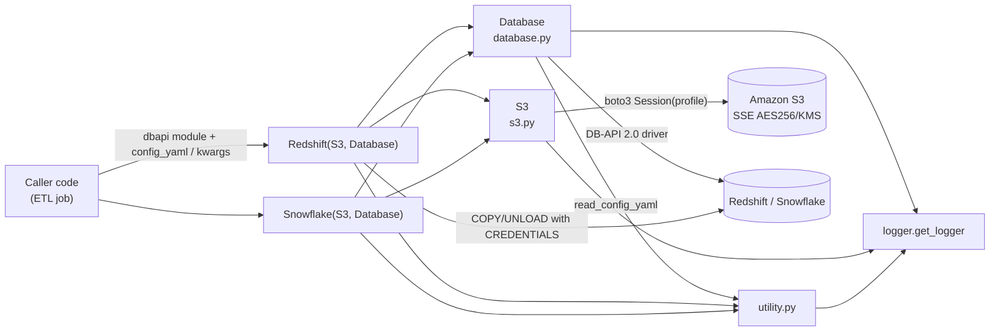

# Technical & Engineering Policy — `capitalone/locopy`

## 1. Document Overview

| Item | Value |
|---|---|
| Repository | https://github.com/capitalone/locopy |
| Commit analysed | `8e3a4f19a121cc5b2cdf815ed267d8d0dd2cada1` (2026-11-13, default branch `main`) |
| Date of analysis | 2026-11-18 |
| Purpose of repo | Python library for ETL load/unload to Amazon Redshift (`COPY`/`UNLOAD`) and Snowflake (`COPY INTO`), with S3 and Snowflake internal-stage file transfer [Source: README.rst, lines 17–27] |
| Audience | Contributors, reviewers, and the AI Pull Request Guardian |

**Purpose.** This document consolidates the engineering rules, conventions and constraints that can be evidenced from the repository itself. It does **not** create new Capital One policy. Where no repository evidence exists, the item is marked **Unknown / Not documented** rather than filled with industry defaults.

**How to use it.**
- Developers: check §5 (reusable components) before writing a new helper, and §15 (prohibited practices) before opening a PR.
- PR Guardian: evaluate diffs against the rule registry in §16. Each rule says how a violation shows up and whether a deterministic tool or contextual reasoning is needed.

**Limitations.**
- Static reading only. No code, tests or CI jobs were run.
- GitHub settings that don't live in the repo (branch protection, required checks, repository rulesets) were not visible. Anything that depends on them is marked *Unverified*.
- The repository contains no Terraform, Kubernetes, Docker or API specs. Infrastructure and cost sections are therefore mostly gaps.

---

## 2. Technology Stack

| Technology | Role | Established in |
|---|---|---|
| Python ≥ 3.11 (3.11–3.14 tested) | Language/runtime | `pyproject.toml` L11, L19–22; `.github/workflows/python-package.yml` L33 |
| setuptools (dynamic version from `locopy/_version.py`) | Build backend / packaging | `pyproject.toml` L31–36 |
| boto3 `>=1.9.92,<=1.44.2` | AWS S3 access and credential sessions | `pyproject.toml` L9; `locopy/s3.py` L90–118 |
| PyYAML `>=5.1,<=6.0.2` | Connection-config loading | `pyproject.toml` L9; `locopy/utility.py` L228–265 |
| pandas `>=2.2.0,<=3.1.1`, polars `>=0.20.0`, pyarrow `>=26.0.1`, numpy `>=2.0.0,<=2.5.4` | DataFrame I/O and type inference | `pyproject.toml` L9 |
| DB-API 2.0 drivers (optional): psycopg2-binary, pg8000, snowflake-connector-python | Database connectivity, injected by caller | `pyproject.toml` L39–41; README.rst L24–25 |
| Amazon Redshift, Snowflake | Target data warehouses | README.rst L19–21 |
| Amazon S3 (+ SSE-AES256 / SSE-KMS) | Staging storage | `locopy/s3.py` L183–226 |
| pytest, pytest-cov, hypothesis | Testing | `pyproject.toml` L43; `Makefile` L1–8 |
| tox | Dependency floor/ceiling matrix | `tox.ini` L1–40 |
| ruff 0.11.12 (lint + format), pre-commit | Static analysis / formatting | `pyproject.toml` L44, L51–106; `.pre-commit-config.yaml` L1–25 |
| edgetest | Automated dependency upper-bound bumping | `pyproject.toml` L108–124; `.github/workflows/edgetest.yml` |
| Sphinx + sphinx_rtd_theme | Docs (GitHub Pages) | `pyproject.toml` L42; `.github/workflows/publish-docs.yml` |
| GitHub Actions | CI/CD | `.github/workflows/*.yml` |
| WhiteSource (Mend) | Dependency scanning config | `whitesource.config` L1–8 |
| Messaging, observability (OTel etc.), containers | — | **Not present** |

---

## 3. Repository Architecture

**Style.** A single-package library with no service boundaries. Engine classes are built through **multiple inheritance**, combining an S3 mixin with a generic DB-API wrapper.

| Module | Responsibility | Source |
|---|---|---|
| `locopy/database.py` | `Database`: DB-API 2.0 connection lifecycle, `execute`, result conversion to pandas/polars/dict, context-manager support, credential redaction in logs | L32–43, L45–296 |
| `locopy/s3.py` | `S3`: boto3 session/client setup, encrypted upload, download, delete, S3 URL parsing, COPY credential string | L44–391 |
| `locopy/redshift.py` | `Redshift(S3, Database)`: `COPY`, `UNLOAD`, `load_and_copy`, `unload_and_copy`, `insert_dataframe_to_table` | L93, L166–666 |
| `locopy/snowflake.py` | `Snowflake(S3, Database)`: internal-stage `PUT`/`GET`, `COPY INTO`, unload, dataframe insert | L113, L182–546 |
| `locopy/utility.py` | File helpers (write, gzip, split, concatenate), YAML config loader, column-type inference, upload progress, IGNOREHEADER parsing | L49–535 |
| `locopy/logger.py` | Central logger factory and format constants | L25–64 |
| `locopy/errors.py` | Exception hierarchy: `LocopyError`, `DBError`, `S3Error` and subclasses | L19–68 |

**Entry points.** Public classes `locopy.Redshift`, `locopy.Snowflake`, `locopy.Database`, `locopy.S3`, re-exported from `locopy/__init__.py`. There is no CLI.



**Data flow (load).** Local file → optional split/gzip (`utility.py`) → encrypted S3 upload (`s3.py` L183–226) → `COPY ... CREDENTIALS '<session creds>'` (`redshift.py` L224–229) → optional S3 cleanup.

---

## 4. Coding Standards

| ID | Standard | Classification | Evidence |
|---|---|---|---|
| CODE-001 | Code must pass `ruff check` with the rule sets E, W, F, D, I, UP, B, C4, T20, TID252, SIM, NPY, LOG, RUF | **Mandatory** (CI job) | `pyproject.toml` L57–78; `.github/workflows/python-package.yml` L23–24 |
| CODE-002 | Code must be formatted with `ruff format` | **Mandatory** (CI job) | `.github/workflows/python-package.yml` L25–26; `.pre-commit-config.yaml` L8–10 |
| CODE-003 | Relative imports are banned; use absolute `locopy.x` imports | **Mandatory** (ruff TID252) | `pyproject.toml` L72, L101–102 |
| CODE-004 | Public functions, classes and modules need **NumPy-convention** docstrings. Tests and docs are exempt. | **Mandatory** (ruff D) | `pyproject.toml` L63, L98, L105–106 |
| CODE-005 | No `print()` in library code. Use the logger. | **Mandatory** (ruff T20) | `pyproject.toml` L71 |
| CODE-006 | Target Python 3.11 syntax (`target-version = "py311"`); `X \| None` union style is used | Mandatory (config) / Convention | `pyproject.toml` L53; e.g. `locopy/s3.py` L91 |
| CODE-007 | Each module gets its logger with `get_logger(__name__, INFO)` from `locopy.logger` | **Convention** (all 5 modules) | `database.py` L27,30; `s3.py` L38,41; `redshift.py` L33,44; `snowflake.py` L33,37; `utility.py` L44,46 |
| CODE-008 | Log with lazy `%s` arguments, not f-strings | **Convention** (ruff LOG selected) | `pyproject.toml` L76; e.g. `database.py` L118, L184 |
| CODE-009 | Catch, log with `logger.error(...)`, then re-raise a **locopy-specific exception** with `from e` | **Convention** | `database.py` L117–119; `s3.py` L105–107; `utility.py` L96–98, L263–265 |
| CODE-010 | New error types must subclass `LocopyError`, `DBError` or `S3Error` in `locopy/errors.py` | **Convention** | `locopy/errors.py` L19–68 |
| CODE-011 | Each source file starts with the SPDX / Apache-2.0 Capital One header | **Inferred** (all modules) | `locopy/logger.py` L1–15; `locopy/errors.py` L1–15 |
| CODE-012 | Type annotations on public signatures | **Inferred** (mixed: `s3.py`/`database.py`/`utility.py` annotated, `redshift.py`/`snowflake.py` constructors not). mypy is commented out. | `.pre-commit-config.yaml` L11–19; `redshift.py` L166–167 |
| CODE-013 | Configuration comes from a YAML file **or** kwargs, never both | **Mandatory** (raises `CredentialsError`) | `database.py` L97–102 |

---

## 5. Reusable Components and Existing Capabilities

Reimplementing any of these in a PR should be flagged (see REUSE-001).

| Component | Category | File path | Responsibility | Usage guidance | Evidence |
|---|---|---|---|---|---|
| `get_logger(name, log_level)` | Logger | `locopy/logger.py` | Configures stdout logging with a standard verbose format; quiets botocore | Use for every module logger. Do not call `logging.basicConfig` elsewhere. | L41–64 |
| `_redact_credentials(sql)` | Security helper | `locopy/database.py` | Masks `aws_secret_access_key=` and `token=` values before SQL is logged | Route any new SQL-logging path through this (or extend its patterns) | L32–43, L184 |
| `Database.execute(sql, params, many, verbose)` | DB access wrapper | `locopy/database.py` | Parameterised execution, commit, timing, redacted logging, `DBError` wrapping | Use instead of raw `cursor.execute` | L144–203 |
| `Database.to_dataframe(df_type, size)` / `to_dict()` | Serialization | `locopy/database.py` | Fetches results into pandas/polars (lower-cased columns) or row dicts | Reuse for result conversion | L220–271 |
| `read_config_yaml(config_yaml)` | Configuration loader | `locopy/utility.py` | `yaml.safe_load` of connection config from a path or file object; raises `CredentialsError` | Use for any credential/config loading. Never use `yaml.load`. | L228–268 |
| `S3.upload_to_s3(...)` / `upload_list_to_s3` | Storage + encryption | `locopy/s3.py` | Upload that **forces** SSE (AES256, or `aws:kms` with `kms_key`) | Use for every S3 write | L183–270 |
| `S3._credentials_string()` | Auth helper | `locopy/s3.py` | Builds the COPY/UNLOAD `CREDENTIALS` string from the boto3 session (incl. temporary token) | Use instead of embedding keys | L120–136 |
| `S3.parse_s3_url(s3_url)` / `_generate_s3_path` / `_generate_unload_path` | Validator / builder | `locopy/s3.py` | Parse and build `s3://bucket/key` paths | Reuse; do not hand-roll URL parsing | L138–181, L373–391 |
| `compress_file`, `compress_file_list`, `split_file`, `concatenate_files`, `write_file` | File utilities | `locopy/utility.py` | gzip, N-way split with cleanup on failure, concat, write | Reuse for file prep before upload | L49–225 |
| `find_column_type(dataframe, warehouse_type)` | Type inference / validation | `locopy/utility.py` | Infers Redshift/Snowflake column types for pandas or polars, incl. date/float validation | Reuse when creating tables from DataFrames | L271–468 |
| `add_default_copy_options`, `combine_copy_options`, `get_ignoreheader_number` | Command builders | `locopy/redshift.py`, `locopy/utility.py` | Default `COPY` options (`DATEFORMAT 'auto'`, `COMPUPDATE ON`, `TRUNCATECOLUMNS`), joining, IGNOREHEADER validation | Reuse when building COPY statements | `redshift.py` L47–91; `utility.py` L509–535 |
| `ProgressPercentage` | Utility | `locopy/utility.py` | Thread-safe upload progress callback | Reuse for transfer progress | L471–507 |
| Exception hierarchy | Exception handling | `locopy/errors.py` | Domain errors for DB, S3, file ops, credentials | Raise these, not bare `Exception` | L19–68 |

---

## 6. API and Data Contracts

- **No HTTP API, OpenAPI spec, database schema or migrations exist.** The contract is the public Python API.
- **Public interface (Architectural constraint ARCH-001):** `Redshift`, `Snowflake`, `Database`, `S3` constructors and methods documented in README/Sphinx. Constructor keyword `config_yaml`, `profile`, `kms_key`, `dbapi` are public [Source: README.rst, lines 81–162; `locopy/redshift.py` L166–175].
- **Result contract:** `to_dataframe` returns lower-cased column names and `None` for empty results [Source: `locopy/database.py` L234–258].
- **Breaking-change signal:** versions are semver (`MAJOR.MINOR.PATCH`) bumped through a workflow [Source: `.github/workflows/bump-version.yml` L7–17, L50–71]. Changes to public signatures should be treated as potentially breaking. No deprecation policy is documented.

---

## 7. Security Policies

| Rule ID | Rule | Severity | Enforcement | Evidence | Remediation |
|---|---|---|---|---|---|
| SEC-001 | **Do not hardcode database passwords or AWS keys.** Supply DB credentials through a YAML config file or kwargs at runtime, and AWS credentials through a named profile / `AWS_DEFAULT_PROFILE` / EC2 IAM role. | Critical | None automated (no secret scanner in repo). Design-enforced: credentials enter only via `config_yaml`/kwargs and boto3 `Session(profile_name=...)`. | README.rst L81–91, L159–162; `locopy/database.py` L97–102; `locopy/s3.py` L101–110; `docs/source/developer.rst` L53–83 | Load from config/profile; remove literal and rotate it |
| SEC-002 | **COPY/UNLOAD credentials must come from the live boto3 session** through `_credentials_string()`, never from literals. | Critical | Design | `locopy/s3.py` L120–136; `locopy/redshift.py` L224–228 | Call `self._credentials_string()` |
| SEC-003 | **SQL that may contain credentials must be logged only through `_redact_credentials`.** | High | Unit test `test_execute_redacts_credentials_in_log` | `locopy/database.py` L32–43, L184; `tests/test_database.py` L206 | Wrap the log argument in `_redact_credentials()` |
| SEC-004 | **Use parameterised queries (`params`) for any value-bearing SQL.** `COPY`/`UNLOAD` cannot be parameterised, so locopy must not be fed untrusted (external/client) input. | High | Documentation only | `docs/source/sql_injection.rst` L4–23; `locopy/database.py` L186–189 | Pass values via `params=`; validate identifiers |
| SEC-005 | **All S3 uploads must use server-side encryption** (AES256 by default, or `aws:kms` with `kms_key`). Do not add an upload path that skips `ExtraArgs` SSE. | High | Design (forced in code) | `locopy/s3.py` L204–212 ("force ServerSideEncryption") | Use `S3.upload_to_s3` |
| SEC-006 | **Load YAML only with `yaml.safe_load`.** | High | Convention (single loader) | `locopy/utility.py` L258–262 | Reuse `read_config_yaml` |
| SEC-007 | **Pin third-party GitHub Actions to a full commit SHA** (with version comment). | Medium | Convention (every workflow) | e.g. `.github/workflows/python-package.yml` L16, L18; `publish-package.yml` L17, L31 | Replace tag refs with SHAs |
| SEC-008 | **PyPI publishing uses OIDC trusted publishing** (`id-token: write`, `environment: pypi`), with no stored API token | High | CI config | `.github/workflows/publish-package.yml` L13–15, L30–31 | Do not add `PYPI_TOKEN` secrets |
| SEC-009 | Workflows declare minimal `permissions:` per job | Medium | Inferred (4 of 5 workflows; `python-package.yml` declares none) | `bump-version.yml` L22–25; `edgetest.yml` L13–15; `publish-docs.yml` L14–15 | Add explicit `permissions:` |

**May secrets, tokens or API keys be hardcoded?** **No.** The repo routes all credentials through runtime config or AWS profiles (SEC-001/002), and redacts them in logs (SEC-003). The only literal credential-like values are **placeholder fixtures** (`password: password`) in `tests/data/.locopyrc` L5 and `tests/data/.locopy-sfrc` L6, which CI copies to `~` for unit tests (`python-package.yml` L43–44). These are test fixtures, not policy. The repo has **no automated secret scanner**.

Not evidenced in repo: authentication/authorization layer (N/A for a library), file-upload restrictions, TLS settings (delegated to drivers/boto3), SAST (Semgrep/CodeQL).

---

## 8. Privacy and Data Protection Policies

| Rule ID | Rule | Classification | Evidence |
|---|---|---|---|
| PRIV-001 | Logged SQL must have AWS secret keys and session tokens masked | Mandatory (tested) | `locopy/database.py` L32–43, L184; `tests/test_database.py` L206 |
| PRIV-002 | `execute(..., verbose=False)` suppresses SQL logging. Bulk inserts that embed row values use it. | Convention | `locopy/database.py` L182–184; `locopy/redshift.py` L660 |
| PRIV-003 | Data staged to S3 must be encrypted at rest (see SEC-005) | Mandatory (code) | `locopy/s3.py` L204–212 |
| PRIV-004 | Do not log row-level data values (customer identifiers, emails, account numbers). Log metadata only: file paths, column names, counts. | **Inferred**. Existing log calls only emit paths, column names and timings. No explicit written rule. | `locopy/utility.py` L73, L94, L352, L376; `locopy/s3.py` L214–216 |

- **Sensitive data handled:** DB passwords, AWS access/secret keys and session tokens. Table contents are opaque to the library.
- **Retention:** Not documented.
- **Gap:** `_CREDENTIAL_PATTERNS` doesn't mask `aws_access_key_id=`, so the access-key ID part of the COPY credentials string is logged in clear text. See GAP-001.

---

## 9. Testing and Quality Assurance

| Item | Detail | Classification | Evidence |
|---|---|---|---|
| Framework | pytest + pytest-cov + hypothesis | Mandatory (tests extra) | `pyproject.toml` L43 |
| Layout | `tests/test_<module>.py`; fixtures in `tests/conftest.py`; data in `tests/data/` | Convention | file tree |
| Integration tests | Marked `@pytest.mark.integration`; need a real Redshift/Snowflake + `~/.locopyrc`; excluded from CI | Mandatory marker | `pyproject.toml` L126–129; `Makefile` L4–8; `docs/source/developer.rst` L48–88 |
| CI test gate | `make not_integration` on Python 3.11–3.14 for PRs to `develop`/`main` | Enforced by CI (required-check status *unverified*) | `.github/workflows/python-package.yml` L6–10, L28–50 |
| Dependency matrix | tox legs `mindeps`, `pandas23`, `pandas30`, `pandas31` (floor/ceiling) | Enforced by CI | `tox.ini` L1–40; `python-package.yml` L52–70 |
| Coverage | Reported with `show_missing`. **No threshold.** | — | `.coveragerc` L1–2; `Makefile` L2 |
| Commands | `make coverage`, `make not_integration`, `make integration`, `tox`, `ruff check`, `ruff format --check`, `pre-commit install` | — | `Makefile`; `developer.rst` L9–11, L43–53 |

Rule **TEST-001 (Recommended):** new public behaviour should come with unit tests in the matching `tests/test_<module>.py`. Tests that touch a live warehouse must be marked `integration` [Source: `pyproject.toml` L126–129].

---

## 10. Dependency and Supply Chain Policies

| ID | Rule | Classification | Evidence |
|---|---|---|---|
| DEP-001 | Runtime deps go in `[project].dependencies`. Test/doc/QA-only deps go in `[project.optional-dependencies]`. | **Mandatory** (documented) | `docs/source/developer.rst` L92–96; `pyproject.toml` L9, L38–48 |
| DEP-002 | Core deps carry explicit lower **and** upper bounds | Convention | `pyproject.toml` L9 |
| DEP-003 | Upper bounds are raised by **edgetest** (weekly, Fri 17:35 UTC), which opens a PR updating `pyproject.toml`/`requirements.txt` | Convention (automated) | `.github/workflows/edgetest.yml` L5–31; `pyproject.toml` L108–124 |
| DEP-004 | `requirements.txt` is a **uv-compiled lock** of `pyproject.toml`, used by the publish job | Convention | `requirements.txt` L1–2; `publish-package.yml` L26 |
| DEP-005 | Changes to dependency floors must keep the tox `mindeps` leg passing | Mandatory (CI) | `tox.ini` L14–25 |
| DEP-006 | Dependency scanning via WhiteSource/Mend config | Present, but config pins Python **3.9**, which is outside the supported range (see GAP-003) | `whitesource.config` L7–8 |

Approved/restricted dependency list, license allow-list and a formal vulnerability SLA: **Not documented.**

---

## 11. Infrastructure and Deployment Policies

- **No IaC, Dockerfile, Kubernetes, Helm or cloud resource definitions exist.** Deployment = publishing a wheel/sdist to PyPI and docs to GitHub Pages.

| ID | Rule | Classification | Evidence |
|---|---|---|---|
| INFRA-001 | Releases are cut from `main` and tagged. Creating a GitHub release triggers the PyPI publish and docs publish. | Mandatory (documented + CI) | `docs/source/developer.rst` L125–140; `publish-package.yml` L6–8; `publish-docs.yml` L6–9 |
| INFRA-002 | Version bumps go through the `Bump version` workflow, which opens a PR (no direct push to `main`) | Convention | `.github/workflows/bump-version.yml` L73–121 |
| INFRA-003 | PyPI publishing runs in the `pypi` GitHub environment (environment protection rules *unverified*) | Mandatory (CI) | `publish-package.yml` L13 |
| INFRA-004 | S3 access uses a named AWS profile or attached IAM role. No IAM policy definitions exist in the repo. | Convention | README.rst L159–162; `locopy/s3.py` L101–110 |

Instance sizing, autoscaling, resource limits, network policy, rollback: **Not applicable / not documented.**

---

## 12. Cost and FinOps Policies

There are **no formal cost policies** in the repo. Observed cost-relevant behaviour (classification **Inferred**, confidence Low):

| ID | Observation | Evidence |
|---|---|---|
| COST-001 | `to_dataframe(size=None)` calls `fetchall()`, which is unbounded. Pass `size` for large result sets. | `locopy/database.py` L220–245 |
| COST-002 | `load_and_copy` supports `splits` + gzip compression, which reduces load time and transfer size | `locopy/utility.py` L82–189; `locopy/redshift.py` L235–347 |
| COST-003 | S3 staging files may be deleted after load (`delete_s3_after`). Leaving them accrues storage cost. | `locopy/redshift.py` L235–347 |

Instance sizes, autoscaling, warehouse sizing: **Not present.**

---

## 13. Architecture Decision Records and Historical Decisions

No `adr/` directory exists. Decisions recorded in docs:

| Decision | Context | Decision | Reasoning | Consequence | Source |
|---|---|---|---|---|---|
| ADR-1: `main`-only branching (2026) | Previously `dev` + `main` | All features merge to `main`; releases are tags | "diverging branches and new rulesets" | CI still lists `develop` as a trigger (GAP-002) | `docs/source/developer.rst` L125–140 |
| ADR-2: Driver-agnostic design | Users bring their own DB-API 2.0 driver | `dbapi` module is injected | Flexibility across psycopg2/pg8000/snowflake | Do not import a specific driver in core | README.rst L24–25; `locopy/database.py` L86–119 |
| ADR-3: COPY/UNLOAD cannot be parameterised | Redshift/Snowflake limitation | Accept string building for these commands; warn against client-facing use | Adapter limitation | SEC-004 | `docs/source/sql_injection.rst` L14–23 |
| ADR-4: Forced S3 SSE | — | Always set SSE on upload | Security default | SEC-005 | `locopy/s3.py` L205 |
| ADR-5: ruff replaces other linters; mypy disabled | — | ruff for lint+format; mypy commented out | "let a machine make style decisions" | Type checking is not enforced | `docs/source/developer.rst` L13–14; `.pre-commit-config.yaml` L11–19 |

Roadmap items (not decisions): Postgres support (#28), Azure Snowflake (#32), non-delimited Redshift files (#39) [Source: ROADMAP.rst L11–13].

---

## 14. CI/CD and Release Policies

| Control | Automated? | Evidence |
|---|---|---|
| Lint (`ruff check`) + format check on push/PR to `develop`, `main` | Yes | `python-package.yml` L6–26 |
| Unit tests, Python 3.11–3.14 | Yes | `python-package.yml` L28–50 |
| tox dependency matrix | Yes | `python-package.yml` L52–70 |
| pre-commit hooks (ruff, trailing-whitespace, debug-statements, end-of-file) | Local only | `.pre-commit-config.yaml`; `developer.rst` L9–11 |
| Code owners review: `@capitalone/locopy-admin-team`, `@capitalone/capital-one-ospo` | Requires branch protection (*unverified*) | `CODEOWNERS` L1 |
| CLA signature before contributions are accepted | Yes (cla-assistant, external) | README.rst L175–176 |
| Secret scanning / SAST / dependency audit in CI | **No** | — |
| Release → PyPI (OIDC) + docs | Yes | `publish-package.yml`; `publish-docs.yml` |
| Rollback process | Not documented | — |

---

## 15. Prohibited Practices

| Rule ID | Prohibited practice | Reason | Evidence | Severity | Status |
|---|---|---|---|---|---|
| PROH-001 | Relative imports | ruff TID252 `ban-relative-imports = "all"` | `pyproject.toml` L101–102 | Low | **Enforced** |
| PROH-002 | `print()` in library code | ruff T20 | `pyproject.toml` L71 | Low | **Enforced** |
| PROH-003 | Passing both `config_yaml` and connection kwargs | Raises `CredentialsError` | `locopy/database.py` L97–100 | Medium | **Enforced in code** |
| PROH-004 | Uploading to S3 without SSE | Forced SSE design | `locopy/s3.py` L205–212 | High | Existing design (no linter) |
| PROH-005 | String-interpolating untrusted values into SQL | Injection risk | `docs/source/sql_injection.rst` L14–23 | High | Documented ("usually a no no") |
| PROH-006 | Hardcoded DB passwords / AWS keys in source | Credentials must come from config/profile | README.rst L81–91, L159–162 | Critical | *Proposed review recommendation*: design implies it, but no explicit "must not" text and no scanner |
| PROH-007 | Logging SQL containing credentials without `_redact_credentials` | Credential leakage | `locopy/database.py` L184; `tests/test_database.py` L206 | High | Existing design + test |
| PROH-008 | Reimplementing helpers listed in §5 | Duplication | §5 | Medium | *Proposed review recommendation* |

---

## 16. Policy Registry

Guardian legend: **D** = deterministic tool can check; **AI** = needs contextual reasoning.

| ID | Category | Title | Classification | Severity | Violation looks like | Evidence | Check | Remediation | Confidence |
|---|---|---|---|---|---|---|---|---|---|
| SEC-001 | Security | No hardcoded credentials | Inferred from design (Mandatory intent) | Critical | String literal assigned to `password`, `aws_secret_access_key`, `token`, or an AKIA… key in `locopy/**` | README.rst L81–91, L159–162 | D (Gitleaks/Semgrep) | Use `config_yaml`/profile | Medium |
| SEC-002 | Security | COPY/UNLOAD creds from session | Convention | Critical | `CREDENTIALS '` built from anything other than `_credentials_string()` | `s3.py` L120–136; `redshift.py` L224–228 | AI | Use helper | High |
| SEC-003 | Security | Redact SQL before logging | Mandatory (tested) | High | New `logger.*(sql)` without `_redact_credentials` | `database.py` L184; test L206 | D (Semgrep pattern) + AI | Wrap with redactor | High |
| SEC-004 | Security | Parameterise value-bearing SQL | Mandatory (documented) | High | f-string / `.format` with user-supplied value passed to `execute` | `sql_injection.rst` L4–23 | D (Semgrep/Bandit B608) + AI | Use `params` | High |
| SEC-005 | Security | Forced S3 SSE | Mandatory (code) | High | `upload_file`/`put_object` without `ServerSideEncryption` | `s3.py` L204–212 | D (Semgrep) | Use `upload_to_s3` | High |
| SEC-006 | Security | `yaml.safe_load` only | Convention | High | `yaml.load(` / `yaml.unsafe_load(` | `utility.py` L258–262 | D (Bandit B506) | `read_config_yaml` | High |
| SEC-007 | Supply chain | SHA-pin Actions | Convention | Medium | `uses: org/action@v1` | all workflows | D | Pin SHA | High |
| SEC-008 | Supply chain | OIDC PyPI publish | Mandatory (CI) | High | Adding `password:`/`PYPI_API_TOKEN` to publish | `publish-package.yml` L13–15 | D | Keep trusted publishing | High |
| PRIV-001 | Privacy | Mask secrets in logged SQL | Mandatory | High | see SEC-003 | `database.py` L32–43 | D+AI | Extend patterns | High |
| PRIV-004 | Privacy | No row-level / customer data in logs | Inferred | High | `logger.*` with record values, `email`, `customer_id`, `ssn`, `account` | `utility.py` L73, L352 | AI (+ Semgrep heuristics) | Log counts/metadata | Low |
| CODE-001 | Quality | ruff lint passes | Mandatory | Medium | CI failure | `python-package.yml` L23–24 | D | `ruff check --fix` | High |
| CODE-002 | Quality | ruff format | Mandatory | Low | CI failure | L25–26 | D | `ruff format` | High |
| CODE-003 | Quality | No relative imports | Mandatory | Low | `from .x import` | `pyproject.toml` L101–102 | D | Absolute import | High |
| CODE-004 | Quality | NumPy docstrings | Mandatory | Low | Missing docstring on public API | `pyproject.toml` L105–106 | D | Add docstring | High |
| CODE-005 | Quality | No print | Mandatory | Low | `print(` | `pyproject.toml` L71 | D | logger | High |
| CODE-007 | Reuse | Use `get_logger` | Convention | Medium | `logging.basicConfig`/new handler in module | 5 modules | D+AI | `get_logger(__name__, INFO)` | High |
| CODE-009 | Errors | Wrap in locopy exceptions with `from e` | Convention | Medium | `raise Exception(...)` / swallowing errors | `database.py` L117–119 | AI | Raise `DBError`/`S3Error` etc. | Medium |
| REUSE-001 | Reuse | Don't reimplement §5 helpers | Proposed | Medium | New gzip/split/YAML-loader/S3-URL parser/logger | §5 | AI (AST similarity) | Call existing helper | Medium |
| DEP-001 | Deps | Correct dependency section | Mandatory (documented) | Medium | Test-only lib in `dependencies` | `developer.rst` L92–96 | D | Move to extras | High |
| DEP-005 | Deps | Floors must pass `mindeps` | Mandatory (CI) | Medium | Raising floor without tox update | `tox.ini` L14–25 | D | Update tox leg | High |
| TEST-001 | Testing | Tests for new behaviour; mark integration | Recommended | Medium | New public method without test | `pyproject.toml` L126–129 | AI | Add test | Medium |
| INFRA-001 | Release | Release via tagged GitHub release | Mandatory | Medium | Manual `twine upload` in CI | `developer.rst` L125–140 | AI | Use workflow | High |
| COST-001 | FinOps | Avoid unbounded fetch | Inferred | Low | `to_dataframe()` on unbounded query in new code | `database.py` L242–245 | AI | Pass `size` | Low |

### Compliant vs non-compliant examples

```python
# SEC-001 / SEC-002 — non-compliant
r = locopy.Redshift(dbapi=pg8000, host="h", user="etl", password="Sup3rS3cret!")
sql = f"COPY t FROM 's3://b/k' CREDENTIALS 'aws_access_key_id=AKIA...;aws_secret_access_key=abc'"

# compliant
with locopy.Redshift(dbapi=pg8000, config_yaml="config.yml", profile="etl-profile") as r:
    r.copy("t", "s3://b/k")          # uses self._credentials_string()
```

```python
# PRIV-004 — non-compliant
logger.info("Loaded customer %s with email %s", row["customer_id"], row["email"])
# compliant
logger.info("Loaded %s rows into %s", n_rows, table_name)
```

```python
# REUSE-001 — non-compliant (re-implements utility.compress_file)
with open(src, "rb") as f, gzip.open(dst, "wb") as g: g.write(f.read())
# compliant
from locopy.utility import compress_file
compress_file(src, dst)
```

---

## 17. Gaps, Ambiguities and Conflicts

| ID | Issue | Files | Why human input is needed |
|---|---|---|---|
| GAP-001 | `_CREDENTIAL_PATTERNS` masks `aws_secret_access_key=` and `token=` but **not `aws_access_key_id=`**, so the key ID appears in `Running SQL:` logs for COPY/UNLOAD | `locopy/database.py` L32–35; `locopy/s3.py` L132–136 | Decide whether key IDs count as sensitive |
| GAP-002 | Docs say `main`-only workflow since 2026, but CI still triggers on `develop` | `docs/source/developer.rst` L128–136 vs `.github/workflows/python-package.yml` L8–10 | Stale config or still in use? |
| GAP-003 | `whitesource.config` targets `python3.9`/`pip3.9`, but the package requires ≥3.11 | `whitesource.config` L7–8; `pyproject.toml` L11 | The scanner may be resolving the wrong environment |
| GAP-004 | `developer.rst` still documents `python setup.py sdist` and manual `twine upload`, but there is no `setup.py` and CI uses `python -m build` + OIDC | `developer.rst` L151–179; `publish-package.yml` L27–31 | Outdated instructions |
| GAP-005 | `get_logger` docstring says the default is `logging.INFO`, but the signature default is `DEBUG` | `locopy/logger.py` L41, L48–49 | Doc/code mismatch |
| GAP-006 | `python-package.yml` has no `permissions:` block (default token scope) | `.github/workflows/python-package.yml` | Org may require least privilege |
| GAP-007 | No SECURITY.md, CONTRIBUTING.md, PR template, secret scanner or SAST | repo root | Org-level policies may exist outside the repo |
| GAP-008 | Type checking (mypy) disabled; annotations inconsistent | `.pre-commit-config.yaml` L11–19 | Is typing expected for new code? |
| GAP-009 | Identifiers (`table_name`, `warehouse`, `schema`) are interpolated into SQL unvalidated | `locopy/snowflake.py` L207–211, L328; `redshift.py` L599 | Identifier validation policy is undefined |
| GAP-010 | Required status checks and branch protection are not visible in the repo | — | Confirm in GitHub settings |

---

## 18. Source Inventory and Evidence

Files inspected (32): `README.rst`, `ROADMAP.rst`, `CODEOWNERS`, `LICENSE`, `MANIFEST.in`, `Makefile`, `pyproject.toml`, `requirements.txt`, `tox.ini`, `.coveragerc`, `.pre-commit-config.yaml`, `.gitignore`, `whitesource.config`, `.github/workflows/{bump-version,edgetest,publish-docs,publish-package,python-package}.yml`, `docs/source/{developer,sql_injection,index,examples,recipes,snowflake}.rst`, `docs/source/conf.py`, `locopy/{__init__,_version,database,errors,logger,redshift,s3,snowflake,utility}.py`, `tests/data/.locopyrc`, `tests/data/.locopy-sfrc`, `tests/test_database.py` (redaction test). Every rule above carries inline `[file, lines]` references.

---

## Analysis Summary

| Metric | Count |
|---|---|
| Files inspected | 32 |
| Policies in registry (§16) | 23 |
| Mandatory (enforced or explicitly documented) | 13 |
| Conventions | 6 |
| Inferred / proposed | 4 |
| Security policies (SEC) | 9 |
| Privacy policies (PRIV) | 4 |
| Cost / infrastructure policies | 3 COST (all inferred) + 4 INFRA |
| Unresolved gaps / conflicts | 10 |
`