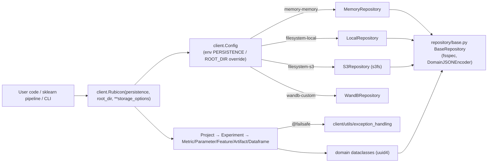

# Technical & Engineering Policy — `capitalone/rubicon-ml`

## 1. Document Overview

| Item | Value |
|---|---|
| Repository | https://github.com/capitalone/rubicon-ml |
| Commit analysed | `09fe62684c9e526a298af16937993540b8fb9401` (2026-11-17, branch `main`) |
| Date of analysis | 2026-11-18 |
| Purpose of repo | "AI/ML lifecycle metadata logger with configurable backends": logs projects, experiments, parameters, metrics, features, artifacts and dataframes to local, S3, in-memory or W&B storage [Source: `pyproject.toml` L10; `rubicon_ml/client/config.py` L15–45] |
| Audience | Contributors, reviewers, AI Pull Request Guardian |

**Scope.** Repository-evidenced rules only, not Capital One corporate policy.

**Authoritative sources.**
- `docs/source/developer-guide.rst`
- `pyproject.toml`
- `.github/workflows/test-package.yml` and `validate-pr-title.yml`
- PR templates

**Limitations.** Static analysis only. GitHub branch protection is not visible. There is no IaC or containers.

---

## 2. Technology Stack

| Technology | Role | Source |
|---|---|---|
| Python ≥3.10 (CI 3.10–3.14) | Runtime | `pyproject.toml` L17; `test-package.yml` L19 |
| setuptools ≥61; static version `0.15.4` managed by **bumpver** | Build / versioning | `pyproject.toml` L1–9, L157–167 |
| click | CLI (`rubicon_ml` → `rubicon_ml.cli:cli`) | `pyproject.toml` L36, L108 |
| fsspec (+ s3fs extra) | Filesystem abstraction for local/S3 persistence | `pyproject.toml` L37, L79–81; `repository/base.py` L45 |
| pandas, numpy, pyarrow, scikit-learn, pyyaml | Data / model logging, schema files | `pyproject.toml` L35–43 |
| intake, jsonpath-ng (extras) | Catalog publishing, JSONPath querying | `pyproject.toml` L66–71, L109–113 |
| dash, dash-bootstrap-components (`viz` extra) | Visualization dashboards | `pyproject.toml` L101–104 |
| W&B (test extra) | Optional `wandb` repository | `repository/wandb.py`; `pyproject.toml` L95 |
| uv | Env/dependency management in CI and dev | `test-package.yml` L27–40; `developer-guide.rst` L28–40 |
| pytest + pytest-cov (90% gate) | Testing | `pyproject.toml` L147–155 |
| ruff (<0.16), pyproject-fmt, pre-commit | Lint / format | `pyproject.toml` L72–78, L131–145; `.pre-commit-config.yaml` |
| edgetest | Dependency bound updates | `pyproject.toml` L169–184; `edgetest.yml` |
| Sphinx, numpydoc, nbsphinx, furo | Docs | `pyproject.toml` L56–65 |
| Databases, messaging, containers, IaC | — | **Not present** |

---

## 3. Repository Architecture

Layered **client → domain → repository** design with a pluggable persistence backend.

| Layer | Modules | Responsibility | Evidence |
|---|---|---|---|
| Client (public API) | `client/rubicon.py`, `project.py`, `experiment.py`, `artifact.py`, `dataframe.py`, `metric.py`, `parameter.py`, `feature.py`, `mixin.py`, `config.py` | User-facing objects; methods wrapped in `@failsafe` (45 uses) | `client/utils/exception_handling.py` L44–57 |
| Domain | `domain/*.py`, `domain/utils/{uuid,training_metadata}.py` | Dataclass entities with `uuid4` ids | `domain/utils/uuid.py` L4–9 |
| Repository | `repository/base.py` (`BaseRepository`), `local.py`, `s3.py`, `memory.py`, `wandb.py` | fsspec-backed persistence, JSON metadata, dataframe/artifact storage | `repository/base.py` L23–900+; `client/config.py` L37–42 |
| Repository utils | `repository/utils/json.py`, `slugify.py` | Domain JSON encoder/decoder; path slugs | `json.py` L11–82; `slugify.py` L4–10 |
| Schema | `schema/logger.py`, `schema/registry.py`, `schema/schema/*.yaml` | Schema-driven auto-logging of model attributes | `schema/registry.py` L37 |
| Integrations | `sklearn/`, `intake_rubicon/`, `viz/` | sklearn pipeline logger, intake drivers, dash dashboards | `pyproject.toml` L109–113 |

**Backend selection (ARCH-001).** `Config` maps `"<persistence>-<protocol>"` to a repository. The keys are `memory-memory`, `filesystem-local`, `filesystem-s3` and `wandb-custom`. The environment variables `PERSISTENCE` and `ROOT_DIR` **override** constructor arguments [Source: `rubicon_ml/client/config.py` L17–19, L37–42, L69–84, L98–110].



---

## 4. Coding Standards

| ID | Standard | Classification | Evidence |
|---|---|---|---|
| CODE-001 | `ruff check` must pass (default rule set, line length 100; excludes docs, notebooks, binder) | **Mandatory (CI)** | `pyproject.toml` L131–140; `test-package.yml` L41–42 |
| CODE-002 | Format with `ruff format`. CI runs `uv run ruff format` **without `--check`** (GAP-001). | Documented / weakly enforced | `test-package.yml` L43–44; `developer-guide.rst` L87–93 |
| CODE-003 | `pyproject.toml` formatted by pyproject-fmt (`column_width = 1`, indent 4) | Mandatory (pre-commit, local) | `.pre-commit-config.yaml` L2–5; `pyproject.toml` L142–145 |
| CODE-004 | **numpydoc** docstrings | Mandatory (documented) | `developer-guide.rst` L58–60 |
| CODE-005 | Public client methods are decorated with `@failsafe`, so behaviour follows the global failure mode (`raise`/`log`/`warn`) | **Convention** (45 uses) | `client/utils/exception_handling.py` L7–57 |
| CODE-006 | Raise `RubiconException` for library-level errors | Convention | `rubicon_ml/exceptions.py` L1; `client/config.py` L62–66, L104–110 |
| CODE-007 | Entity ids come from `domain.utils.uuid4()` as a dataclass default factory | Convention | `domain/utils/uuid.py` L4–9 |
| CODE-008 | Module loggers: `LOGGER = logging.getLogger(__name__)` | Convention (2 modules) | `repository/wandb.py` L16; `rubicon_ml/intake_rubicon/__init__.py` L5 |
| CODE-009 | Commit only **executed** notebooks; never commit built docs | Mandatory (documented) | `developer-guide.rst` L62–65, L80–82 |
| CODE-010 | **PR titles must follow Conventional Commits** (`build, chore, docs, feat, fix, ops, perf, refactor, release, revert, style, test`; scope optional) | **Mandatory (CI)** | `.github/workflows/validate-pr-title.yml` L1–50 |
| CODE-011 | PR body: `closes: #<issue>`, `## Changes`, `## How to Test` | Convention (template) | `.github/pull_request_template.md` L5–13 |

---

## 5. Reusable Components and Existing Capabilities

| Component | Category | File path | Responsibility | Usage guidance | Evidence |
|---|---|---|---|---|---|
| `failsafe`, `set_failure_mode(mode, traceback_chain, traceback_limit)` | Exception handling | `rubicon_ml/client/utils/exception_handling.py` | Global raise/log/warn failure policy for client calls | Decorate new public client methods. Do not write ad-hoc try/except-log blocks. | L7–57 |
| `Config` | Configuration loader / backend router | `rubicon_ml/client/config.py` | Resolves persistence + root dir (env overrides), validates, selects repository | Add new backends via `REPOSITORIES`, not `if` chains | L15–110 |
| `BaseRepository` (+ `_persist_bytes`, `_persist_domain`, `_read_bytes`, `_read_domain`, `_cat_paths`, `_ls_directories_only`, `_archive`) | Storage abstraction | `rubicon_ml/repository/base.py` | fsspec-based CRUD for every entity type | Subclass for a new backend; reuse path helpers | L23–900+ |
| `S3Repository(root_dir, **storage_options)` | Storage (S3) | `rubicon_ml/repository/s3.py` | S3 persistence through s3fs; creds via `storage_options` / environment | Use instead of raw boto3 | L7–40 |
| `DomainJSONEncoder` / `DomainJSONDecoder`, `dump/dumps/load/loads` | Serialization | `rubicon_ml/repository/utils/json.py` | JSON (de)serialization of domain objects incl. datetimes, sets, `TrainingMetadata` | Use for any metadata persistence | L11–82 |
| `slugify(value, separator)` | String utility | `rubicon_ml/repository/utils/slugify.py` | Path-safe names | Reuse for paths and keys | L4–10 |
| `uuid4()` | ID generator | `rubicon_ml/domain/utils/uuid.py` | String UUID factory | Use as `field(default_factory=uuid4)` | L4–9 |
| `TrainingMetadata` | Domain helper | `rubicon_ml/domain/utils/training_metadata.py` | Structured training-data lineage | Reuse for lineage | L6–40 |
| `TagContainer`, `has_tag_requirements`, `filter_children` | Query / filter | `rubicon_ml/client/utils/tags.py` | Tag-based filtering (`and`/`or`) | Reuse for filtering | L5–70 |
| `schema/logger.py`, `schema/registry.py` | Auto-logging | `rubicon_ml/schema/` | Schema-driven model logging (`yaml.safe_load`) | Add schemas as YAML rather than code | `registry.py` L37; `docs/source/contribute-schema.rst` |
| `RubiconPipeline`, `EstimatorLogger`, `FilterEstimatorLogger` | sklearn integration | `rubicon_ml/sklearn/` | Log sklearn pipeline params and metrics | Reuse for sklearn | `sklearn/pipeline.py` L129–204 |

---

## 6. API and Data Contracts

- Public API is the client object model (`Rubicon → Project → Experiment → …`). Release notes have a **"breaking changes"** and **"deprecations"** section, so breaking changes must be declared there [Source: `.github/PULL_REQUEST_TEMPLATE/release.md` L18–30].
- Persistence layout and JSON metadata format come from `BaseRepository` path helpers. Changing them breaks existing stored experiments (ARCH-002, inferred).
- `Artifact.get_data(deserialize=...)` supports `h2o`, `h2o_binary`, `h2o_mojo`, `pickle`, `xgboost`. `unpickle` is marked `TODO: deprecate` [Source: `rubicon_ml/client/artifact.py` L72–75, L146].
- Versioning is `MAJOR.MINOR.PATCH` via bumpver [Source: `pyproject.toml` L157–167].

---

## 7. Security Policies

| Rule ID | Rule | Severity | Enforcement | Evidence | Remediation |
|---|---|---|---|---|---|
| SEC-001 | **S3 credentials must be supplied through `storage_options` or the ambient AWS environment** (s3fs). Never hardcode them. | Critical | Design; no secret scanner | `client/config.py` L35–38, L46–58; `repository/s3.py` L23 | Pass via env/IAM; rotate leaks |
| SEC-002 | `pickle` deserialisation of artifacts happens **only on explicit opt-in** (`deserialize="pickle"` / `unpickle=True`). Do not make it the default. | High | Code | `client/artifact.py` L74–75, L146 | Keep opt-in; document trust |
| SEC-003 | YAML loaded with `yaml.safe_load` only | High | Convention | `schema/registry.py` L37; `intake_rubicon/publish.py` L98 | Use `safe_load` |
| SEC-004 | `subprocess` usage is limited to fixed-argument `git` calls (no shell) | Medium | Convention | `client/config.py` L61–66 | List args; no `shell=True` |
| SEC-005 | Pin GitHub Actions to commit SHAs | Medium | Convention | `test-package.yml` L22–28; `validate-pr-title.yml` L31–33 | Pin |
| SEC-006 | PyPI publish credentials are GitHub secrets (`PYPI_USERNAME`/`PYPI_PASSWORD`) | High | CI | `publish-package.yml` L50–51 | Keep in secrets (consider OIDC, GAP-004) |
| SEC-007 | Docs deploy uses `id-token: write` + `environment` (OIDC Pages) | Medium | CI | `publish-docs.yml` L19–21, L57 | — |

**May secrets, tokens or API keys be hardcoded?** **No evidence permits it.** Credentials reach storage through `storage_options` or the environment (SEC-001), and CI uses GitHub secrets (SEC-006). There is **no secret scanning, SAST or dependency audit** in CI.

---

## 8. Privacy and Data Protection Policies

| Rule ID | Rule | Classification | Evidence |
|---|---|---|---|
| PRIV-001 | rubicon-ml persists user-supplied dataframes and artifacts verbatim. Logging training data with customer PII stores it in the backend. **No masking or redaction capability exists.** | Observed (gap) | `repository/base.py` L599–656; `client/artifact.py` |
| PRIV-002 | In `log` failure mode, full tracebacks go to `logging.error`. Tracebacks may include argument values. | Inferred (Low) | `exception_handling.py` L54–55 |
| PRIV-003 | Don't log customer identifiers or emails as parameter/metric/tag values | **Inferred / proposed** (no repo text) | — |

Retention and access control are **not documented**. They depend on the chosen backend.

---

## 9. Testing and Quality Assurance

| Item | Detail | Classification | Evidence |
|---|---|---|---|
| Gate | `pytest --cov=./rubicon_ml --cov-fail-under=90` (via `addopts`), excluding markers `write_files` and `wandb` | **Mandatory (CI)**, 90% threshold | `pyproject.toml` L147–155; `test-package.yml` L45–46 |
| `xfail_strict = true` | Unexpected passes fail the run | Mandatory | `pyproject.toml` L155 |
| Markers | `run_notebooks`, `wandb`, `write_files` | Mandatory registration | `pyproject.toml` L150–154 |
| Coverage omits | `repository/wandb.py`; `pragma: no cover`, `TYPE_CHECKING` lines | Config | `.coveragerc` L1–11 |
| Build validation | On py3.13: build wheel, install, import | Mandatory (CI) | `test-package.yml` L47–52 |
| Commands | `uv sync --extra dev`, `uv run pytest`, `uv run ruff check --fix`, `uv run ruff format`, `uv run pre-commit run --all-files` | — | `developer-guide.rst` L40–97 |
| Layout | `tests/` (unit, integration subfolders); `conftest.py` at root | Convention | tree |

---

## 10. Dependency and Supply Chain Policies

| ID | Rule | Classification | Evidence |
|---|---|---|---|
| DEP-001 | Core deps declare both lower and upper bounds | Convention | `pyproject.toml` L35–43 |
| DEP-002 | Upper bounds are raised by edgetest (core env, `dev` extra) | Convention (automated) | `pyproject.toml` L169–184; `edgetest.yml` |
| DEP-003 | `ruff<0.16.0` pinned in `ops` extra | Config | `pyproject.toml` L77 |
| DEP-004 | Test-only pins: `dask<2025.4.0`, `polars<1.0`, `h2o<=3.46.0.11` | Config | `pyproject.toml` L83–92 |
| DEP-005 | `requirements.txt` exists alongside pyproject | Observed | repo root |

No lockfile committed, no licence policy, no vulnerability scanning documented.

---

## 11. Infrastructure and Deployment Policies

| ID | Rule | Classification | Evidence |
|---|---|---|---|
| INFRA-001 | Contributors work from a **fork** | Documented | `developer-guide.rst` L10–23 |
| INFRA-002 | Release: branch `release/vx.y.z` → `bumpver update` → PR titled `release: vx.y.z` using the release template. On merge, CI publishes to PyPI and creates the GitHub release/tag. | **Mandatory (documented + CI)** | `developer-guide.rst` L103–121; `release.md` L1–4; `publish-package.yml` L12–14 |
| INFRA-003 | CI runs on PRs to `main` and `**/integration/**` branches | CI | `test-package.yml` L10–12 |
| INFRA-004 | Docs deployed by CI only | Documented | `developer-guide.rst` L80–82 |

No containers, IaC, sizing or IAM definitions.

---

## 12. Cost and FinOps Policies

There are **no formal cost policies.** Observations (Inferred, Low):

| ID | Observation | Evidence |
|---|---|---|
| COST-001 | `write_files` and `wandb` tests are excluded by default, so CI doesn't touch S3 or W&B | `pyproject.toml` L149 |
| COST-002 | Artifacts and dataframes are persisted uncompressed as provided; storage growth is unbounded. `_archive` exists for experiments. | `repository/base.py` L305–416, L599–620 |

---

## 13. Architecture Decision Records and Historical Decisions

No ADR folder. Recorded decisions:

| Decision | Detail | Source |
|---|---|---|
| Pluggable persistence keyed by `persistence-protocol` | Adding a backend = one mapping entry + `BaseRepository` subclass | `client/config.py` L37–42 |
| Env vars override constructor | `PERSISTENCE`, `ROOT_DIR` take precedence | `client/config.py` L17–19, L73–77 |
| Global failure mode | `raise` by default; `log`/`warn` opt-in | `exception_handling.py` L7–8 |
| Conventional Commit PR titles drive release notes | Enforced by CI | `validate-pr-title.yml` |
| `unpickle` flag slated for deprecation | Move to `deserialize` | `client/artifact.py` L75 |

From GitHub history (not in repo): PR #20 ("auto versioning using git tags") was not merged, and the project uses **bumpver** with a static version instead.

---

## 14. CI/CD and Release Policies

| Control | Automated | Evidence |
|---|---|---|
| ruff check | Yes | `test-package.yml` L41–42 |
| ruff format | Runs but **does not fail** on diffs (GAP-001) | L43–44 |
| Tests + 90% coverage, Python 3.10–3.14 | Yes | L19, L45–46 |
| Build/import validation | Yes (3.13) | L47–52 |
| Conventional-commit PR title | Yes | `validate-pr-title.yml` |
| Code owners: rubicon-admin-team, rubicon-write-team, capital-one-ospo | Branch protection *unverified* | `CODEOWNERS` L1 |
| Release on merged `release:` PR | Yes | `publish-package.yml` L12–14 |
| Secret / SAST scan | **No** | — |

---

## 15. Prohibited Practices

| Rule ID | Prohibited practice | Reason | Evidence | Severity | Status |
|---|---|---|---|---|---|
| PROH-001 | Committing built documentation | CI deploys docs | `developer-guide.rst` L80–82 | Low | **Documented ("Never")** |
| PROH-002 | Committing un-executed notebooks | Docs build doesn't execute them | `developer-guide.rst` L62–65 | Low | Documented |
| PROH-003 | Non-conventional PR titles | CI check | `validate-pr-title.yml` | Low | **Enforced** |
| PROH-004 | Coverage below 90% | pytest addopts | `pyproject.toml` L149 | Medium | **Enforced** |
| PROH-005 | Defaulting artifact deserialisation to pickle | RCE risk | `client/artifact.py` L74–75 | High | *Proposed review recommendation* |
| PROH-006 | Hardcoded S3/W&B credentials | — | `client/config.py` L35–38 | Critical | *Proposed review recommendation* |
| PROH-007 | Ad-hoc try/except-log in client methods instead of `@failsafe` | Inconsistent failure mode | `exception_handling.py` | Medium | *Proposed review recommendation* |

---

## 16. Policy Registry

| ID | Category | Rule | Classification | Severity | Violation looks like | Evidence | Check | Remediation | Confidence |
|---|---|---|---|---|---|---|---|---|---|
| SEC-001 | Security | No hardcoded storage creds | Inferred (design) | Critical | `key=`, `secret=`, `AKIA…`, W&B API key literal | `client/config.py` L35–58 | D (Gitleaks) | `storage_options` from env | Medium |
| SEC-002 | Security | Pickle opt-in only | Convention | High | `pickle.loads` in default path | `client/artifact.py` L146 | D (Bandit B301) + AI | Keep explicit | High |
| SEC-003 | Security | `yaml.safe_load` | Convention | High | `yaml.load(` | `schema/registry.py` L37 | D (Bandit B506) | safe_load | High |
| SEC-004 | Security | No shell subprocess | Convention | Medium | `shell=True` | `config.py` L63 | D (Bandit B602) | List args | High |
| SEC-006 | Supply chain | Publish creds in secrets | Mandatory (CI) | High | Literal in workflow | `publish-package.yml` L50–51 | D | Secrets/OIDC | High |
| PRIV-003 | Privacy | No PII in logged params/tags | Proposed | High | `log_parameter("customer_email", ...)`, `logging.info(customer_id)` | — | AI + Semgrep | Hash/omit | Low |
| CODE-001 | Quality | ruff check | Mandatory | Medium | CI fail | `test-package.yml` L41–42 | D | Fix | High |
| CODE-004 | Quality | numpydoc docstrings | Mandatory (documented) | Low | Missing/other style | `developer-guide.rst` L58 | AI | Add docstring | Medium |
| CODE-005 | Reuse | `@failsafe` on client methods | Convention | Medium | New public client method without decorator | `exception_handling.py` | D (AST) + AI | Add decorator | Medium |
| CODE-006 | Errors | `RubiconException` | Convention | Low | Bare `Exception` | `exceptions.py` L1 | AI | Use it | Medium |
| CODE-010 | Process | Conventional PR title | Mandatory | Low | `Update stuff` | `validate-pr-title.yml` | D | Rename | High |
| ARCH-001 | Architecture | New backends via `Config.REPOSITORIES` + `BaseRepository` | Convention | Medium | New storage path bypassing repository | `config.py` L37–42 | AI | Subclass | High |
| TEST-001 | Testing | ≥90% coverage, xfail strict | Mandatory | Medium | Coverage drop | `pyproject.toml` L149–155 | D | Add tests | High |
| INFRA-002 | Release | `release/vx.y.z` + bumpver + release PR | Mandatory | Medium | Manual version edit | `developer-guide.rst` L103–121 | D + AI | Use bumpver | High |
| REUSE-001 | Reuse | Don't reimplement §5 | Proposed | Medium | New slugify/uuid/JSON encoder/tag filter | §5 | AI | Call helper | Medium |

```python
# CODE-005 / PROH-007 — non-compliant
def log_thing(self, x):
    try: ...
    except Exception as e: logging.error(e)
# compliant
@failsafe
def log_thing(self, x): ...
```

---

## 17. Gaps, Ambiguities and Conflicts

| ID | Issue | Files | Needs human input because |
|---|---|---|---|
| GAP-001 | CI step "Check format with ruff" runs `ruff format` (rewrites) instead of `ruff format --check`, so unformatted code passes CI | `test-package.yml` L43–44 | Formatting is not actually gated |
| GAP-002 | Ruff pinned `<0.16.0` in `ops` extra while pre-commit uses `v0.12.4` | `pyproject.toml` L77; `.pre-commit-config.yaml` L7 | Version drift |
| GAP-003 | `developer-guide.rst` tells contributors they can skip hooks with `git commit --no-verify` | `developer-guide.rst` L98 | Combined with GAP-001, formatting can slip |
| GAP-004 | PyPI publish uses username/password secrets. Sister repos use OIDC. | `publish-package.yml` L50–51 | Org standard unclear |
| GAP-005 | No PII masking for logged dataframes/artifacts | `repository/base.py` | Privacy expectations undefined |
| GAP-006 | No SECURITY.md, CONTRIBUTING.md (guide is in docs), secret scanning or SAST | repo root | Org controls outside repo |
| GAP-007 | `MemoryRepository` uses pickle for dataframes (in-memory fs) | `repository/memory.py` L44–51 | Probably acceptable; confirm |

---

## 18. Source Inventory and Evidence

Files inspected (≈30): `README.md`, `CODEOWNERS`, `pyproject.toml`, `requirements.txt`, `.coveragerc`, `.pre-commit-config.yaml`, `.github/pull_request_template.md`, `.github/PULL_REQUEST_TEMPLATE/release.md`, `.github/workflows/{test-package,validate-pr-title,publish-package,publish-docs,edgetest}.yml`, `docs/source/{developer-guide,contribute-schema,backend-repositories}.rst`, `rubicon_ml/client/{config,artifact}.py`, `rubicon_ml/client/utils/{exception_handling,tags}.py`, `rubicon_ml/domain/utils/{uuid,training_metadata}.py`, `rubicon_ml/repository/{base,s3,memory,wandb}.py`, `rubicon_ml/repository/utils/{json,slugify}.py`, `rubicon_ml/schema/registry.py`, `rubicon_ml/intake_rubicon/{__init__,publish}.py`, `rubicon_ml/exceptions.py`, `rubicon_ml/sklearn/pipeline.py`.

---

## Analysis Summary

| Metric | Count |
|---|---|
| Files inspected | ~30 |
| Policies in registry | 15 |
| Mandatory | 7 |
| Conventions | 5 |
| Inferred / proposed | 3 |
| Security policies | 7 |
| Privacy policies | 3 |
| Cost / infra policies | 2 COST + 4 INFRA |
| Unresolved gaps / conflicts | 7 |
