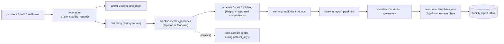

# Technical & Engineering Policy — `ing-bank/popmon`

## 1. Document Overview

| Item | Value |
|---|---|
| Repository | https://github.com/ing-bank/popmon |
| Commit analysed | `af654436f9c4195cc105735169d5e0595fe5b16e` (2026-01-09, default branch `master`) |
| Date of analysis | 2026-11-18 |
| Purpose of repo | "Monitor the stability of a pandas or spark dataset": histograms over time, statistical comparisons, traffic-light alerts, HTML stability reports. Authored by ING Analytics Wholesale Banking. [Source: `pyproject.toml` L7, L21; README.rst L14] |
| Audience | Contributors, reviewers, AI Pull Request Guardian |

**Scope.** Repository-evidenced rules only. This does not create ING policy.

**Authoritative sources.**
- `pyproject.toml`, which uses the ruff `ALL` rule set.
- `.pre-commit-config.yaml`.
- `.github/workflows/{build,codeql-analysis,commit,release}.yml`.
- `commitlint.config.js`.
- `docs/source/developing.rst`.

**Limitations.** Static analysis only. Branch protection is not visible. The last commit is from 2026-01-09, so some tooling is old (see §17).

---

## 2. Technology Stack

| Technology | Role | Source |
|---|---|---|
| Python ≥3.9 (CI 3.9–3.13) | Runtime | `pyproject.toml` L20; `build.yml` L13 |
| setuptools; version from `popmon/version.py`; python-semantic-release config | Build / versioning | `pyproject.toml` L1–3, L205–213 |
| numpy, pandas, scipy, histogrammar, phik, joblib | Histogramming and statistics | `pyproject.toml` L23–33 |
| jinja2, plotly, htmlmin2 | HTML report rendering | `pyproject.toml` L29–33; `popmon/resources.py` L43–47 |
| pydantic ≥2, pydantic-settings | Typed, validated configuration (`Settings`) | `pyproject.toml` L34–35; `popmon/config.py` L34–38, L297 |
| PySpark (CI: 3.3.2, 3.5.4, 4.0.0, 4.1.0) | Optional Spark backend | `build.yml` L39–124 |
| pytest, pytest-notebook, pytest-spark | Tests | `pyproject.toml` L46–52, L193–203 |
| pre-commit: black 23.7.0, ruff v0.0.278, blacken-docs, nbQA, docs autogenerate | QA | `.pre-commit-config.yaml` L1–27 |
| **CodeQL** (Python) | SAST | `.github/workflows/codeql-analysis.yml` |
| commitlint (conventional) | Commit message lint | `commitlint.config.js` L1–5; `commit.yml` |
| Dependabot (pip, daily, → `develop`) | Dependency updates | `.github/dependabot.yml` L1–18 |
| Read the Docs (Sphinx) | Docs | `.readthedocs.yml`; `docs/source/` |
| Databases, messaging, containers, IaC | — | **Not present** |

---

## 3. Repository Architecture

The design is a **pipeline of modules over a shared datastore**.

| Package | Responsibility | Evidence |
|---|---|---|
| `popmon/base/` | `Module` ABC (inputs/outputs, `logger`, datastore access), `Pipeline`, `Registry` (metric/comparison registration with `dim`/`htype`) | `module.py` L27–130; `pipeline.py` L24; `registry.py` L25–60 |
| `popmon/pipeline/` | End-to-end pipelines (`metrics_pipelines`, `report_pipelines`, `amazing_pipeline` CLI entry), dataset splitting, timing | `pyproject.toml` L72–73 |
| `popmon/hist/` | Histogram filling, splitting, utilities | `hist_utils.py` L48–318 |
| `popmon/analysis/`, `popmon/stats/`, `popmon/stitching/` | Profiles, comparisons, statistical tests, histogram stitching | directory tree |
| `popmon/alerting/` | Traffic-light bounds and alert summaries | `compute_tl_bounds.py`, `alerts_summary.py` |
| `popmon/visualization/` | Section generators, report generator, plotly helpers, Jinja2 templates | `visualization/utils.py`; `report_generator.py` |
| `popmon/decorators/` | `pandas` / `spark` DataFrame accessors (e.g. `df.pm_stability_report`) | `decorators/pandas.py`, `spark.py` |
| `popmon/io/` | `FileReader`, `FileWriter`, `JsonReader` modules | `io/*.py` L28–29 |
| `popmon/config.py` | Pydantic `Settings` tree (report, comparison, monitoring, time axis, reference type, features); global `parallel_args` | L28–31, L34–330 |
| `popmon/resources.py` | Packaged data/notebook/template lookup; Jinja2 env (`autoescape=True`) | L43–47, L75–135 |



---

## 4. Coding Standards

| ID | Standard | Classification | Evidence |
|---|---|---|---|
| CODE-001 | `make lint` (= `pre-commit run --all-files`) must pass in CI | **Mandatory (CI)** | `build.yml` L32–34; `Makefile` L1–2 |
| CODE-002 | **ruff with `select = ["ALL", "CPY001"]`** minus the explicit ignore list. This includes the `S` (flake8-bandit), `T20` (print), `PTH`, `PL`, `RUF` families. Line length 120. | **Mandatory** (pre-commit in CI) | `pyproject.toml` L75–129 |
| CODE-003 | **Every source file must carry the copyright notice** matching `Copyright (c) 2023 ING Analytics Wholesale Banking` (CPY001). Tests, docs, tools, examples and notebooks are exempt. | **Mandatory** (ruff) | `pyproject.toml` L79, L147–148, L190–191; e.g. `popmon/utils.py` L1 |
| CODE-004 | Format with black (incl. docs code blocks via blacken-docs, notebooks via nbQA) | Mandatory | `.pre-commit-config.yaml` L2–14, L22–27 |
| CODE-005 | Docs API pages are regenerated by the `docautogenerate` hook (`docs/autogenerate.sh`) | Mandatory (hook) | `.pre-commit-config.yaml` L15–21 |
| CODE-006 | `print` is prohibited in package code (T201 via `ALL`). It's allowed only in `examples/*` and `popmon/notebooks/*`. | **Mandatory (ruff)** | `pyproject.toml` L155–157, L172–178; 0 `print(` calls in `popmon/**` outside notebooks |
| CODE-007 | Commit messages follow **Conventional Commits** (`@commitlint/config-conventional`; footer lines ≤100 chars, warning level) | **Mandatory (CI on PRs)** | `commitlint.config.js` L1–5; `.github/workflows/commit.yml` |
| CODE-008 | Pipeline steps subclass `Module`, declare inputs/outputs, and use `self.logger` (settable via `set_logger`) | Convention | `popmon/base/module.py` L89–130 |
| CODE-009 | New metrics/comparisons are registered through a `Registry.register(key, description, dim, htype)` decorator | Convention | `popmon/base/registry.py` L25–60 |
| CODE-010 | Configuration is a typed pydantic model with `validate_default` and `validate_assignment`. Add settings as typed fields with docstrings. | Convention | `popmon/config.py` L34–38, L297–330 |
| CODE-011 | Docstrings use reST `:param ...:` style (`D` rules are ignored, so this isn't enforced) | Inferred | `popmon/resources.py` L117–123; `pyproject.toml` L97 |
| CODE-012 | f-strings in logging are allowed (`G004` ignored) | Config | `pyproject.toml` L127 |

---

## 5. Reusable Components and Existing Capabilities

| Component | Category | File path | Responsibility | Usage guidance | Evidence |
|---|---|---|---|---|---|
| `parallel(func, args_list, mode)` + `config.parallel_args` | Parallelism | `popmon/utils.py`, `popmon/config.py` | joblib parallel map honouring the global `n_jobs` (default 1) | Use for any fan-out. Don't instantiate `Parallel` directly. | `utils.py` L65–80; `config.py` L28–31 |
| `filter_metrics`, `short_date` | Utilities | `popmon/utils.py` | Metric list filtering; date formatting | Reuse | L30–64 |
| `hist_utils` (`sum_entries`, `project_on_x`, `sum_over_x`, `project_split2dhist_on_axis`, `get_histogram`, `is_timestamp`, `is_numeric`, `get_bin_centers`, `split_hist_along_first_dimension`) | Histogram helpers | `popmon/hist/hist_utils.py` | Histogram arithmetic and inspection | **Use for any histogram manipulation** | L48–318 |
| `Module`, `datastore_helper`, `Pipeline` | Pipeline framework | `popmon/base/module.py`, `pipeline.py` | Composable steps over a datastore with logging | Subclass `Module` for new steps | `module.py` L27–130; `pipeline.py` L24 |
| `Registry` | Plugin registry | `popmon/base/registry.py` | Registers profiles/comparisons by key, dimension, histogram type | Register new statistics here | L25–60 |
| `Settings` (+ `Report`, `Comparison`, `Monitoring`, section models) | Configuration / validation | `popmon/config.py` | Validated config tree | Extend with typed fields | L34–330 |
| `resources.templates_env`, `data`, `notebook` | Templating / resource loader | `popmon/resources.py` | Jinja2 env with `autoescape=True`; packaged data paths | Use for any HTML rendering or resource lookup | L43–47, L94–135 |
| `visualization.utils` (`plot_bars`, `plot_heatmap`, `plot_histogram_overlay`, `plot_traffic_lights_*`, `get_summary_table`, `get_reproduction_table`, `convert_time_delta`) | Report builders | `popmon/visualization/utils.py` | Plotly figure and table builders | Reuse for new report sections | L42–800 |
| `FileReader`, `FileWriter`, `JsonReader` | I/O modules | `popmon/io/` | Read/write as pipeline modules | Reuse in pipelines | `file_reader.py` L28; `file_writer.py` L29; `json_reader.py` L28 |
| Alert bounds (`compute_tl_bounds`), `alerts_summary` | Alerting | `popmon/alerting/` | Traffic-light thresholds and summaries | Reuse for new alert types | files |

---

## 6. API and Data Contracts

- Public entry points: `df.pm_stability_report(...)` (pandas/Spark accessors), `popmon.stability_report`, `Settings`, and the `popmon_run` console script [Source: `pyproject.toml` L72–73; `popmon/decorators/`].
- The `Settings` field names and types are the configuration contract. `validate_assignment=True` means invalid values raise [Source: `popmon/config.py` L34–38].
- Versioning is semantic-release driven (`version_variable = popmon/version.py:version`) [Source: `pyproject.toml` L205–209].
- Release notes live in `CHANGELOG.md` (`CHANGES.rst` is legacy) [Source: `CHANGES.rst` L5].
- No HTTP API, DB schema or migrations.

---

## 7. Security Policies

| Rule ID | Rule | Severity | Enforcement | Evidence | Remediation |
|---|---|---|---|---|---|
| SEC-001 | **Bandit-style checks are part of lint.** ruff `ALL` enables the `S` family, including S105/S106/S107 hardcoded passwords, S307 eval, S506 unsafe YAML and S603/S602 subprocess. Only `S101` (assert) and `S301` (pickle) are ignored. | High | **ruff via pre-commit in CI** (version caveat, GAP-001) | `pyproject.toml` L79–91; `build.yml` L32–34 | Fix the finding; don't add `# noqa` without justification |
| SEC-002 | **CodeQL static analysis** on pushes to `master`/`develop`, PRs to `master`, and weekly (Tue 11:22 UTC) | High | CI (uses deprecated `@v1` actions, GAP-002) | `codeql-analysis.yml` L3–60 | Keep enabled; upgrade actions |
| SEC-003 | Jinja2 templates render with `autoescape=True` | High | Code (single env) | `popmon/resources.py` L43–46 | Use `templates_env` |
| SEC-004 | PyPI publish token is a GitHub secret (`PYPI_TOKEN`) | High | CI | `release.yml` L14–17 | Keep secret / move to OIDC |
| SEC-005 | Pickle use is explicitly tolerated (S301 ignored). Don't unpickle untrusted input in new code. | Medium | Config shows a conscious exception | `pyproject.toml` L87 | Prefer JSON |

**May secrets, tokens or API keys be hardcoded?** **No.** ruff `S105`/`S106`/`S107` (enabled through `ALL`) flags hardcoded passwords as a lint failure in CI, and the publish token is a GitHub secret. There is no dedicated secret scanner (e.g. Gitleaks). **Observation:** `pyproject.toml` hardcodes a private IP (`spark.driver.host = "192.168.1.78"`) in the pytest Spark options. It isn't a secret, but it is environment-specific configuration (GAP-004).

---

## 8. Privacy and Data Protection Policies

| Rule ID | Rule | Classification | Evidence |
|---|---|---|---|
| PRIV-001 | popmon works on **aggregated histograms**, not rows. Reports contain distributions and statistics. | Architectural (observed) | README.rst L14; `popmon/hist/` |
| PRIV-002 | Histograms of high-cardinality identifier columns (customer IDs, emails) would surface those values as bin labels in the HTML report. Callers should exclude them via `Settings.features`. | **Inferred** | `config.py` L318–330 |
| PRIV-003 | Logging uses the root logger (`logging.getLogger()`), and `metrics.py` calls `logging.basicConfig` at import time | Observed (GAP-005) | `pipeline/metrics.py` L29–32; `visualization/utils.py` L38 |

There is no masking, retention or access policy in the repo.

---

## 9. Testing and Quality Assurance

| Item | Detail | Classification | Evidence |
|---|---|---|---|
| Unit tests | `pytest -m "not spark"` on Python 3.9–3.13 | **Mandatory (CI)** | `build.yml` L9–37 |
| Spark tests | `pytest -m spark` on 4 Spark/Python/Java combos with pandas/numpy constraints | Mandatory (CI) | `build.yml` L39–124 |
| Examples | Example scripts must generate HTML reports (`if-no-files-found: error`). Runs after tests. | Mandatory (CI) | `build.yml` L126–166 |
| Rule TEST-001 | "When contributing all unit tests have to run successfully." | **Mandatory (documented)** | `docs/source/developing.rst` L43 |
| Layout | `tests/popmon/<package>/test_*.py`; `conftest.py` | Convention | tree |
| Coverage | **No coverage measurement or threshold** | — | — |

---

## 10. Dependency and Supply Chain Policies

| ID | Rule | Classification | Evidence |
|---|---|---|---|
| DEP-001 | Core deps are mostly **floor-only or unpinned** (`phik`, `jinja2`, `tqdm`, `plotly`, `htmlmin2`, `pydantic-settings`) | Observed | `pyproject.toml` L23–37 |
| DEP-002 | Dependabot: pip, **daily** at 04:00, up to 10 PRs, targeting `develop`, direct and indirect deps | Automated | `.github/dependabot.yml` L3–12 |
| DEP-003 | Known-bad `histogrammar` versions 1.0.20, 1.0.21, 1.0.23 are ignored | Config | `.github/dependabot.yml` L13–18 |
| DEP-004 | `requirements.txt` exists alongside pyproject | Observed | repo root |

No lockfile or licence policy. Project licence is MIT [Source: `pyproject.toml` L22].

---

## 11. Infrastructure and Deployment Policies

| ID | Rule | Classification | Evidence |
|---|---|---|---|
| INFRA-001 | Branches: `master` (release) and `develop` (integration, Dependabot target). CI on push to both and on all PRs. | Config | `build.yml` L3–6; `dependabot.yml` L9 |
| INFRA-002 | Publishing on GitHub release `published`: `python -m build` then `pypa/gh-action-pypi-publish@release/v1` with `PYPI_TOKEN` | CI | `release.yml` L1–17 |
| INFRA-003 | Discuss changes with owners (issue/email) before making them | Documented | `docs/source/developing.rst` L39–41 |
| INFRA-004 | Changelog generated with `npm run release` | Documented (Makefile) | `Makefile` L7–8 |

No containers, IaC, sizing or IAM.

---

## 12. Cost and FinOps Policies

There are **no formal cost policies.** Observed:

| ID | Observation | Classification | Evidence |
|---|---|---|---|
| COST-001 | Parallelism is **off by default** (`parallel_args = {"n_jobs": 1}`) and must be enabled explicitly | Config | `popmon/config.py` L28–31 |
| COST-002 | CI caches pip and the Spark tarball to avoid repeated downloads | Convention | `build.yml` L22–27, L76–94 |
| COST-003 | Report sections allow `last_n`/skip pruning, which bounds report size | Inferred | `visualization/utils.py` L797 (`_prune`) |

---

## 13. Architecture Decision Records and Historical Decisions

No ADR folder. Decisions found:

| Decision | Detail | Source |
|---|---|---|
| Lint with ruff `ALL` and an explicit ignore list | Opt-out rather than opt-in, with reasons commented | `pyproject.toml` L79–129 |
| Pickle tolerated | S301 ignored ("Not sure if these are helpful") | `pyproject.toml` L84–87 |
| Pydantic settings (v2) | Typed validated config | `config.py` |
| Conventional commits + semantic release | Automates versioning | `commitlint.config.js`; `pyproject.toml` L205–209 |

From GitHub history (not in repo): PR #60 ("Imports Optimized") was rejected because "this project is already using isort, but with the flag `--profile black`". That is precedent for rejecting **duplicate tooling** changes.

---

## 14. CI/CD and Release Policies

| Control | Automated | Evidence |
|---|---|---|
| pre-commit lint (black, ruff ALL incl. S, blacken-docs, nbQA, docs autogen) | Yes | `build.yml` L32–34 |
| Unit + Spark + examples jobs | Yes | `build.yml` |
| CodeQL SAST | Yes | `codeql-analysis.yml` |
| Commit lint | Yes (PRs) | `commit.yml` |
| Dependabot | Yes | `dependabot.yml` |
| Release → PyPI | Yes | `release.yml` |
| CODEOWNERS | **Absent** | — |
| Coverage gate | **No** | — |

---

## 15. Prohibited Practices

| Rule ID | Prohibited practice | Reason | Evidence | Severity | Status |
|---|---|---|---|---|---|
| PROH-001 | Hardcoded passwords/secrets (S105/S106/S107) | Bandit rules via ruff ALL | `pyproject.toml` L79 | Critical | **Enforced (lint)** |
| PROH-002 | `print` in package code | T201 | `pyproject.toml` L79, L155–178 | Low | **Enforced** |
| PROH-003 | Source file without the ING copyright header | CPY001 | `pyproject.toml` L190–191 | Low | **Enforced** |
| PROH-004 | Non-conventional commit messages | commitlint | `commit.yml` | Low | **Enforced** |
| PROH-005 | `eval`/unsafe YAML/shell subprocess | S307/S506/S602 | `pyproject.toml` L79 | High | **Enforced (lint)** |
| PROH-006 | Changes without prior discussion with owners | Governance | `developing.rst` L39–41 | Low | Documented |
| PROH-007 | Re-implementing histogram/parallel/template helpers | Duplication | §5 | Medium | *Proposed review recommendation* |
| PROH-008 | Duplicate tooling (e.g. a second import sorter) | Precedent PR #60 | — | Low | *Proposed review recommendation* |

---

## 16. Policy Registry

| ID | Category | Rule | Classification | Severity | Violation looks like | Evidence | Check | Remediation | Confidence |
|---|---|---|---|---|---|---|---|---|---|
| SEC-001 | Security | ruff `S` rules pass | Mandatory | High | `password = "x"`, `eval(`, `yaml.load(`, `shell=True` | `pyproject.toml` L79–91 | D | Fix | High |
| SEC-002 | Security | CodeQL clean | Mandatory (CI) | High | CodeQL alert | `codeql-analysis.yml` | D | Fix | Medium (deprecated action) |
| SEC-003 | Security | Jinja2 autoescape | Convention | High | New `Environment(` without autoescape | `resources.py` L43–46 | D (Bandit B701) | Use `templates_env` | High |
| SEC-004 | Supply chain | Publish token in secrets | Mandatory (CI) | High | Literal token | `release.yml` L17 | D | Secret/OIDC | High |
| PRIV-002 | Privacy | Exclude identifier columns from reports | Inferred | High | Report on `customer_id`/`email` features; logging identifiers | `config.py` L318–330 | AI | Set `features` | Low |
| CODE-002 | Quality | ruff ALL passes | Mandatory | Medium | Lint fail | `pyproject.toml` L75–129 | D | Fix | High |
| CODE-003 | Legal | Copyright header | Mandatory | Low | Missing header in `popmon/**/*.py` | `pyproject.toml` L190–191 | D | Add header | High |
| CODE-006 | Quality | No print | Mandatory | Low | `print(` in `popmon/` | `pyproject.toml` L79 | D | logger | High |
| CODE-007 | Process | Conventional commits | Mandatory | Low | `fixed stuff` | `commitlint.config.js` | D | Reword | High |
| CODE-008 | Architecture | New pipeline steps subclass `Module` | Convention | Medium | Ad-hoc function chain in pipeline | `base/module.py` L89 | AI | Subclass | Medium |
| CODE-009 | Architecture | Register stats via `Registry` | Convention | Medium | Hard-coded dispatch | `base/registry.py` | AI | Register | Medium |
| CODE-010 | Config | Typed pydantic settings | Convention | Medium | Untyped dict config | `config.py` L34–38 | AI | Add field | Medium |
| TEST-001 | Testing | All unit tests pass | Mandatory | Medium | CI fail | `developing.rst` L43; `build.yml` | D | Fix | High |
| COST-001 | FinOps | Use `parallel()`; keep `n_jobs` default 1 | Convention | Low | `Parallel(n_jobs=-1)` hard-coded | `config.py` L31; `utils.py` L65 | D + AI | `parallel()` | Medium |
| REUSE-001 | Reuse | Don't reimplement §5 | Proposed | Medium | New histogram projection / bin-centre / joblib wrapper | §5 | AI | Call helper | Medium |

```python
# COST-001 / REUSE-001 non-compliant
from joblib import Parallel, delayed
out = Parallel(n_jobs=-1)(delayed(f)(a) for a in args)
# compliant
from popmon.utils import parallel
out = parallel(f, [(a,) for a in args])
```

---

## 17. Gaps, Ambiguities and Conflicts

| ID | Issue | Files | Needs human input because |
|---|---|---|---|
| GAP-001 | pre-commit pins **ruff v0.0.278** (2023) and nbQA uses ruff 0.0.277, while `pyproject.toml` uses `[tool.ruff]` top-level `select`/`ignore` (deprecated layout). Rule coverage depends on that old version. | `.pre-commit-config.yaml` L6–10, L27; `pyproject.toml` L75–129 | Upgrade could surface many new findings |
| GAP-002 | CodeQL uses **`github/codeql-action/*@v1`**, which GitHub has deprecated. The scan may not run. | `codeql-analysis.yml` L35, L46, L60 | Verify SAST is actually executing |
| GAP-003 | Actions pinned to tags (`checkout@v2`, `setup-python@v1`, `commitlint-github-action@v3`, `gh-action-pypi-publish@release/v1`), not SHAs; several are very old | workflows | Supply-chain policy undefined |
| GAP-004 | Hardcoded private IP `spark.driver.host = "192.168.1.78"` in pytest Spark options | `pyproject.toml` L202 | Environment leakage / brittle tests |
| GAP-005 | `pipeline/metrics.py` calls `logging.basicConfig` at import time, configuring the host application's root logger | `pipeline/metrics.py` L29–32 | Libraries normally shouldn't |
| GAP-006 | Ruff `target-version = "py37"` but `requires-python >= 3.9` | `pyproject.toml` L20, L76 | Mismatch |
| GAP-007 | `developing.rst` clones `github.com/popmon/popmon.git` and runs `pip install -r .[test]` (invalid). The repo is `ing-bank/popmon`. | `docs/source/developing.rst` L13, L30 | Stale instructions |
| GAP-008 | No CODEOWNERS, PR template, coverage gate or SECURITY.md | repo root | Review/ownership undefined |
| GAP-009 | Copyright regex hardcodes year 2023 | `pyproject.toml` L191 | New files must use 2023 to pass |

---

## 18. Source Inventory and Evidence

Files inspected (≈30): `README.rst`, `CHANGES.rst`, `LICENSE`, `NOTICE` (listed), `Makefile`, `pyproject.toml`, `requirements.txt`, `commitlint.config.js`, `.pre-commit-config.yaml`, `.readthedocs.yml` (listed), `.github/dependabot.yml`, `.github/workflows/{build,codeql-analysis,commit,release}.yml`, `docs/source/developing.rst`, `popmon/{config,utils,resources}.py`, `popmon/base/{module,pipeline,registry}.py`, `popmon/hist/hist_utils.py`, `popmon/visualization/utils.py`, `popmon/pipeline/metrics.py`, `popmon/io/*.py`, `popmon/decorators/*` (listed), `tests/popmon/` (tree).

---

## Analysis Summary

| Metric | Count |
|---|---|
| Files inspected | ~30 |
| Policies in registry | 15 |
| Mandatory | 9 |
| Conventions | 4 |
| Inferred / proposed | 2 |
| Security policies | 5 |
| Privacy policies | 3 |
| Cost / infra policies | 3 COST + 4 INFRA |
| Unresolved gaps / conflicts | 9 |
