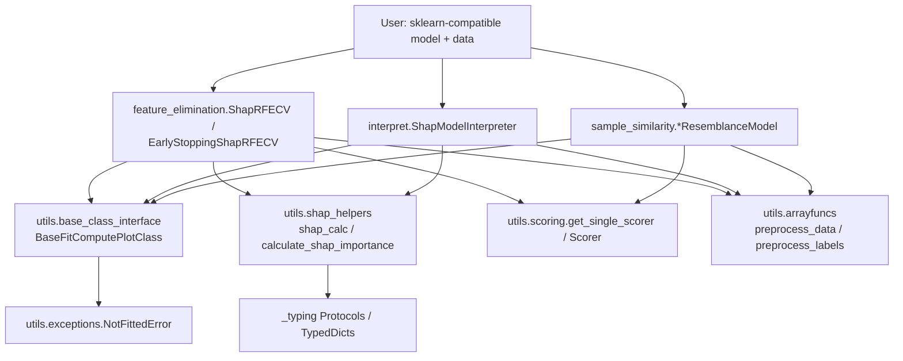

# Technical & Engineering Policy — `ing-bank/probatus`

## 1. Document Overview

| Item | Value |
|---|---|
| Repository | https://github.com/ing-bank/probatus |
| Commit analysed | `6ed08aaf1a685d21c1256e302f8ef0ba9a494f50` (2026-11-06, branch `main`) |
| Date of analysis | 2026-11-18 |
| Purpose of repo | "Validation of regression & classifiers and data used to develop them": SHAP-based feature elimination, model interpretation, sample similarity. Started as a side project of ING Bank data scientists. [Source: `pyproject.toml` L9; `VISION.md` L7–13] |
| Audience | Contributors, reviewers, AI Pull Request Guardian |

**Scope.** Repository-evidenced rules only. This does not create ING Bank policy.

**Authoritative sources.**
- `CONTRIBUTING.md`, which is detailed and explicit.
- `pyproject.toml`.
- `.pre-commit-config.yaml`.
- `scripts/check.py`, the single command shared by CI and local runs.
- `.github/workflows/*`.

**Limitations.** Static analysis only. Branch protection is not visible. There is no infrastructure or service deployment.

---

## 2. Technology Stack

| Technology | Role | Source |
|---|---|---|
| Python ≥3.10 (CI 3.10–3.14 on Linux, macOS, Windows) | Runtime | `pyproject.toml` L8; `.github/workflows/checks.yml` L22–24 |
| setuptools | Build | `pyproject.toml` L1–3 |
| scikit-learn, pandas, numpy, matplotlib, joblib, shap (0.49.x on py3.10 / ≥0.50 on ≥3.11) | Core | `pyproject.toml` L29–38 |
| lightgbm, catboost, xgboost (version-split by Python) | Test/dev model integrations | `pyproject.toml` L60–65 |
| **uv** 0.12.7 + committed `uv.lock` | Env and lockfile | `CONTRIBUTING.md` L23, L35; `checks.yml` L30–33 |
| ruff (lint + format, Python, notebooks, Markdown) | QA | `pyproject.toml` L105–124; `.pre-commit-config.yaml` L31–44 |
| mypy (`disallow_untyped_defs` for `probatus.*`) + nbQA-mypy | Type checking | `pyproject.toml` L81–93; `.pre-commit-config.yaml` L16–30 |
| codespell | Spelling | `.pre-commit-config.yaml` L45–52 |
| pytest + pytest-cov (branch coverage) + Codecov | Tests | `scripts/check.py` L26; `pyproject.toml` L98–103; `checks.yml` L39–46 |
| mkdocs + material + mkdocstrings + mkdocs-jupyter | Docs | `pyproject.toml` L67–73; `CONTRIBUTING.md` L137–141 |
| Dependabot (pip, weekly) | Dependency updates | `.github/dependabot.yml` L6–11 |
| Databases, messaging, containers, IaC | — | **Not present** |

---

## 3. Repository Architecture

| Package | Responsibility | Evidence |
|---|---|---|
| `probatus/feature_elimination/` | `ShapRFECV`, `EarlyStoppingShapRFECV`: recursive feature elimination using SHAP importance with CV | `feature_elimination.py`, `early_stopping_feature_elimination.py` |
| `probatus/interpret/` | `ShapModelInterpreter`, `DependencePlotter` | `model_interpret.py`, `shap_dependence.py` |
| `probatus/sample_similarity/` | Resemblance models (train vs test distribution shift) | `resemblance_model.py` |
| `probatus/utils/` | Shared base classes, array coercion, scoring, SHAP helpers, exceptions | see §5 |
| `probatus/_typing.py` | Protocols and TypedDicts (`Estimator`, `ShapExplainer`, `CVSplitter`, option dicts) | L30–200 |

**API contract (ARCH-001, Mandatory).** Every class implements `fit()`, `compute()` and `fit_compute()`. `plot()` is added where applicable. `compute()` and `plot()` must check the object is fitted first. Modules have a base class plus specialised subclasses [Source: `CONTRIBUTING.md` L127–132; `probatus/utils/base_class_interface.py` L16–58].



---

## 4. Coding Standards

| ID | Standard | Classification | Evidence |
|---|---|---|---|
| CODE-001 | `ruff check` with rules E4, E7, E9, F, I, UP, TID251; line length 120; target py310 | **Mandatory** (pre-commit + `scripts/check.py` in CI) | `pyproject.toml` L105–124; `.pre-commit-config.yaml` L33–38 |
| CODE-002 | `ruff format` for Python, notebooks **and Markdown** | Mandatory | `.pre-commit-config.yaml` L39–44 |
| CODE-003 | **`typing.Any` is banned.** Use concrete types, protocols, generics or typed option dicts from `probatus._typing`. | **Mandatory (ruff TID251)** | `pyproject.toml` L117–118; `CONTRIBUTING.md` L92–93 |
| CODE-004 | Every function in `probatus/`, including private helpers, must be annotated (`disallow_untyped_defs`, `check_untyped_defs`). mypy also runs on notebooks via nbQA. | **Mandatory** | `pyproject.toml` L81–93; `CONTRIBUTING.md` L88–98 |
| CODE-005 | **Google docstring format**. The docstring must come first in the module (`check-docstring-first`). | Mandatory (documented + hook) | `CONTRIBUTING.md` L118; `.pre-commit-config.yaml` L10–11; `tests/docs/test_docstring.py` |
| CODE-006 | PEP 8 except line length | Documented | `CONTRIBUTING.md` L117 |
| CODE-007 | codespell passes on Python files | Mandatory (hook) | `.pre-commit-config.yaml` L45–52 |
| CODE-008 | Commit messages: what + why, present tense, imperative mood, first line ≤72 chars | Documented | `CONTRIBUTING.md` L119–120 |
| CODE-009 | Use stdlib `logging` with `logger = logging.getLogger(__name__)`. Progress logs are shown at `verbose=2`. The library does **not** configure logging; applications do. | Convention (documented) | `CONTRIBUTING.md` L105–112; `feature_elimination.py` L51; `resemblance_model.py` L33 |
| CODE-010 | All validation code lives under `/probatus/` | Mandatory (documented) | `CONTRIBUTING.md` L126 |
| CODE-011 | Models passed in must follow the scikit-learn API (`predict_proba`, etc.) | Architectural constraint | `CONTRIBUTING.md` L125 |
| CODE-012 | Split long logic into smaller functions for readability and testability | Recommended | `CONTRIBUTING.md` L128 |

---

## 5. Reusable Components and Existing Capabilities

| Component | Category | File path | Responsibility | Usage guidance | Evidence |
|---|---|---|---|---|---|
| `BaseFitComputeClass`, `BaseFitComputePlotClass` (`_check_if_fitted`, `fit_compute`) | Base class / contract | `probatus/utils/base_class_interface.py` | Enforces the fit/compute/plot API and fitted-state checks | **Subclass for every new estimator-like class** | L16–58 |
| `NotFittedError` | Exception | `probatus/utils/exceptions.py` | Raised when compute/plot runs before fit | Use instead of custom errors | L4–12 |
| `assure_pandas_df`, `assure_pandas_series`, `preprocess_data`, `preprocess_labels` | Input validation / coercion | `probatus/utils/arrayfuncs.py` | Convert arrays to pandas, handle column names, categorical/missing checks, label alignment | **Use for every public entry point that accepts X/y** | L19–160 |
| `assure_list_of_strings` | Validator | `probatus/utils/_utils.py` | Normalise str / list-of-features args | Reuse for column-list params | L9–30 |
| `get_single_scorer`, `Scorer` | Scoring | `probatus/utils/scoring.py` | Wrap sklearn metric names or custom scorers | Reuse; do not build scorers ad hoc | L15–110 |
| `shap_calc`, `shap_to_df`, `calculate_shap_importance` (+ `_build_explainer`, `_tree_shap_values_chunk`) | SHAP computation | `probatus/utils/shap_helpers.py` | Explainer construction, chunked tree SHAP, importance aggregation | **Use for any SHAP need; do not add parallel SHAP utilities** | L30–320 |
| `_typing` protocols (`Estimator`, `WeightedEstimator`, `ScorerCallable`, `ShapExplainer`, `CVSplitter`, `EarlyStoppingEstimator`) and TypedDicts (`ShapOptions`, `FigureOptions`, `BoostingFitParams`, `CatBoostFitParams`, …) | Typing contracts | `probatus/_typing.py` | Typed replacements for `Any` | Required by CODE-003 | L30–210 |
| `scripts/check.py` | Dev tooling | `scripts/check.py` | Single entry point for lint, types, tests and docs (CI and local) | Don't duplicate check commands in workflows | L10–30; `CONTRIBUTING.md` L48–49 |

---

## 6. API and Data Contracts

- **Public estimator API:** `fit`, `compute`, `fit_compute`, `plot` (ARCH-001).
- **Public API typing tests:** `tests/typing/public_api.py` and `tests/typing/estimator_contracts.py` are type-checked by mypy. "Public API checks exercise real model signatures and reject invalid model and option types." [Source: `pyproject.toml` L87; `CONTRIBUTING.md` L97].
- **Breaking changes** must be flagged in the PR template checkbox [Source: `.github/PULL_REQUEST_TEMPLATE/PULL_REQUEST_TEMPLATE.md` L16–19].
- `py.typed` is shipped, so type hints are part of the public contract [Source: `pyproject.toml` L95–96; `CONTRIBUTING.md` L91].
- No HTTP APIs, schemas or migrations.

---

## 7. Security Policies

| Rule ID | Rule | Severity | Enforcement | Evidence | Remediation |
|---|---|---|---|---|---|
| SEC-001 | **Private keys must not be committed.** The `detect-private-key` hook blocks them. | Critical | **pre-commit hook** (runs in CI via `scripts/check.py`) | `.pre-commit-config.yaml` L12–13 | Remove the key, rotate it, purge history |
| SEC-002 | CI secrets (`PYPI_USERNAME`, `PYPI_PASSWORD`, `CODECOV_TOKEN`) live in GitHub secrets | High | CI config | `publish_to_pypi.yml` L19–21; `checks.yml` L12–14, L43 | Never inline |
| SEC-003 | Dependencies are installed **only from the committed lockfile** (`uv run --locked`). An outdated lock is rejected. | High | CI + hooks | `CONTRIBUTING.md` L29–35; `checks.yml` L38 | Run `uv lock` and review the diff |
| SEC-004 | The release job re-runs the full check suite before publishing | Medium | CI | `publish_to_pypi.yml` L16–17 | — |

**May secrets, tokens or API keys be hardcoded?** **No.** Private keys are mechanically blocked (SEC-001), and CI tokens are GitHub secrets (SEC-002). Note that `detect-private-key` only detects **private-key blocks** such as PEM headers. It does **not** detect API keys or passwords (GAP-002).

Not present: SAST, dependency vulnerability scanning, SHA-pinned actions (GAP-001), SECURITY.md.

---

## 8. Privacy and Data Protection Policies

| Rule ID | Rule | Classification | Evidence |
|---|---|---|---|
| PRIV-001 | The library doesn't configure logging and leaves it to the application. Progress logs report metrics and SHAP reports, not raw rows. | Convention | `CONTRIBUTING.md` L105–112; `feature_elimination.py` L562, L1022 |
| PRIV-002 | Don't log raw feature values, customer identifiers or emails | **Inferred / proposed** (no repo text) | — |

The repository has no PII handling, masking, retention or access rules. Model-validation data is caller-supplied.

---

## 9. Testing and Quality Assurance

| Item | Detail | Classification | Evidence |
|---|---|---|---|
| Single check command | `uv run --locked --all-extras python scripts/check.py`. Runs pre-commit hooks, whole-library type checking, tests with line+branch coverage, and `mkdocs build`. Stops at the first failure. | **Mandatory (CI + pre-push hook)** | `CONTRIBUTING.md` L26–35; `checks.yml` L37–38; `.pre-commit-config.yaml` L53–61 |
| Matrix | Python 3.10–3.14 × Linux/macOS/Windows | Mandatory (CI) | `checks.yml` L20–24 |
| Pre-push hook | Every push runs `scripts/check.py` and is blocked on failure | Mandatory (local) | `CONTRIBUTING.md` L74–77 |
| Coverage | `source = ["probatus"]`, branch on. Reported to Codecov. **No fail-under threshold.** | Config | `pyproject.toml` L98–103; `checks.yml` L39–46 |
| Rule TEST-001 | **Add behavioural regression tests alongside bug fixes**, especially for feature-elimination policies and model integration paths | **Mandatory (documented)** | `CONTRIBUTING.md` L102–103; `tests/feature_elimination/test_regressions.py` |
| Notebooks | Notebook tests skipped by default; enable with `--notebooks` | Config | `CONTRIBUTING.md` L45; `scripts/check.py` L16–22 |
| Docstring tests | `tests/docs/test_docstring.py` | Mandatory (suite) | file |
| PR checklist | Tests added, tests passed, docs/notebooks updated | Convention | PR template L24–29 |

---

## 10. Dependency and Supply Chain Policies

| ID | Rule | Classification | Evidence |
|---|---|---|---|
| DEP-001 | `pyproject.toml` declares **minimums**; `uv.lock` records the resolved versions per Python | **Mandatory** | `CONTRIBUTING.md` L58–59 |
| DEP-002 | CI must use `--locked`. Lock changes must be reviewed before commit. | Mandatory | `CONTRIBUTING.md` L35, L58 |
| DEP-003 | Weekly cron (Sun 04:05 UTC) re-runs checks with `uv lock --upgrade` | Automated | `cronjob_unit_tests.yml` L4–13 |
| DEP-004 | Dependabot pip updates weekly | Automated | `.github/dependabot.yml` L8–11 |
| DEP-005 | **SHAP/XGBoost compatibility limits:** py3.10 uses SHAP 0.49.x + XGBoost 3.0.x; py≥3.11 uses SHAP ≥0.50 + XGBoost 3.2.x (XGBoost 3.3+ is rejected by SHAP 0.52). Recheck when upgrading SHAP. | **Mandatory (documented)** | `CONTRIBUTING.md` L61–66; `pyproject.toml` L35–36, L62–65 |

No licence allow-list or vulnerability policy. The licence itself conflicts (GAP-003).

---

## 11. Infrastructure and Deployment Policies

| ID | Rule | Classification | Evidence |
|---|---|---|---|
| INFRA-001 | Release = create a GitHub release, which runs the checks, then `uv build`, `twine upload`, `mkdocs gh-deploy --force` | Mandatory (CI) | `publish_to_pypi.yml` L3–26 |
| INFRA-002 | Docs at https://ing-bank.github.io/probatus/; maintainers can deploy with `mkdocs gh-deploy` | Documented | `CONTRIBUTING.md` L139–141 |

No containers, IaC, sizing or IAM definitions.

---

## 12. Cost and FinOps Policies

There are **no formal cost policies.** Observations:

| ID | Observation | Classification | Evidence |
|---|---|---|---|
| COST-001 | `n_jobs` defaults to `-1` (all cores) in `ShapRFECV` | Observed | `feature_elimination.py` L142 |
| COST-002 | Tree SHAP is computed in chunks (`_tree_shap_values_chunk`) | Convention | `shap_helpers.py` L217–254 |
| COST-003 | The CI matrix is 15 jobs (5 Python × 3 OS) per PR plus a weekly cron. No documented cost constraint. | Observed | `checks.yml` L20–24 |

---

## 13. Architecture Decision Records and Historical Decisions

No ADR folder. Decisions recorded in repo docs:

| Decision | Detail | Source |
|---|---|---|
| fit/compute/plot API | All classes follow it | `CONTRIBUTING.md` L129–132 |
| No `typing.Any` | Typed protocols instead | `pyproject.toml` L117–118 |
| One shared check script | CI and local stay in sync | `CONTRIBUTING.md` L48–49 |
| Discuss before PR; maintainers have the final word | Governance | `CONTRIBUTING.md` L6 |
| Close unmergeable PRs early | "kinder than deciding this after a long period" | `CONTRIBUTING.md` L9 |
| Niche features unlikely to be accepted | Need a general use case | `CONTRIBUTING.md` L7; `VISION.md` L24–27 |

From GitHub history (not in repo):
- PR #156 ("Add util function to get SHAP values via CV") had changes requested. The reviewer said such a utility "needs to handle hyperparam optimization passed as a model, and be consistent with all applications of this method". It was closed for inactivity.
- That is precedent for **REUSE-001**: new SHAP utilities must be consistent with `shap_helpers`.

---

## 14. CI/CD and Release Policies

| Control | Automated | Evidence |
|---|---|---|
| Shared checks on every PR and push to `main` | Yes | `unit_tests.yml` L3–15 |
| 15-job OS × Python matrix | Yes | `checks.yml` L20–24 |
| Codecov upload on `main` (non-blocking) | Yes | `checks.yml` L39–46 |
| Pre-push full check | Local | `.pre-commit-config.yaml` L53–61 |
| Weekly dependency-upgrade run | Yes | `cronjob_unit_tests.yml` |
| Release publish + docs deploy | Yes | `publish_to_pypi.yml` |
| CODEOWNERS | **Absent** | — |
| Secret scan beyond private keys / SAST | **No** | — |

---

## 15. Prohibited Practices

| Rule ID | Prohibited practice | Reason | Evidence | Severity | Status |
|---|---|---|---|---|---|
| PROH-001 | Importing `typing.Any` | Use concrete types | `pyproject.toml` L117–118 | Medium | **Enforced** |
| PROH-002 | Unannotated functions in `probatus/` | mypy `disallow_untyped_defs` | `pyproject.toml` L90–93 | Medium | **Enforced** |
| PROH-003 | Committing private keys | `detect-private-key` | `.pre-commit-config.yaml` L12–13 | Critical | **Enforced** |
| PROH-004 | Committing an outdated or unreviewed `uv.lock` | `--locked` rejects it | `CONTRIBUTING.md` L35, L58 | Medium | **Enforced** |
| PROH-005 | Opening a feature PR without prior GitHub discussion | Governance | `CONTRIBUTING.md` L6 | Low | Documented |
| PROH-006 | `compute()`/`plot()` without a fitted check | API contract | `CONTRIBUTING.md` L132 | Medium | Documented |
| PROH-007 | Hardcoded API keys/passwords (non-PEM) | Not covered by hook | — | Critical | *Proposed review recommendation* |
| PROH-008 | New SHAP/scoring/array-coercion helpers duplicating `utils/` | Duplication (cf. PR #156) | §5 | Medium | *Proposed review recommendation* |

---

## 16. Policy Registry

| ID | Category | Rule | Classification | Severity | Violation looks like | Evidence | Check | Remediation | Confidence |
|---|---|---|---|---|---|---|---|---|---|
| SEC-001 | Security | No private keys | Mandatory (hook) | Critical | `-----BEGIN ... PRIVATE KEY-----` | `.pre-commit-config.yaml` L12 | D | Remove/rotate | High |
| SEC-003 | Supply chain | Locked installs | Mandatory | High | `uv run` without `--locked` in CI; lock drift | `checks.yml` L38 | D | Relock | High |
| PROH-007 | Security | No hardcoded API keys/passwords | Proposed | Critical | `api_key = "..."`, `password = "..."` | — | D (Gitleaks) | Env var | Medium |
| CODE-001 | Quality | ruff check | Mandatory | Medium | Lint fail | `pyproject.toml` L112–115 | D | Fix | High |
| CODE-003 | Typing | No `typing.Any` | Mandatory | Medium | `from typing import Any` | `pyproject.toml` L117–118 | D | Protocol/TypedDict | High |
| CODE-004 | Typing | Fully annotated | Mandatory | Medium | Untyped def | `pyproject.toml` L90–93 | D | Annotate | High |
| CODE-005 | Docs | Google docstrings, docstring first | Mandatory | Low | NumPy/reST style or missing | `CONTRIBUTING.md` L118 | D (hook) + AI | Rewrite | High |
| CODE-008 | Process | Commit message style ≤72 chars, imperative | Documented | Low | Long/past-tense subject | `CONTRIBUTING.md` L119–120 | D | Reword | High |
| CODE-009 | Logging | `logging.getLogger(__name__)`; no `basicConfig` in library | Convention | Low | `logging.basicConfig` inside `probatus/` | `CONTRIBUTING.md` L105–112 | D | Remove | High |
| ARCH-001 | Architecture | fit/compute/fit_compute(/plot) via base classes | Mandatory (documented) | High | New class not inheriting `BaseFitCompute*` | `CONTRIBUTING.md` L129–132 | AI (AST) | Subclass | High |
| TEST-001 | Testing | Regression test with each bug fix | Mandatory (documented) | Medium | `fix:` PR without new test | `CONTRIBUTING.md` L102–103 | AI | Add test | High |
| DEP-005 | Deps | Respect SHAP/XGBoost compat pins | Mandatory (documented) | High | Bumping xgboost ≥3.3 on py≥3.11 | `CONTRIBUTING.md` L61–66 | D | Keep pins | High |
| PRIV-002 | Privacy | No raw values/PII in logs | Proposed | High | `logger.info(X.head())`, customer id/email in logs | — | AI + Semgrep | Log aggregates | Low |
| REUSE-001 | Reuse | Use `utils/` helpers | Proposed | Medium | New SHAP-via-CV / DataFrame coercion / scorer wrapper | §5 | AI | Call helper | Medium |

```python
# CODE-003 non-compliant
from typing import Any
def fit(self, X: Any, y: Any) -> Any: ...
# compliant
from probatus._typing import Estimator
def fit(self, X: pd.DataFrame, y: pd.Series) -> "ShapRFECV": ...
```

```python
# ARCH-001 non-compliant
class DriftChecker:
    def run(self, X): ...
# compliant
class DriftChecker(BaseFitComputePlotClass[...]):
    def fit(self, X, y): ...; def compute(self): self._check_if_fitted(); ...
```

---

## 17. Gaps, Ambiguities and Conflicts

| ID | Issue | Files | Needs human input because |
|---|---|---|---|
| GAP-001 | GitHub Actions use **tag refs** (`actions/checkout@v4`, `astral-sh/setup-uv@v8.1.0`, `codecov/codecov-action@v4`), not SHAs | `checks.yml` L26, L30, L41; `publish_to_pypi.yml` L11–12 | Supply-chain policy for Actions undefined |
| GAP-002 | Only `detect-private-key` exists. API keys and passwords are not scanned. | `.pre-commit-config.yaml` L12 | A broader secret scan may be expected |
| GAP-003 | (Resolved on check) `LICENCE` is MIT text ("Copyright (c) ING Bank N.V." + MIT grant), which matches the MIT classifier. Spelling note: the file is `LICENCE`, not `LICENSE`. | `LICENCE` L1–3; `pyproject.toml` L14, L26 | Informational only |
| GAP-004 | `Changelog` URL points to `CHANGELOG.md`, which doesn't exist in the repo | `pyproject.toml` L44; file tree | Broken link |
| GAP-005 | No CODEOWNERS, so review requirements are undefined in-repo | repo root | Who must approve? |
| GAP-006 | No coverage threshold despite a "Reliability … well tested" principle | `pyproject.toml` L98–103; `VISION.md` L27 | Should there be a gate? |
| GAP-007 | PyPI publishing uses username/password secrets, not OIDC | `publish_to_pypi.yml` L19–21 | Org standard |
| GAP-008 | `CONTRIBUTING.md` L128: "Functions should not be as short as possible…". The sentence contradicts its own explanation, which asks for smaller functions. | `CONTRIBUTING.md` L128 | Wording ambiguity |

---

## 18. Source Inventory and Evidence

Files inspected (≈25): `README.md`, `CONTRIBUTING.md`, `VISION.md`, `pyproject.toml`, `uv.lock` (existence), `mkdocs.yml`, `.pre-commit-config.yaml`, `.github/dependabot.yml`, `.github/PULL_REQUEST_TEMPLATE/PULL_REQUEST_TEMPLATE.md`, `.github/workflows/{checks,unit_tests,cronjob_unit_tests,publish_to_pypi}.yml`, `scripts/check.py`, `probatus/_typing.py`, `probatus/utils/{_utils,arrayfuncs,base_class_interface,exceptions,scoring,shap_helpers}.py`, `probatus/feature_elimination/feature_elimination.py`, `probatus/sample_similarity/resemblance_model.py`, `tests/typing/*`, `tests/docs/test_docstring.py`, `tests/feature_elimination/test_regressions.py`.

---

## Analysis Summary

| Metric | Count |
|---|---|
| Files inspected | ~25 |
| Policies in registry | 14 |
| Mandatory | 10 |
| Conventions | 1 |
| Inferred / proposed | 3 |
| Security policies | 4 (+1 proposed) |
| Privacy policies | 2 |
| Cost / infra policies | 3 COST (observed) + 2 INFRA |
| Unresolved gaps / conflicts | 8 |
