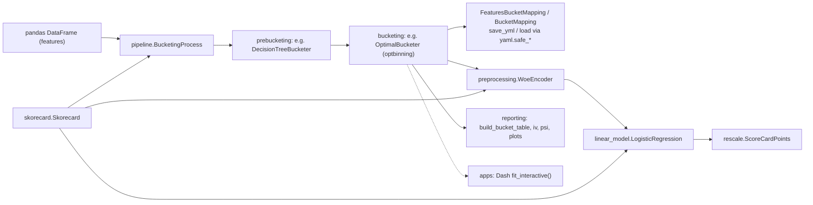

# Technical & Engineering Policy — `ing-bank/skorecard`

## 1. Document Overview

| Item | Value |
|---|---|
| Repository | https://github.com/ing-bank/skorecard |
| Commit analysed | `21217426bc5c62a2eec525d0b45662dccc2a93a3` (2025-02-09, branch `main`) |
| Date of analysis | 2026-11-18 |
| Purpose of repo | "Tools for building scorecard models in python, with a sklearn-compatible API": credit-risk style bucketing, WoE encoding, logistic regression and score rescaling [Source: `pyproject.toml` L9] |
| Audience | Contributors, reviewers, AI Pull Request Guardian |

**Scope.** Repository-evidenced rules only. This does not create ING policy.

**Authoritative sources.**
- `CONTRIBUTING.md`
- `pyproject.toml`
- `.pre-commit-config.yaml`
- `.github/workflows/*`

**Limitations.** Static analysis only. The last commit is 2025-02-09, so some CI config is stale or malformed (see §17). Branch protection is not visible.

---

## 2. Technology Stack

| Technology | Role | Source |
|---|---|---|
| Python ≥3.9 (CI 3.9–3.12 on macOS, Ubuntu, Windows) | Runtime | `pyproject.toml` L8, L20–23; `unittests.yml` L9–17 |
| setuptools; version from `skorecard.__version__` | Build | `pyproject.toml` L1–3, L79–80 |
| scipy, numpy <2, pandas, scikit-learn, category_encoders, **optbinning** (flagged "TODO Reconsider … since its big") | Core modelling | `pyproject.toml` L26–34 |
| pyyaml | Bucket-mapping persistence | `pyproject.toml` L31; `features_bucket_mapping.py` L131; `bucketers/bucketers.py` L1093–1101 |
| dash, jupyter-dash, dash-bootstrap-components (`dashboard` extra) | Interactive manual bucketing app | `pyproject.toml` L43–47; `skorecard/apps/` |
| plotly (`reporting` extra) | Plots | `pyproject.toml` L48–50 |
| pytest, pytest-cov, pyflakes, mypy, ruff, black, isort, codespell, pre-commit | QA | `pyproject.toml` L51–65 |
| mkdocs + material + mkdocstrings | Docs | `pyproject.toml` L66–73 |
| Dependabot (pip, weekly) | Dependency updates | `.github/dependabot.yml` L6–11 |
| Databases, messaging, containers, IaC | — | **Not present** |

---

## 3. Repository Architecture

All estimators follow the scikit-learn estimator/transformer API.

| Module | Responsibility | Evidence |
|---|---|---|
| `skorecard/bucketers/` | `BaseBucketer` plus `OptimalBucketer`, `EqualWidthBucketer`, `AgglomerativeClusteringBucketer`, `EqualFrequencyBucketer`, `DecisionTreeBucketer`, `OrdinalCategoricalBucketer`, `AsIsCategoricalBucketer`, `AsIsNumericalBucketer`, `UserInputBucketer` | `base_bucketer.py` L38; `bucketers.py` L24–1017 |
| `skorecard/bucket_mapping.py`, `features_bucket_mapping.py` | `BucketMapping` (one feature's bucketing) and `FeaturesBucketMapping` (collection), label builders, merge helpers, YAML save | `bucket_mapping.py` L14–400; `features_bucket_mapping.py` L8–170; `CONTRIBUTING.md` L61–64 |
| `skorecard/pipeline/` | `BucketingProcess` (pre-bucketing → bucketing), `SkorecardPipeline`, `KeepPandas` | `bucketing_process.py` L41; `pipeline.py` L32, L234 |
| `skorecard/preprocessing/` | `WoeEncoder`, `ColumnSelector` | `_WoEEncoder.py` L13; `preprocessing.py` L8 |
| `skorecard/linear_model/` | `LogisticRegression` subclass with stats | `linear_model.py` L11 |
| `skorecard/rescale/` | `ScoreCardPoints` | `rescale.py` L63 |
| `skorecard/skorecard.py` | `Skorecard` end-to-end classifier | L31 |
| `skorecard/reporting/` | `build_bucket_table`, `psi`, `iv`, plotting mixins | `report.py` L14–338; `plotting.py` L19–287 |
| `skorecard/metrics/` | Metrics | `metrics.py` |
| `skorecard/apps/` | Dash manual bucketing app (`fit_interactive`) | `base_bucketer.py` L338; `apps/*` |
| `skorecard/utils/` | Validation, array, dataframe helpers; custom exceptions | see §5 |
| `skorecard/datasets.py` + `data/UCI_Credit_Card.zip` | Bundled demo credit-card default dataset | `datasets.py` L8–45 |



---

## 4. Coding Standards

| ID | Standard | Classification | Evidence |
|---|---|---|---|
| CODE-001 | `pre-commit run --all-files` must pass in CI. Hooks: case-conflict, docstring-first, detect-private-key, trailing-whitespace, nbQA (ruff/mypy/isort/pyupgrade/black), mypy, ruff check, ruff format, codespell, pyupgrade. | **Mandatory (CI)** | `unittests.yml` L42–45; `.pre-commit-config.yaml` L1–59 |
| CODE-002 | `ruff check` (line length 120; default rule set plus an ignore list) and `ruff format` | Mandatory (pre-commit) | `pyproject.toml` L95–112; `.pre-commit-config.yaml` L34–45 |
| CODE-003 | **Google docstring convention** is configured (`pydocstyle.convention = "google"`), and docstrings must come first (`check-docstring-first`). `tests/test_docstring.py` exists. | Mandatory (hook + test). Note: `D` rules are not in an explicit `select` (GAP-004). | `pyproject.toml` L114–115; `.pre-commit-config.yaml` L7–8; `tests/test_docstring.py` |
| CODE-004 | mypy on Python files (`python_version = 3.9`, `ignore_missing_imports`) | Mandatory (pre-commit) | `pyproject.toml` L89–93; `.pre-commit-config.yaml` L27–33 |
| CODE-005 | `pyflakes skorecard` must pass after tests | Mandatory (CI) | `unittests.yml` L47–50 |
| CODE-006 | codespell (skip words "missings", "bu") | Mandatory (pre-commit) | `.pre-commit-config.yaml` L46–53 |
| CODE-007 | All estimators subclass sklearn `BaseEstimator` + `TransformerMixin`/`ClassifierMixin`, use `check_is_fitted`, and expose `fit`/`transform` | **Convention** (all estimators; `test_sklearn_compat.py`) | `base_bucketer.py` L38, L218, L361, L428; `skorecard.py` L31; `tests/test_sklearn_compat.py` |
| CODE-008 | New bucketers subclass `BaseBucketer` to inherit plotting, bucket-table and summary mixins | Convention | `base_bucketer.py` L38 |
| CODE-009 | Raise the package's typed exceptions (`NotPreBucketedError`, `NotBucketedError`, `BucketingPipelineError`, `DimensionalityError`, `UnknownCategoryError`, `BucketerTypeError`) | Convention | `skorecard/utils/exceptions.py` L1–140 |
| CODE-010 | Inputs must be pandas DataFrames: use `ensure_dataframe` | Convention | `skorecard/utils/validation.py` L24–48 |
| CODE-011 | Logging: stdlib `logging.warning` (pipeline). `print` is used for user feedback in `report.py` L141 and `utils/dataframe.py` L25–26. | Observed (mixed) | `pipeline/pipeline.py` L1, L82 |

---

## 5. Reusable Components and Existing Capabilities

| Component | Category | File path | Responsibility | Usage guidance | Evidence |
|---|---|---|---|---|---|
| `is_fitted`, `ensure_dataframe`, `check_args`, `check_suppressor_effect` | Validators | `skorecard/utils/validation.py` | Fitted-state check, DataFrame coercion, kwarg validation, suppressor-effect warning on LR coefficients | **Use at every public entry point** | L8–80 |
| `reshape_1d_to_2d`, `convert_sparse_matrix` | Array helpers | `skorecard/utils/arrayfuncs.py` | Shape and sparse handling | Reuse | L8–50 |
| `detect_types(X)` | Type inference | `skorecard/utils/dataframe.py` | Split categorical vs numerical columns | Reuse instead of ad-hoc dtype checks | L13–27 |
| Exceptions (`NotPreBucketedError`, `NotBucketedError`, `NotBucketObjectError`, `BucketingPipelineError`, `DimensionalityError`, `UnknownCategoryError`, `NotInstalledError`, `ApproximationWarning`, `BucketerTypeError`) | Exception handling | `skorecard/utils/exceptions.py` | Domain errors and optional-dependency placeholder | Raise these | L1–140 |
| `BaseBucketer` (`fit`, `transform`, `fit_interactive`, `save_yml`, `bucket_table`, `summary`, `plot_bucket`) | Base class | `skorecard/bucketers/base_bucketer.py` | Shared bucketing behaviour + mixins | Subclass for new bucketers | L38–440 |
| `BucketMapping`, `MissingDict`, `build_labels`, `build_cat_labels`, `merge_bucket_mapping` | Domain model / serialization | `skorecard/bucket_mapping.py` | Represent and label buckets; merge mappings | Reuse for any bucketing representation | L14–400 |
| `FeaturesBucketMapping`, `merge_features_bucket_mapping`, `.save_yml()` | Serialization | `skorecard/features_bucket_mapping.py` | Collection of mappings; YAML save via `yaml.safe_dump` | Reuse to persist bucketing | L8–170 |
| `UserInputBucketer` (loads YAML via `yaml.safe_load`) | Config loader | `skorecard/bucketers/bucketers.py` | Apply user-provided bucket maps | Use for externally defined buckets | L1017–1105 |
| `build_bucket_table`, `iv`, `psi`, `BucketTableMethod`, `SummaryMethod` | Reporting / metrics | `skorecard/reporting/report.py` | Bucket tables, Information Value, Population Stability Index | **Use for IV/PSI; do not re-implement** | L14–380 |
| `make_plot_figure`, `plot_bucket_table`, `plot_prebucket_table`, `weight_plot`, `PlotBucketMethod`, `PlotPreBucketMethod` | Plotting | `skorecard/reporting/plotting.py` | Plotly figures | Reuse | L19–300 |
| `WoeEncoder` | Encoder | `skorecard/preprocessing/_WoEEncoder.py` | Weight-of-Evidence encoding | Reuse | L13 |
| `ScoreCardPoints` | Rescaling | `skorecard/rescale/rescale.py` | Convert model output to scorecard points | Reuse | L63 |
| `KeepPandas` | Pipeline helper | `skorecard/pipeline/pipeline.py` | Preserve DataFrame through sklearn steps | Reuse | L32 |
| `load_uci_credit_card()` | Dataset | `skorecard/datasets.py` | Demo data; returns only 4 features + target | Use for examples/tests | L8–45 |

---

## 6. API and Data Contracts

- **sklearn compatibility is a contract.** `tests/test_sklearn_compat.py` checks estimators. Breaking it breaks pipelines.
- **Bucket mapping YAML format** (`save_yml` / `UserInputBucketer`) is a persisted contract [Source: `base_bucketer.py` L421–432; `bucketers.py` L1093–1101].
- Versioning is **SemVer**; maintainers tag `vX.Y` [Source: `CONTRIBUTING.md` L44–48].
- No HTTP API, DB schema or migrations.

---

## 7. Security Policies

| Rule ID | Rule | Severity | Enforcement | Evidence | Remediation |
|---|---|---|---|---|---|
| SEC-001 | **Private keys must not be committed** (`detect-private-key`) | Critical | **pre-commit in CI** | `.pre-commit-config.yaml` L9–10; `unittests.yml` L42–45 | Remove, rotate |
| SEC-002 | YAML is read with `yaml.safe_load` and written with `yaml.safe_dump` | High | Convention (all YAML I/O) | `bucketers.py` L1093, L1101; `features_bucket_mapping.py` L131 | Never `yaml.load` |
| SEC-003 | The Dash app parses user-typed bucket maps with `ast.literal_eval`, not `eval` | High | Convention | `apps/app_callbacks.py` L103, L226 | Keep `literal_eval` |
| SEC-004 | PyPI credentials are GitHub secrets | High | CI | `publish_pypi.yml` L25–27 | Secrets / OIDC |
| SEC-005 | The release job runs the unit tests before publishing | Medium | CI | `publish_pypi.yml` L20–23 | — |

**May secrets, tokens or API keys be hardcoded?** **No.** Private keys are blocked by the hook (SEC-001), and PyPI credentials are secrets (SEC-004). API keys and passwords are **not** scanned by any tool (GAP-005).

---

## 8. Privacy and Data Protection Policies

| Rule ID | Rule | Classification | Evidence |
|---|---|---|---|
| PRIV-001 | The bundled credit-card dataset loader **returns only `EDUCATION`, `MARRIAGE`, `LIMIT_BAL`, `BILL_AMT1` and the target**. It deliberately omits other columns, including the record `ID`. | Observed data-minimisation pattern | `skorecard/datasets.py` L31–43 |
| PRIV-002 | Bucket tables and reports show bucket boundaries and category labels. Categorical bucketing on identifier columns would expose identifiers in reports and YAML. Don't bucket identifier columns. | **Inferred** | `reporting/report.py` L14; `bucket_mapping.py` L345 |
| PRIV-003 | Don't log or print customer identifiers. The existing `print` calls emit column names and IV values only. | Inferred | `report.py` L141; `utils/dataframe.py` L25–26 |

There is no masking utility, retention policy or access policy in the repo.

---

## 9. Testing and Quality Assurance

| Item | Detail | Classification | Evidence |
|---|---|---|---|
| PR gate | Workflow "Development" on every PR: install `.[all]`, pre-commit all files, `pytest`, `pyflakes skorecard`, on 3 OS × Python 3.9–3.12 | **Mandatory (CI)** | `unittests.yml` L1–50 |
| Weekly cron | Same suite Sunday 04:05 | Automated | `cronjob_unit_tests.yml` L6–57 |
| Coverage | `pytest --cov=src` in the codecov workflow, but the package is `skorecard`, there's no upload step, and the YAML is malformed (GAP-001/002). **No threshold.** | — | `unittests_with_codecov.yml` L57–60 |
| Layout | Flat `tests/test_<area>.py` (bucketers, pipelines, reports, sklearn compat, docstrings, usage flows) | Convention | tree |
| Commands | `pip install -e '.[all]'`, `pytest`, `pre-commit install`, `pre-commit run --all-files`, `mkdocs serve` | — | `CONTRIBUTING.md` L9–40 |

---

## 10. Dependency and Supply Chain Policies

| ID | Rule | Classification | Evidence |
|---|---|---|---|
| DEP-001 | Core deps are mostly floor-pinned; `numpy<2.0.0` is capped | Observed | `pyproject.toml` L26–34 |
| DEP-002 | `optbinning` is flagged for reconsideration due to size | Documented TODO | `pyproject.toml` L33 |
| DEP-003 | Dependabot pip weekly | Automated | `.github/dependabot.yml` L8–11 |
| DEP-004 | Optional features are isolated in extras (`dashboard`, `reporting`, `dev`, `docs`, `all`) | Convention | `pyproject.toml` L42–74 |

No lockfile, licence policy or vulnerability scan. Licence is MIT [Source: `pyproject.toml` L14–16].

---

## 11. Infrastructure and Deployment Policies

| ID | Rule | Classification | Evidence |
|---|---|---|---|
| INFRA-001 | Discuss changes on the issue board **before** doing work | Documented | `CONTRIBUTING.md` L3 |
| INFRA-002 | Release: maintainer tags `vX.Y`, then creates a GitHub release, which runs tests → build → twine upload, and deploys docs (`mkdocs gh-deploy`) | Documented + CI | `CONTRIBUTING.md` L42–53; `publish_pypi.yml`; `publish_docs.yml` |

No containers, IaC, sizing or IAM.

---

## 12. Cost and FinOps Policies

There are **no formal cost policies.** Observed:

| ID | Observation | Classification | Evidence |
|---|---|---|---|
| COST-001 | Heavy dependency (`optbinning`) flagged for reconsideration | Documented TODO | `pyproject.toml` L33 |
| COST-002 | CI runs 12 jobs per PR (3 OS × 4 Python) plus a weekly cron, with `lukka/get-cmake@latest` downloads each run | Observed | `unittests.yml` L9–25 |

---

## 13. Architecture Decision Records and Historical Decisions

No ADR folder. Decisions:

| Decision | Detail | Source |
|---|---|---|
| sklearn-compatible API | All components are estimators/transformers | `pyproject.toml` L9; `tests/test_sklearn_compat.py` |
| Bucketing as data (`BucketMapping` / `FeaturesBucketMapping`) | Serializable to YAML | `CONTRIBUTING.md` L61–64 |
| Two-stage bucketing (`BucketingProcess`) | Pre-bucketing then bucketing | `pipeline/bucketing_process.py` L41 |
| Divio docs structure | Docs organised as tutorials / how-to / reference / explanation | `CONTRIBUTING.md` L35 |

From GitHub history (not in repo): PR #96 ("Update code to newer versions of dash, pandas") was closed after merge conflicts with #101 ("Drop support for Python 3.6, 3.7") and re-submitted as #104. That is precedent for coordinating dependency-bump PRs with Python-support changes.

---

## 14. CI/CD and Release Policies

| Control | Automated | Evidence |
|---|---|---|
| pre-commit + pytest + pyflakes on all PRs | Yes | `unittests.yml` |
| Weekly cron | Yes | `cronjob_unit_tests.yml` |
| Coverage upload | **Broken / missing** (GAP-001/002) | `unittests_with_codecov.yml` |
| Release → tests → PyPI; docs deploy | Yes | `publish_pypi.yml`, `publish_docs.yml` |
| CODEOWNERS, PR template | **Absent** | — |
| SAST / secret scan (beyond private keys) | **No** | — |

---

## 15. Prohibited Practices

| Rule ID | Prohibited practice | Reason | Evidence | Severity | Status |
|---|---|---|---|---|---|
| PROH-001 | Committing private keys | Hook | `.pre-commit-config.yaml` L9–10 | Critical | **Enforced** |
| PROH-002 | Modules whose first statement isn't a docstring | `check-docstring-first` | `.pre-commit-config.yaml` L7–8 | Low | **Enforced** |
| PROH-003 | Starting work without issue-board discussion | Governance | `CONTRIBUTING.md` L3 | Low | Documented |
| PROH-004 | `yaml.load` / `eval` on user input | Existing safe patterns | §7 | High | *Proposed review recommendation* |
| PROH-005 | Hardcoded API keys/passwords | Not scanned | — | Critical | *Proposed review recommendation* |
| PROH-006 | Re-implementing IV/PSI/WoE/bucket-table helpers | Duplication | §5 | Medium | *Proposed review recommendation* |
| PROH-007 | Estimators that break sklearn compatibility | Contract | `tests/test_sklearn_compat.py` | High | Enforced by tests |

---

## 16. Policy Registry

| ID | Category | Rule | Classification | Severity | Violation looks like | Evidence | Check | Remediation | Confidence |
|---|---|---|---|---|---|---|---|---|---|
| SEC-001 | Security | No private keys | Mandatory | Critical | PEM private key block | `.pre-commit-config.yaml` L9 | D | Remove/rotate | High |
| SEC-002 | Security | Safe YAML | Convention | High | `yaml.load(` | `bucketers.py` L1093 | D (Bandit B506) | `safe_load` | High |
| SEC-003 | Security | No `eval` on user input | Convention | High | `eval(` in `apps/` | `app_callbacks.py` L103 | D (Bandit B307) | `ast.literal_eval` | High |
| PROH-005 | Security | No hardcoded API keys/passwords | Proposed | Critical | `api_key="..."` | — | D (Gitleaks) | Env var | Medium |
| PRIV-001/002 | Privacy | Don't bucket/report identifier columns; keep demo data minimal | Inferred | High | Bucketing `customer_id`, logging emails | `datasets.py` L31–43 | AI | Drop identifiers | Low |
| CODE-001 | Quality | pre-commit passes | Mandatory | Medium | CI fail | `unittests.yml` L42–45 | D | Fix | High |
| CODE-003 | Docs | Google docstrings, docstring-first | Mandatory (partial) | Low | Missing module docstring | `pyproject.toml` L114–115 | D | Add | Medium |
| CODE-005 | Quality | pyflakes clean | Mandatory | Low | Unused import | `unittests.yml` L50 | D | Fix | High |
| CODE-007 | Architecture | sklearn estimator API | Convention (test-enforced) | High | Estimator without `fit`/`transform`/`check_is_fitted` | `base_bucketer.py` L218–432 | D (test) + AI | Follow API | High |
| CODE-008 | Architecture | New bucketers subclass `BaseBucketer` | Convention | Medium | Standalone bucketer class | `base_bucketer.py` L38 | AI | Subclass | High |
| CODE-009 | Errors | Typed exceptions | Convention | Low | `raise Exception(` | `utils/exceptions.py` | AI | Use typed | Medium |
| CODE-010 | Validation | `ensure_dataframe` at entry | Convention | Medium | Public method assuming DataFrame without coercion | `utils/validation.py` L24 | AI | Call helper | Medium |
| INFRA-002 | Release | SemVer tag + GitHub release | Documented | Low | Manual PyPI upload | `CONTRIBUTING.md` L44–53 | AI | Follow flow | High |
| REUSE-001 | Reuse | Don't reimplement §5 | Proposed | Medium | New IV/PSI function, new DataFrame coercion, new dtype detector | §5 | AI | Call helper | Medium |

```python
# REUSE-001 non-compliant
def information_value(df, target): ...   # re-implements skorecard.reporting.iv
# compliant
from skorecard.reporting import iv
iv(X_bucketed, y)
```

---

## 17. Gaps, Ambiguities and Conflicts

| ID | Issue | Files | Needs human input because |
|---|---|---|---|
| GAP-001 | `unittests_with_codecov.yml` YAML is malformed: `pull_request` is nested under `push`, and `python-version` sits inside the Windows `include` entry, so the matrix is not what it appears | `unittests_with_codecov.yml` L5–27 | Workflow may not run as intended |
| GAP-002 | Coverage runs `--cov=src` but the package is `skorecard/`, and there is **no Codecov upload step** | `unittests_with_codecov.yml` L57–60 | Coverage is effectively unmeasured |
| GAP-003 | Actions use **mutable refs** (`actions/checkout@master`, `actions/setup-python@master`, `lukka/get-cmake@latest`) | `unittests.yml` L19–33; `cronjob_unit_tests.yml` L26–40 | High supply-chain risk |
| GAP-004 | `pydocstyle.convention = "google"` is set, but `D` rules are never added to `select`. ruff's defaults (E4/E7/E9/F) don't include `D`, so docstring rules may not be enforced beyond `check-docstring-first` and `test_docstring.py`. | `pyproject.toml` L100–115 | Confirm intended enforcement |
| GAP-005 | Only `detect-private-key`; no API-key/password scanning or SAST | `.pre-commit-config.yaml` | Org expectations |
| GAP-006 | pyupgrade args `--py38-plus` while hook names say "Python 3.9+" and `requires-python >= 3.9` | `.pre-commit-config.yaml` L22–24, L54–59 | Mismatch |
| GAP-007 | `numpy<2.0.0` cap; Python 3.13 not tested | `pyproject.toml` L28 | Maintenance status |
| GAP-008 | No CODEOWNERS or PR template | repo root | Review ownership undefined |
| GAP-009 | `CONTRIBUTING.md` says pre-commit is "encouraged", while CI makes it mandatory | `CONTRIBUTING.md` L25 vs `unittests.yml` L42–45 | Wording vs enforcement |

---

## 18. Source Inventory and Evidence

Files inspected (≈25): `README.md` (grep), `CONTRIBUTING.md`, `CHANGELOG.md` (listed), `LICENSE` (classifier), `pyproject.toml`, `mkdocs.yml` (listed), `.pre-commit-config.yaml`, `.github/dependabot.yml`, `.github/workflows/{unittests,unittests_with_codecov,cronjob_unit_tests,publish_pypi,publish_docs}.yml`, `skorecard/{datasets,bucket_mapping,features_bucket_mapping,skorecard}.py`, `skorecard/bucketers/{base_bucketer,bucketers}.py`, `skorecard/utils/{validation,arrayfuncs,dataframe,exceptions}.py`, `skorecard/reporting/{report,plotting}.py`, `skorecard/pipeline/{pipeline,bucketing_process}.py`, `skorecard/preprocessing/*`, `skorecard/rescale/rescale.py`, `skorecard/linear_model/linear_model.py`, `skorecard/apps/{app_utils,app_callbacks}.py`, `tests/` (tree).

---

## Analysis Summary

| Metric | Count |
|---|---|
| Files inspected | ~25 |
| Policies in registry | 14 |
| Mandatory | 5 |
| Conventions | 6 |
| Inferred / proposed | 3 |
| Security policies | 5 (+1 proposed) |
| Privacy policies | 3 |
| Cost / infra policies | 2 COST + 2 INFRA |
| Unresolved gaps / conflicts | 9 |
